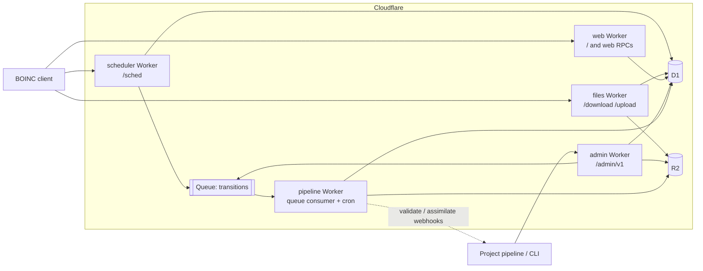

# Architecture

Status: draft, written before implementation. Table columns marked "measured" are filled in as
the implementation lands.

## Goal

Run a BOINC project server on Cloudflare's developer platform, with no origin server, so that
stock BOINC clients (8.x) attach, fetch work, upload results and get credit exactly as they do
against the C++/PHP server in this repository.

The stock server is a set of daemons that poll one MySQL database and share one file system:
`cgi` (scheduler), `feeder`, `transitioner`, validators, assimilators, `file_deleter`,
`db_purge`, `file_upload_handler`, Apache for downloads, and a PHP site. None of that runs on
Workers as is: there is no shared memory, no local disk, no long-running process and no MySQL.
The server side is therefore rewritten in Rust and compiled to WebAssembly. The wire protocols
and the job state machine are kept; the process model is replaced.

The upstream tree stays in this repository unchanged. It is the reference for behaviour
(`sched/`, `db/`, `tools/`, `lib/crypt.cpp`), and its client is what the end-to-end tests run.
New code lives under `cloud/`.

## Scope

The first target is feature parity with one real project, used as the reference deployment: a
five-app OCR project with container and native GPU apps, about a dozen hosts, quorum 1 and
quorum 2 apps, and a remote pipeline that submits work and collects results.

In scope, because the reference deployment uses it:

| Area | Features |
| --- | --- |
| Scheduler | account keys and weak keys, host records, result reporting, work requests for CPU and GPU, plan classes (container, NVIDIA, AMD, Intel, Apple GPU, multi-thread), client-version floors, batch and workunit-ID gates, per-app weights, assigned (targeted) jobs, `one_result_per_host_per_wu`, in-progress and daily limits, lost-result resend, request back-off |
| Job pipeline | workunit and result state machine, deadlines and retries, error limits, quorum validation (trivial, bitwise, project-supplied), canonical result choice, credit, assimilation hand-off, output and input clean-up, purge |
| Files | signed app versions, input downloads with range requests, multi-GB sticky files, upload certificates, uploads with size limits and checksums |
| Web RPCs | `get_project_config.php`, `lookup_account.php`, `create_account.php`, `server_status.php?xml=1` |
| Site | project home (master URL), apps, server status, account, hosts and tasks pages |
| Operations | app, platform, app-version and plan-class management, batch job submission, cancel, result feed for the project's pipeline, all over an authenticated HTTP API with a CLI |

Out of scope for now: forums, teams, profiles, account managers, locality scheduling,
homogeneous redundancy, adaptive replication, trickle messages, BUDA, the XML stats export,
and the full PFC credit model (see "Credit").

## Service map

Five Workers, one D1 database, one R2 bucket, one queue. Each Worker is a Rust crate built with
`workers-rs`. Routes on the project hostname send each path to its Worker directly; there is
no gateway Worker in front.



| Stock component | Replacement |
| --- | --- |
| `cgi` scheduler | `scheduler` Worker |
| `feeder` and the shared-memory job cache | an indexed query on unsent results plus an atomic claim (see "Dispatch without a feeder") |
| `transitioner` | `pipeline` Worker, driven by the queue, with a cron sweep for deadlines |
| validators | `pipeline` Worker: built-in trivial and bitwise validators, and a webhook validator for project code |
| assimilators | `pipeline` Worker marks work ready; the project pulls it from the admin API or receives a webhook |
| `file_deleter`, `db_purge` | cron handlers in the `pipeline` Worker |
| `file_upload_handler` | `files` Worker writing to R2 |
| Apache download directory | `files` Worker reading from R2 |
| PHP web RPCs and site | `web` Worker |
| `create_work`, `update_versions`, `xadd`, ops pages | `admin` Worker and the `cboinc` CLI |
| `config.xml`, `plan_class_spec.xml`, `project.xml` | rows in D1, edited through the admin API, cached in each Worker for a few seconds |

The split follows the stock daemons' boundaries where they have different load shapes and
different secrets: the scheduler is the hot request path; file transfer is byte-heavy and holds
no private keys; the pipeline is asynchronous; the pipeline and admin Workers hold the upload
signing key, and only admin can submit workunits.

## Code layout

```
cloud/
  crates/
    cb-proto/    BOINC XML tokenizer, scheduler request and reply, upload protocol
    cb-crypto/   BOINC key file format, RSA signatures, MD5
    cb-core/     scheduling, plan classes, state machine, validators, credit; SQL behind a Db trait
    cb-sqlite/   Db trait on rusqlite, for native tests and tools
    cb-d1/       Db trait on D1
  workers/
    scheduler/  files/  pipeline/  web/  admin/
  cli/           cboinc: admin client, key tools, app signing, load generator
  migrations/    D1 schema
  tests/         end-to-end tests that drive a real BOINC client
  docs/
```

All protocol and policy code is in plain Rust crates with no Workers dependency. Every SQL
statement goes through one `Db` trait with two implementations, so the full scheduler and
pipeline logic runs in native `cargo test` against SQLite, with the same SQL text D1 executes.
The Worker crates are thin: parse the request, call the core, map errors.

## Data

### Database: D1

D1 is the cheapest database Cloudflare offers for this workload. It has a free allowance on
both plans, bills per row read and written with no instance or hourly charge, and scales to
zero. Durable Object SQLite storage has the same per-row prices but adds compute duration
charges, and KV charges per write operation at several times the D1 row price.

D1 is SQLite, single-writer, and each query is a network round trip from the Worker. The design
follows from that:

- Each scheduler request makes a fixed, small number of round trips (four batches; see
  "Scheduler request path"). Statements are grouped into `batch()` calls, which run as one
  transaction.
- Smart Placement runs the Workers next to the database.
- Rows written are the main cost. The schema keeps few indexes, uses partial indexes so a
  row is in an index only while it is in the state that index serves, and the pipeline writes
  the final state of a result once rather than stepping it through each daemon's flag.

The schema is a port of `db/schema.sql` reduced to the tables in scope: `platform`, `app`,
`app_version`, `user`, `host`, `host_app_version`, `workunit`, `result`, `assignment`,
`batch`, `job_file`, plus `config` (key, JSON value, version). Column names and state
constants match upstream so that the upstream documentation still describes the data, and so a
MySQL dump can be imported later.

Indexes on the two large tables:

| Index | Serves | Rows in it |
| --- | --- | --- |
| `workunit(name)` unique | duplicate submission, report lookup | all |
| `workunit(transition_time)` where `transition_time < 2147483647` | deadline sweep | workunits with a pending transition |
| `workunit(appid, id)` where `assimilate_state = 1` | result feed | ready, not yet collected |
| `workunit(batch)` where `batch > 0` | batch status and cancel | batched |
| `result(name)` unique | report lookup | all |
| `result(workunitid)` | transitions | all |
| `result(appid, priority desc, id)` where `server_state = 2` | dispatch | unsent |
| `result(hostid)` where `server_state = 4` | lost-result resend, per-host limits | in progress |

Large XML (`xml_doc`, `xml_doc_in`, `stderr_out`) is stored in the row; D1 allows 2 MB per row
and BOINC documents are a few KB. `stderr_out` is truncated to 64 KB as upstream does.

Target write budget, measured in tests from D1's `rows_written` metadata: at most 25 rows
written per quorum-1 job from submission to purge.

### Files: R2

One bucket per project.

| Prefix | Content | Written by | Lifetime |
| --- | --- | --- | --- |
| `download/<name>` | app version files, job inputs | admin API | until the workunit is purged, or forever when marked `no_delete` or sticky |
| `upload/<name>` | result outputs | files Worker | `delete_delay_hours` after assimilation |
| `archive/` | purged workunit and result rows, as JSON lines per day | pipeline cron | by bucket lifecycle rule |

Names are flat. The stock fan-out directories exist to keep directory sizes down on a POSIX
file system and have no purpose in an object store. R2 has no egress charge, serves range
requests, and has no object size limit that matters here (5 TB), so multi-GB model files are
ordinary downloads rather than a special case.

### Queue

`transitions` carries workunit IDs. The database is still the source of truth: every producer
also sets `workunit.transition_time = now` in the same batch as its other writes, and a
one-minute cron sweep transitions anything whose time has passed. A lost or duplicated queue
message therefore costs only latency or an idempotent re-run. This is the stock
design (daemons poll `transition_time`) with the queue as a fast path.

## Scheduler request path

`POST /sched` with a `<scheduler_request>` body, as sent by the client.

1. Parse the request with the tolerant tokenizer in `cb-proto` (BOINC XML is not always
   well-formed XML, and the client's reply parser is line-oriented, so both directions follow
   `sched/sched_types.cpp` rather than an XML library).
2. Batch 1 (read): user by authenticator or weak authenticator, host by ID, config version.
   If the config version changed, reload apps, app versions, platforms, plan classes and
   project settings; otherwise use the copy cached in the isolate.
3. Authenticate, find or create the host (same rules as `handle_request.cpp`: host ID and
   `rpc_seqno` checks, CPID match to detect a copied or reset client).
4. Batch 2 (read): reported results by name, this host's in-progress results, its
   `host_app_version` rows.
5. Pick usable app versions for the host: platform match, plan class evaluation
   (`plan_class_spec.cpp` semantics, including GPU model, VRAM, driver and client-version
   floors, container runtime, batch and workunit-ID gates), best version per app and resource.
6. Batch 3 (read): candidate unsent results for those apps, joined to their workunits, ordered
   by priority then age, interleaved across apps by weight; plus assigned jobs for this host
   or user.
7. Filter candidates in memory: feasibility (memory, disk, deadline against the host's
   estimated speed and availability), `one_result_per_host_per_wu`, per-host and per-app
   in-progress limits, daily quota, requested seconds and instances per resource.
8. Batch 4 (write, one transaction): update the host; apply result reports; claim each chosen
   result with `UPDATE result SET server_state = 4, hostid = ?, ... WHERE id = ? AND
   server_state = 2 RETURNING id`; set `transition_time` on affected workunits.
9. Send the affected workunit IDs to the queue, build the `<scheduler_reply>` from the claims
   that succeeded, return it.

### Dispatch without a feeder

The stock feeder preloads a window of unsent results (`shmem_work_items`, 100 by default) into
shared memory so that schedulers do not scan MySQL on every request; schedulers lock slots
there.
Here the partial index on unsent results makes the candidate query a short index range read,
and the conditional `UPDATE ... WHERE server_state = 2` is the slot lock: D1 runs one write at
a time, so two schedulers that pick the same result cannot both claim it. The loser sees fewer
rows returned and sends less work; the client asks again.

If D1 read latency or row reads ever limit throughput, the next step is a Durable Object that
holds the unsent window in memory, which is the feeder again. We build it only if measurements
show that D1 limits throughput.

### Plan classes and admission gates

Plan classes are stored as the stock `plan_class_spec.xml` document in the `config` table and
parsed into the same structure upstream uses. The reference deployment opens and closes
admission by editing workunit-ID and batch bounds on live plan classes; here that is an admin
API call that bumps the config version, and every isolate picks it up within its cache
lifetime (5 seconds).

## Job pipeline

The upstream state machine is kept: `server_state`, `outcome`, `validate_state`,
`assimilate_state`, `file_delete_state` and `error_mask` have the same values and meanings.
What changes is that one handler does the work of three daemons.

`transition(workunit_id)`, called from the queue or the sweep, in one transaction:

1. Load the workunit and its results.
2. Time out in-progress results past their deadline.
3. Count outcomes; set error bits when a limit is reached (`max_error_results`,
   `max_total_results`, `max_success_results`), and cancel unsent results if so.
4. If there is no canonical result and enough successful results have arrived, validate.
5. If more results are needed (`target_nresults`, or a quorum not yet reached), create them,
   signing each output file's upload certificate with the upload key.
6. If a canonical result exists or the workunit has failed, mark it ready to assimilate.
7. When everything is reported and assimilated, mark files for deletion.
8. Set the next `transition_time` to the earliest outstanding deadline.

### Validation

Per app, one of:

- `trivial`: any successful result is valid (quorum 1 apps).
- `bitwise`: results agree when every output file has the same MD5. Upload stores each
  object's MD5, so comparison reads metadata, not file bodies.
- `webhook`: the pipeline posts the workunit, the candidate results and short-lived signed
  download URLs for their outputs to a project endpoint, which answers with a verdict per
  result, the canonical result and optionally credit. This is where project-specific compare
  code runs (the stock `script_validator` case). It can be an external HTTPS endpoint or
  another Worker through a service binding. The call is retried with back-off; the workunit
  stays in "needs validation" until it answers.

### Assimilation

The stock assimilator is project code that runs next to the database. Here the project pulls:
`GET /admin/v1/assimilate?app=<name>&limit=<n>` returns ready workunits with their canonical
result, output file names and sizes; output bodies are fetched from `/admin/v1/files/upload/`;
`POST /admin/v1/assimilate/ack` marks them done. An optional webhook announces new work so the
project does not have to poll. Outputs are deleted `delete_delay_hours` after the acknowledgement (upstream counts from the
most recently returned result).

### Credit

The first version grants credit from elapsed time and the host's benchmark
(`elapsed_time * p_fpops * 200 / 86400e9` cobblestones, scaled by threads or GPU usage of the
app version), takes the minimum claim among the valid results of a quorum, and maintains total
and recent-average credit for hosts and users with the stock half-life. The full PFC model in
`sched/credit.cpp` (cross-version and cross-host normalisation) is not ported yet. A validator
webhook can override the granted credit.

## Files

### Download

`GET /download/<name>` streams the R2 object with `Content-Length`, `ETag`, `Accept-Ranges`
and range support (the client resumes interrupted downloads with `Range`). Small immutable
objects are cached at the edge by name. The client verifies app files against the code-signing
public key and input files against the MD5 in the workunit, so the download path needs no
authentication and holds no secret.

### Upload

`POST /upload` implements the `file_upload_handler` protocol: `<get_file_size>` and
`<file_upload>` with a signed `<file_info>`, then raw bytes. The Worker verifies the
`<xml_signature>` with the upload public key, checks `max_nbytes`, and streams the body into
R2 with the client's MD5 as an integrity check.

Two differences from the stock handler:

- No partial-file resume. An interrupted upload starts again from zero (`get_file_size`
  answers 0 until the object is complete). The stock handler appends to a file at an offset,
  which an object store cannot do.
- One upload request is limited by the zone plan's request body limit (100 MB on Free and Pro).
  Larger outputs need the client's `gzip_when_done` or a higher plan.

## Keys and secrets

BOINC uses two RSA key pairs in its own key file format, and signs the MD5 of the data with
PKCS#1 v1.5 padding and no digest prefix (`lib/crypt.cpp`). `cb-crypto` reads and writes that
format and produces signatures the stock client accepts.

- Code-signing key: the private key never reaches Cloudflare. `cboinc sign` signs app files
  on an offline machine; the admin API stores the file and its signature. The public key is in
  the project config and is served to clients.
- Upload key: the private key is a Worker secret on the `pipeline` and `admin` Workers, which
  create results. The `files` Worker has only the public key.
- Admin API: bearer tokens stored as secrets, compared in constant time. Cloudflare Access can
  be put in front as well.
- Account passwords: the client sends `md5(password + email)`; the server stores an HMAC-SHA-256
  of that under a secret pepper. Authenticators are 128 random bits.

A deployment generates its own keys. A dev deployment never holds another project's keys.

## Web RPCs and site

The `web` Worker serves the master URL page, which carries the scheduler URL in the
`<link rel="boinc_scheduler">` form the client looks for, the three account RPCs with the
stock XML shapes and error numbers, `server_status.php` in HTML and XML, and server-rendered
pages for apps, account, hosts and tasks. PHP file names are kept in the URLs because clients
have them built in.

## Admin API and CLI

`/admin/v1` is JSON over HTTPS. `cboinc` wraps it.

| Resource | Operations |
| --- | --- |
| `platforms`, `apps` | create, update, deprecate |
| `app-versions` | upload signed files, register, deprecate, hold |
| `config` | project settings, plan classes, admission gates |
| `files` | stage inputs (upload, or register an object already in the bucket) |
| `jobs` | submit a batch of workunits in one call, query, cancel, target to a host |
| `assimilate` | pull and acknowledge finished work |
| `hosts`, `users` | look up, block, set limits |

Job submission takes many workunits per request and writes them in batched statements, since
the reference pipeline submits in chunks of hundreds.

## Cost model

Reference load, from the reference deployment's request logs and status pages: about 9,000
scheduler and upload requests a day, 500 to 2,000 results a day, inputs of about 2 MB per
page, about 1 TB of inputs kept.

| Meter | Reference load | Workers Free | Workers Paid ($5/month) |
| --- | --- | --- | --- |
| Worker requests | ~15,000/day with downloads | 100,000/day | 10 million/month |
| D1 rows written | up to ~50,000/day at 25 per job | 100,000/day | 50 million/month |
| D1 rows read | under 1 million/day | 5 million/day | 25 billion/month |
| D1 storage | under 2 GB | 5 GB | 5 GB, then $0.75/GB |
| R2 storage | inputs dominate | 10 GB | $0.015/GB-month |
| CPU per request | a few ms | 10 ms limit | 30 s limit |

The Free plan carries the reference job rate with little headroom and a hard stop at each daily
limit. The Paid plan is the realistic production choice. Input storage is the largest line:
1 TB in R2 is about $15 a month, so a project that keeps every input should keep cold inputs
elsewhere and stage only the working set.

## Performance targets

Targets are set against the reference deployment, measured from the same client machines.

| Measure | Reference (measured) | Target |
| --- | --- | --- |
| Web RPC time to first byte (`get_project_config.php`) | 73 to 98 ms | no slower |
| Scheduler RPC wall time, no work sent | to be measured from client logs | no slower at p50 and p95 |
| Scheduler RPC wall time, work sent | to be measured | no slower at p50 and p95 |
| Sustained request rate | ~0.1 requests/s observed | 10 requests/s for 10 minutes with no errors |
| Large file download | to be measured | no slower |
| Upload of a 2 MB output | to be measured | no slower |

A load generator in the CLI replays recorded scheduler requests from simulated hosts so the
rate targets can be tested without real compute.

## Testing

1. Unit tests for the tokenizer, request and reply round trips, key format and signatures
   (checked against signatures produced by the upstream `crypt_prog`), plan class evaluation
   and each state transition.
2. Native integration tests: scheduler and pipeline logic end to end on SQLite, including
   quorum, deadline, error-limit and resend cases, and the row-write budget.
3. Local end-to-end: `wrangler dev` with local D1, R2 and queue, and a real BOINC client in a
   container that attaches, downloads an app, runs a job and reports it.
4. Deployed end-to-end on the dev hostname with real clients on several machines and
   platforms, CPU and GPU.
5. Load test against the dev deployment.

CI runs formatting, Clippy, native tests and the WebAssembly builds.

## Isolation from other deployments

A cloud-boinc deployment has its own hostname, database, bucket, queue and keys. Development
and tests use only the dev hostname. Test clients run as separate BOINC client instances with
their own data directories, so a machine that also crunches for another project keeps that
client's state untouched. Nothing in this repository reads from or writes to another project's
server.

## Open questions

- Whether the queue is worth keeping once the sweep interval and scheduler-triggered
  transitions are measured.
- Upload resume for large outputs (R2 multipart keyed by upload offset).
- Importing an existing project's MySQL database, and cutting a live master URL over.
