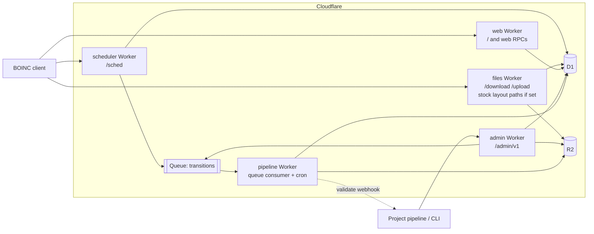

# Architecture

Status: implemented in part; see "Implementation status".

## Goal

Run a BOINC project server on Cloudflare's developer platform, with no origin server, so that
stock BOINC clients (8.x) attach, fetch work, upload results and get credit exactly as they do
against the C++/PHP server in this repository.

The stock server is a set of daemons that poll one MySQL database and share one file system:
`cgi` (scheduler), `feeder`, `transitioner`, validators, assimilators, `file_deleter`,
`db_purge`, `file_upload_handler`, Apache for downloads, and a PHP site. None of that runs on
Workers as is: there is no shared memory, no local disk, no long-running process and no MySQL.
The server side is therefore rewritten in Rust and compiled to WebAssembly. The wire protocols
and the job state machine are kept; the process model is replaced.

The upstream tree stays in this repository unchanged. It is the reference for behaviour
(`sched/`, `db/`, `tools/`, `lib/crypt.cpp`), and its client is what the end-to-end tests run.
New code lives under `cloud/`.

## Scope

The first target is feature parity with one real project, used as the reference deployment: a
five-app OCR project with container and native GPU apps, about a dozen hosts, quorum 1 and
quorum 2 apps, and a remote pipeline that submits work and collects results.

In scope, because the reference deployment uses it:

| Area | Features |
| --- | --- |
| Scheduler | account keys and weak keys, host records, result reporting, work requests for CPU and GPU, plan classes (container, NVIDIA, AMD, Intel, Apple GPU, multi-thread), client-version floors, batch and workunit-ID gates, per-app weights, assigned (targeted) jobs, homogeneous redundancy and homogeneous app version, `one_result_per_host_per_wu`, in-progress and daily limits, lost-result resend, request back-off |
| Job pipeline | workunit and result state machine, deadlines and retries, error limits, quorum validation (trivial, bitwise, project-supplied), canonical result choice, credit, assimilation hand-off, output and input clean-up, purge |
| Files | signed app versions, input downloads with range requests, multi-GB sticky files, upload certificates, uploads with size limits, checksums and resume |
| Web RPCs | `get_project_config.php`, `lookup_account.php`, `create_account.php`, `server_status.php?xml=1`, `show_user.php?format=xml`, `team_lookup.php`, and the account manager RPCs `am_get_info.php`, `am_set_info.php`, `am_set_host_info.php` |
| Site | project home (master URL), apps, server status, account, hosts and tasks pages; teams (list, search, team pages, members, create, join, quit, the founder's pages, `top_teams.php`); sign-up, account details, password and email address changes, computing and project preferences; password recovery, address verification and change notices through Cloudflare Email Service when the Worker has the binding |
| Operations | app, platform, app-version and plan-class management, batch job submission, cancel, result feed for the project's pipeline, all over an authenticated HTTP API with a CLI |

Out of scope for now: forums, profiles, private messages, locality scheduling,
trickle messages, BUDA, the XML stats export, and the full PFC credit model (see "Credit").

## Service map

Five Workers, one D1 database, one R2 bucket, one queue. Each Worker is a Rust crate built with
`workers-rs`. Routes on the project hostname send each path to its Worker directly; there is
no gateway Worker in front.



| Stock component | Replacement |
| --- | --- |
| `cgi` scheduler | `scheduler` Worker |
| `feeder` and the shared-memory job cache | an indexed query on unsent results plus an atomic claim (see "Dispatch without a feeder") |
| `transitioner` | `pipeline` Worker, driven by the queue, with a cron sweep for deadlines |
| validators | `pipeline` Worker: built-in trivial and bitwise validators, and a webhook validator for project code |
| assimilators | `pipeline` Worker marks work ready; the project pulls it from the admin API |
| `file_deleter` | part of the transition in the `pipeline` Worker |
| `db_purge` | cron handler in the `pipeline` Worker |
| `file_upload_handler` | `files` Worker writing to R2 |
| Apache download directory | `files` Worker reading from R2 |
| PHP web RPCs and site | `web` Worker |
| `create_work`, `update_versions`, `xadd`, ops pages | `admin` Worker and the `cboinc` CLI |
| `config.xml`, `plan_class_spec.xml`, `project.xml` | rows in D1, edited through the admin API, cached in each Worker for up to 30 seconds |

The split follows the stock daemons' boundaries where they have different load shapes and
different secrets: the scheduler is the hot request path; file transfer is byte-heavy and holds
no private keys; the pipeline is asynchronous; the pipeline and admin Workers hold the upload
signing key, and only admin can submit workunits.

## Code layout

```
cloud/
  crates/
    cb-proto/    BOINC XML tokenizer, scheduler request and reply, upload protocol
    cb-crypto/   BOINC key file format, RSA signatures, MD5
    cb-db/       the Db trait
    cb-core/     scheduling, plan classes, state machine, validators, credit, web RPCs, site pages, admin operations
    cb-sqlite/   Db trait on rusqlite, for native tests and tools
    cb-d1/       Db trait on D1
    cb-worker/   what the five Workers share: bindings, the settings cache, replies
    cb-import/   cb-import: reads a stock MySQL database, writes this schema as SQLite or D1 SQL files (native only; see migration.md)
  workers/
    scheduler/  files/  pipeline/  web/  admin/
  cli/           cboinc: admin client, key tools, app signing, load generator
  migrations/    D1 schema
  dev/           build, local stack and seeding scripts
  tests/app/     a small BOINC app for end-to-end tests
  docs/
```

All protocol and policy code is in plain Rust crates with no Workers dependency. Every SQL
statement goes through one `Db` trait with two implementations, so the full scheduler and
pipeline logic runs in native `cargo test` against SQLite, with the same SQL text D1 executes.
The Worker crates are thin: parse the request, call the core, map errors.

## Data

### Database: D1

D1 is the cheapest database Cloudflare offers for this workload. It has a free allowance on
both plans, bills per row read and written with no instance or hourly charge, and scales to
zero. Durable Object SQLite storage has the same per-row prices but adds compute duration
charges, and KV charges per write operation at several times the D1 row price.

D1 is SQLite, single-writer, and each query is a network round trip from the Worker. The design
follows from that:

- Each scheduler request makes a small, bounded number of round trips (see "Scheduler request
  path"). Statements are grouped into `batch()` calls, which run as one transaction.
- A `batch()` takes statements prepared in advance, so a transaction cannot span a read, a
  decision in Rust and a write. Every read-decide-write path is therefore optimistic: it
  reads, decides, and commits with one batch whose statements carry their own conditions
  (see "Concurrency").
- Smart Placement runs the Workers next to the database.
- Rows written are the main cost. The schema keeps few indexes, uses partial indexes so a
  row is in an index only while it is in the state that index serves, and the pipeline writes
  the final state of a result once rather than stepping it through each daemon's flag.

The schema is a port of `db/schema.sql` reduced to the tables in scope: `platform`, `app`,
`app_version`, `user`, `host`, `host_app_version`, `workunit`, `result`, `assignment`,
`batch`, `job_file`, plus `config` (key, JSON value, version) and `upload_epoch` (see "Upload"). Column names and state
constants match upstream so that the upstream documentation still describes the data, and so a
MySQL dump can be imported later.

Indexes on the two large tables:

| Index | Serves | Rows in it |
| --- | --- | --- |
| `workunit(name)` unique | duplicate submission, report lookup | all |
| `workunit(transition_time)` where `transition_time < 2147483647` | deadline sweep | workunits with a pending transition |
| `workunit(appid, id)` where `assimilate_state = 1` | result feed | ready, not yet collected |
| `workunit(batch)` where `batch > 0` | batch status and cancel | batched |
| `result(name)` unique | report lookup | all |
| `result(workunitid)` | transitions | all |
| `result(appid, priority desc, id)` where `server_state = 2` | dispatch | unsent |
| `result(hostid)` where `server_state = 4` | lost-result resend, per-host limits | in progress |
| `result(hostid, id)` where `hostid > 0` | a computer's task list | sent |
| `result(userid, id)` where `userid > 0` | an account's task list | sent |

Large XML (`xml_doc`, `xml_doc_in`, `stderr_out`) is stored in the row; D1 allows 2 MB per row
and BOINC documents are a few KB. `stderr_out` is truncated to 64 KB as upstream does.

Target write budget, measured in tests from D1's `rows_written` metadata: at most 25 rows
written per quorum-1 job from submission to purge.

### Files: R2

One bucket per project.

| Prefix | Content | Written by | Lifetime |
| --- | --- | --- | --- |
| `download/<name>` | app version files, job inputs | admin API | job inputs: `delete_delay_hours` after assimilation, or forever when marked `no_delete`; app files: until the version is removed |
| `upload/<name>` | result outputs | files Worker | `delete_delay_hours` after assimilation |
| `partial/<name>/<epoch>/<md5>/<start>` | pieces of unfinished uploads over 8 MiB (see "Upload") | files Worker | until the file is finished, else by bucket lifecycle rule |
| `archive/<date>/` | purged workunit and result rows, as JSON lines, one object per purge pass | pipeline cron | by bucket lifecycle rule |

Names are flat. The stock fan-out directories exist to keep directory sizes down on a POSIX
file system and have no purpose in an object store. R2 has no egress charge, serves range
requests, and has no object size limit that matters here (5 TB), so multi-GB model files are
ordinary downloads rather than a special case.

### Queue

`transitions` carries workunit IDs. The database is still the source of truth: every producer
also sets `workunit.transition_time = now` in the same batch as its other writes, and a
one-minute cron sweep transitions anything whose time has passed. A lost or duplicated queue
message therefore costs only latency or an idempotent re-run. This is the stock
design (daemons poll `transition_time`) with the queue as a fast path.

Messages are sent in the two cases where a transition has work to do at once: when a result is reported
and when assimilation is acknowledged. Submission creates the first results in the same
batch as the workunit, and dispatch only lowers `transition_time` to the new result's
deadline, so neither sends a message.

## Scheduler request path

`POST /sched` with a `<scheduler_request>` body, as sent by the client.

1. Parse the request with the tolerant tokenizer in `cb-proto` (BOINC XML is not always
   well-formed XML, and the client's reply parser is line-oriented, so both directions follow
   `sched/sched_types.cpp` rather than an XML library).
2. Batch 1 (read): user by authenticator or weak authenticator, host by ID, config version.
   If the config version changed, reload apps, app versions, platforms, plan classes and
   project settings; otherwise use the copy cached in the isolate.
3. Authenticate, find or create the host, in the order of `authenticate_user` in
   `sched/handle_request.cpp`:
   - A host ID that names a host with no user is a host merged into another on the web; its
     `rpc_seqno` holds the ID of the host it became, and the links are followed, ten at most
     (`authenticate_user`, the `while` over `host.userid==0`). The reply names the host the chain
     ends at. A chain that is longer or breaks is an unknown host ID.
   - A host ID that names a host of the account, with an `rpc_seqno` not below the stored one,
     is that host, and nothing else is looked up.
   - A host ID that names no host: the reply carries the message "Can't find host record" (low
     priority) and the request is handled as one with no host ID, which is the next step
     (`lookup_user_and_make_new_host`).
   - No host ID: the account's newest host with the request's host CPID is used
     (`find_host_by_cpid`), unless it is obviously another computer (`obviously_different`:
     processor count, vendor and model, OS name and version): a CPID is made from the MAC address
     and the data directory, so two computers cloned from one image share it. If the request
     lists no results it still holds (`<other_results>`) and the client does not say it is one of
     several on its computer (`<allow_multiple_clients>`), the host's tasks in progress are
     marked over with outcome `CLIENT_DETACHED` (`mark_results_over`).
   - A host ID that is another account's, or an `rpc_seqno` below the stored one (the state file
     was copied to another computer): the CPID lookup is skipped (`didnt_find_host`), so a host
     of the account that has the request's CPID is not used.
   - Then, for every request that has not found a host yet and unless the client says it is one of
     several on its computer, the newest host of the account with the same name, address, OS name,
     processor model and memory is used (`find_host_by_other`, which runs only when the request
     has all of the first four). Its tasks in progress are marked over when the request lists no
     results it holds, as above. This is also where a copied state file on a computer that looks
     like the one it came from gets that computer's host.
   - Otherwise a new host is made (`host.insert()` in `authenticate_user`).
   - A host that was found by a lookup or made is stored with `rpc_seqno` 0 and named in the reply
     (`got_host`), so the client takes the ID and starts its sequence from 0 again; a host named by
     the request keeps the request's `rpc_seqno`. The reply names the host even when a lookup finds
     the one the request already named. The same holds for the destination of a merged host: the
     reply names it, so `rpc_seqno` 0 is stored. Stock stores the request's value there
     (`g_reply->host.rpc_seqno = g_request->rpc_seqno` in `handle_request`, after the zombie loop
     of `authenticate_user`), and the client starts from 0 when the reply carries a host ID
     (`handle_scheduler_reply` in `client/cs_scheduler.cpp`), so stock treats the client's next
     request as a copied state file (D20 in [compatibility.md](compatibility.md)).
   - A weak authenticator is accepted only with a host ID of its own account; with another
     account's it finds no key and the request is refused, as in stock.
   - Stock's `stdin_reqs` exception to the `rpc_seqno` test belongs to a scheduler run from a file
     of requests in batch; the Worker has no such mode.
4. Batch 2 (read): reported results by name, this host's in-progress results, its
   `host_app_version` rows.
5. Find the app versions the host can run: platform match and the host-dependent part of
   plan class evaluation (`plan_class_spec.cpp` semantics: GPU model, VRAM, driver and
   client-version floors, container runtime). Every version that passes is kept, with its
   projected speed. Nothing is chosen yet, because the batch and workunit-ID gates of a plan
   class depend on the job.
6. Batch 3 (read): candidate unsent results for the apps that have a usable version, joined
   to their workunits, ordered by priority then age, interleaved across apps by weight. The query
   leaves out what this host cannot be sent: workunits committed to another class or version
   (see "Homogeneous redundancy and homogeneous app version"), pinned to a version number the
   host has no version for, outside a plan class's workunit-ID or batch window (see "Pinned
   jobs, kept versions and client versions"), refused for the version by a routing rule (see
   "Routing rules"), and ones the host already has a result of. Plus,
   with `enable_assignment`, assigned jobs for this host or user (see "Assigned jobs").
7. If an assigned job can be sent, the reply carries assigned jobs and no other new work,
   and steps 8 and 9 are skipped.
8. When `one_result_per_host_per_wu` or `one_result_per_user_per_wu` is set, the candidate
   query itself leaves out workunits that already have a result for this host or user, in any
   state (`NOT EXISTS` on `res_wuid`). A host that returned, failed or timed out on a replica
   must not get another one (`sched/sched_check.cpp`, `slow_check`), so the in-progress list
   from batch 2 is not enough. This was a read of its own, on the candidates, until a window
   full of such workunits could hide the ones behind it (see "Dispatch without a feeder").
9. Filter candidates in memory. For each candidate, narrow the kept versions to the ones
   that can still be sent: the batch and workunit-ID gates admit the job, the workunit is not
   committed to or pinned to another app version, the client still
   wants work for the version's resource (seconds or idle instances not yet filled by this
   reply, as `need_this_resource` in `sched/sched_version.cpp`), and the version's daily
   quota and in-progress limits are not used up. Take the fastest version that remains (of
   two with the same speed, the one for the platform the client lists first; see "Platforms of a
   client"); drop the candidate if none does. A CPU-only request therefore gets the CPU version of an app
   that also has a faster GPU version, and so does a request whose GPU share is already
   filled. Then check feasibility with that version (memory, disk, deadline against the
   host's estimated speed and availability) and the replica rule from batch 4 and within
   this reply.
10. Batch 5 (write, one transaction): update the host; apply result reports; claim each chosen
    result; lower `transition_time` on the workunits of claimed results and set it to now on
    the workunits of reported ones. The claim statements enforce the limits again (see
    "Limits under concurrent requests"), and, for an app with homogeneous redundancy or
    homogeneous app version, that the workunit is not committed to another class or version; the
    update that follows a claim commits it.
11. Send the workunit IDs of reported results to the queue, build the `<scheduler_reply>`
    from the claims that succeeded, return it.

### Dispatch without a feeder

The stock feeder preloads a window of unsent results (`shmem_work_items`, 100 by default) into
shared memory so that schedulers do not scan MySQL on every request; schedulers lock slots
there.
Here the partial index on unsent results makes the candidate query a short index range read,
and the conditional `UPDATE ... WHERE server_state = 2` is the slot lock: D1 runs one write at
a time, so two schedulers that pick the same result cannot both claim it. The loser sees fewer
rows returned and sends less work; the client asks again.

The window is a read of at most 100 unsent results of one app (`3 * max_send + 20`, capped),
and only results the host could be sent are in it. Upstream's feeder fills its cache without
regard to a host, and its scheduler scans that cache, so a cache full of work that one host
cannot take (another platform's version, a closed plan-class window, a committed class) starves
that host there too (`shmem_work_items` in `sched/feeder.cpp`, 100 by default). Here the query carries the host's
conditions, built from the versions the host can use (`version_gate` in
`crates/cb-core/src/scheduler.rs`): for each of those versions, which version numbers, pinned
versions, committed versions and workunit-ID and batch bounds admit a workunit, joined by `OR`.
The test is the same as the one the loop applies to a row (`admitted`), so the rows read are
the rows the loop can send. What the query cannot see is what depends on the size of the
job against the host: memory, disk and the deadline. A window that comes back full while the
request still wants work, has sent less than the most it may send, has a version that could still
take a job (resource wanted, daily limit and limit in progress not reached) and disk left, and
resent no lost task (a reply that resends sends nothing else), is followed by the
next one (`r.priority`, `r.id` after the last row), up to `MAX_WINDOWS` (4) in all, so a host
reaches 400 rows of an app in one request. Beyond that, jobs the host is too small for in front
of ones it is not stay in front: the host is told what stopped it ("Tasks need more memory than
this computer makes available") and the next request reads the same four windows. The remedy
is to give jobs of very different sizes their own apps; size classes are not ported.

The query leaves out what the host cannot take, so an empty read does not mean the project
has no tasks. The decision between "Project has no tasks available" and "No tasks sent" is the
project-wide probe of `UNSENT_EXISTS` (see D10 in `compatibility.md`), which asks about unsent
work of any app, as upstream's cache does.

If D1 read latency or row reads ever limit throughput, the next step is a Durable Object that
holds the unsent window in memory, which is the feeder again. We build it only if measurements
show that D1 limits throughput.

### Limits under concurrent requests

A client can have two scheduler requests in flight (a retry after a timeout, or two clients
sharing a host ID). Both read the same spare capacity in batch 2, and the per-result claim
alone would let both use it. So each claim statement carries the limits in its `WHERE`
clause, evaluated against the database at commit time:

```sql
UPDATE result SET server_state = 4, hostid = ?, ...
WHERE id = ? AND server_state = 2
  AND (SELECT count(*) FROM result WHERE hostid = ? AND server_state = 4) < ?          -- per host
  AND (SELECT count(*) FROM result WHERE hostid = ? AND server_state = 4 AND appid = ?) < ?  -- per app
  AND (SELECT n_jobs_today FROM host_app_version WHERE host_id = ? AND app_version_id = ?) < ?  -- daily quota
RETURNING id
```

Each claim is followed in the batch by the `host_app_version` counter update for that
result, itself conditional on the claim having succeeded: it adds one only if `SELECT changes()`
is positive, which in the same transaction is the claim statement just before it. (The test it
replaced, that the result was in progress for this host since this second, is also true for a
request that lost the claim to another request of the same host in the same second, which then
counted a job it did not send.) The batch creates a missing
`host_app_version` row before the first claim that needs it. D1 applies a batch as one
transaction and runs writes one at a time, so a later claim in the same batch, or in a
concurrent request, sees the earlier ones. A request that loses the race claims fewer
results than it chose; it never exceeds a limit. The subqueries read the partial index on
in-progress results for one host, a few rows.

### Assigned jobs

A job can be assigned to one host or to one user's hosts, as with `create_work --target_host`
and `--target_user` upstream. The project turns this on with `enable_assignment`; a submission
that assigns a job while it is off is refused. Team targets and broadcast assignments
(`multi`, `enable_assignment_multi`) are not implemented.

Upstream creates the result of an assigned job in the scheduler, at the moment it sends it
(`send_assigned_job` in `sched/sched_assign.cpp`), and its transitioner creates no results
for such a workunit, which `create_work` marks `TRANSITION_NO_NEW_RESULTS`. That cannot work
here: creating a result signs its upload certificates, and the scheduler Worker does not hold
the upload key. So the results of an assigned job are created ahead of time, by job
submission (`create_work` in `crates/cb-core/src/work.rs`) and by the transition that
replaces a failed or timed-out instance (`transitioner_pass` in
`crates/cb-core/src/pipeline.rs`), in the reserved state `RESULT_SERVER_STATE_INACTIVE` (1)
instead of unsent (2). The workunit is still marked `TRANSITION_NO_NEW_RESULTS`, which here
means "create its results reserved". Dispatch reads only unsent results, so it never sees a
reserved one.

`handle_request` in `crates/cb-core/src/scheduler.rs` adds one query to batch 3: the
assignments for this host or user (`multi = 0`) whose workunit has no error and no canonical
result, has a reserved result, and has no result on this host, with the reserved result of
lowest ID for each, at most `MAX_ASSIGNED` (20). The query keeps only workunits of an app the
host has a usable version of and, when the workunit is pinned to a version, that version, so
jobs the host cannot run do not use up the 20. A plan class's batch and workunit-ID gates are
checked after the read. Assigned jobs go first. As upstream, they
skip the memory, disk, deadline, daily-quota and in-progress checks, but the request must ask
for work and the host must have a usable app version that the plan class's batch and
workunit-ID gates admit. The fastest such version is taken, preferring one for a resource the
client asks for. The claim is the same conditional `UPDATE` as for an unsent result, with
`server_state = 1` in place of 2, without the limit subqueries, and with a guard that the
host holds no other result of the workunit: upstream sends at most one instance of an
assigned job to a host, whatever `one_result_per_host_per_wu` says. Two requests that choose
the same reserved result cannot both claim it. If any assigned job is chosen, no other new
work goes in the reply (`send_work` in `sched/sched_send.cpp`); if its claim then loses a race,
that reply is empty and the client asks again.

Reserved results count as unsent in the transition. When a workunit gets its canonical
result, fails or is cancelled, its reserved results are retired (`OVER`, `DIDNT_NEED`) as
unsent ones are, so the purge, which waits for every result to be over, still takes the
workunit. An assigned workunit nobody claims keeps its reserved results and sits on the
safety-net transition time, as upstream's would sit with no results. The behaviours upstream
has follow from its rules: a host-assigned job whose only instance failed is not sent to that
host again, and a replacement for a user-assigned job goes to another of the user's hosts.
Because a host never gets a second instance, `build_workunit` in `crates/cb-core/src/work.rs`
refuses a host-assigned job with `target_nresults` above 1.
Assignment rows stay until the purge removes them with their workunit.

### Homogeneous redundancy and homogeneous app version

Two app settings keep the results of one workunit comparable. Both are off by default.

- **Homogeneous redundancy (HR)** sends every result of a workunit to hosts of one class. The
  class comes from the host's OS name, CPU vendor and CPU model as the request reports them,
  computed by `hr_class` in `crates/cb-core/src/hr.rs`, a port of `sched/hr.cpp`: `os + cpu`,
  with OS 256 Linux, 384 Windows, 512 Darwin, 640 FreeBSD, 768 Android and 128 for any other
  OS, and a CPU number that differs by type. Type 1 ("fine") tells CPU families apart (Xeon,
  Core, Pentium variants, AMD Athlon, Opteron and so on). Type 2 ("coarse") has Intel, ARM,
  PowerPC (`Macintosh`) and none, and counts AMD as Intel, as upstream does. A host a type
  cannot place (`hr_unknown_class`) is sent nothing by an app of that type: for type 1 an OS
  or CPU the table has no number for, for type 2 anything but Windows, Linux, and Darwin on an
  Intel, AMD or PowerPC CPU. The type of an app is its own `homogeneous_redundancy` if nonzero,
  else the project's `<homogeneous_redundancy>` (`app_hr_type` in `sched/sched_hr.h`).
- **Homogeneous app version (HAV)** sends every result of a workunit with one app version. The
  first send decides it. An anonymous-platform client is never sent a job of such an app, as in
  `get_app_version` in `sched/sched_version.cpp`.

The commitment is `workunit.hr_class` (migration `0006_homogeneous.sql`) and
`workunit.app_version_id`, 0 while the workunit is uncommitted.

**Choosing.** The query that reads the candidates for an app adds `AND w.hr_class IN (0, :class)`
for an app that uses HR and `AND w.app_version_id IN (0, :versions)` for one that uses HAV,
where the versions are those this host can run (as integers of the cached catalog, not bound
parameters). A queue whose first rows are committed to other classes therefore cannot hide
the ones this host can take, as it would if the window of `fetch` rows were cut first and
filtered after. For an app that uses HAV, workunits not yet committed are read only when the host
has a version of the app that is still sent for new work; a host whose versions of the app are
all withdrawn (deprecated, superseded or below `min_version`) reads only workunits committed to
one of them, so uncommitted ones cannot fill the window ahead of them. Assigned jobs follow the
same rule. The in-memory loop then repeats the check against the row it read, picks the
version for a committed workunit (only its own, which can be a deprecated version, one
superseded by a newer version of the same platform and plan class, or one below the app's
`min_version`, as `check_homogeneous_app_version` allows) or, for an uncommitted one, the fastest version still
sent, and applies the memory, disk, deadline, quota and in-progress checks to it as for any
job. A host the type cannot place is left out of the app's queue altogether, and when every app
uses HR and none can place the host, the request sends nothing and the reply carries
"Your computer type is not supported by this project". Assigned jobs skip the unknown-class
test, as `send_assigned_job` does, and are held to the class and version by the claim.

**Committing.** The claim of a result adds one condition to the claim statement:

```sql
AND EXISTS (SELECT 1 FROM workunit WHERE id = ? AND hr_class IN (0, :class)
            AND app_version_id IN (0, :version))
```

and the workunit update already guarded by "this claim succeeded" gains
`hr_class = :class, app_version_id = :version` and the same condition on its own row
(`AND hr_class IN (0, :class) AND app_version_id IN (0, :version)`): "this claim succeeded"
is also true for another request of the same host that claimed the result in the same second,
and the update of a request whose claim lost must not overwrite the winner's commitment. They run in the request's one write batch, one
transaction, so a host of another class or version whose claim comes later sees the commitment
and fails its claim, and a host that read the workunit uncommitted but writes after another host
committed it gets no result of it.
The commitment is written in the same batch as the claim and the claim guards it, so a
workunit is never committed without a result having been sent. Upstream's `update_wu_on_send`
commits before it updates the result and can leave a commitment behind when that update fails
(`add_result_to_reply` notes this and does not undo it). Upstream's feeder also zeroes the class
of a work item that sat in its cache too long (`purge_stale`); there is no cache here, so that
has no equivalent. A lost claim sends less work and the client asks again.

**Releasing.** The transition (`transitioner_pass` in `crates/cb-core/src/pipeline.rs`) sets
both fields back to 0 when a workunit has results with errors and none successful, in
progress or timed out and possibly still to come, as `handle_wu` in `sched/transitioner.cpp`
does. `<hr_class_static/>` in the config turns that off. The write of the fields is part of the
transition's update guarded by `rev`, and every claim bumps `rev`, so a transition computed
from a read that a claim has overtaken is retried and cannot undo the claim's commitment.

**Lost results.** A resend runs the same tests as upstream's `wu_is_infeasible_fast`: if the
host's class is not the workunit's, or the type no longer places it, the result is allowed to expire
("Didn't resend lost task ... (expired)"); a client on the anonymous platform is not resent a
result of an app with HAV. A resend does not commit: a workunit with a result in progress is
never released by the transition, so the commitment is still there.

**Cost per request.** A request that sends work gets no extra statement. The candidate
statement for an app has one more condition; the claim and the workunit update gain a few bound
parameters (the claim stays well under D1's 100). For an app that uses HAV the catalog also
carries the deprecated versions of such apps, in the statement that already reads versions. A
request that sends nothing gets one extra round trip when an HR app's candidate query came
back empty: a probe, `SELECT 1 ... LIMIT 1`, asks whether unsent work of the app is committed to
another class, to give upstream's message "Tasks are committed to other platforms"
(`hr_reject_temp`). It stops at the first such row, or on an empty queue.

**Differences from upstream.**

- The feeder's `hr_info` balancing (`sched/hr_info.cpp`, the job cache's per-class slots and
  `hr_info.txt`) is not ported: there is no job cache, each request reads candidates for its own
  class, so nothing needs balancing. The statistics pages (`html/ops/hrclass_summary.php`,
  `reset_hrclass.php`) are not ported as pages: `cboinc job --name` shows a workunit's
  `hr_class` and `app_version_id`, and `cboinc reset-hr` releases them (see "Admin API and CLI").
- `already_sent_to_different_hr_class` sets `hr_reject_temp` for the last job it looked at;
  the message here is given when any job was passed over for its class, or the probe above
  finds work committed elsewhere.
- Upstream's `send_work` returns before it writes "Your computer type is not supported by this
  project" (`hr_reject_perm`), so the message never reaches a client. Here it is sent.
- A committed job is still held to the host's daily limit, limit on jobs in progress and
  per-version limits, as the claim enforces them; upstream's `check_homogeneous_app_version`
  does not look at them.
- A beta version is not sent to a user who does not allow beta work, even as the committed
  version of a workunit; upstream's `check_homogeneous_app_version` does not look at beta.
- A resend does not commit the workunit (see above). Upstream's `add_result_to_reply` does, and
  fails the resend if the workunit is committed to something else.
- `homogeneous_redundancy` outside 0 to 2 in the config is refused when the config is saved;
  upstream's feeder exits at start. Setting both a project type and an app type is
  allowed and the app's wins; upstream's feeder refuses to start with both.
- A job can start out committed: `hr_class` in a job object, `cboinc submit --hr-class`
  (`create_work --hr_class`).
- Validation does not look at a version or class: upstream's validator does not either.

An app is set with `PUT /admin/v1/apps` or `cboinc app-put --name NAME --homogeneous-redundancy 0|1|2
--homogeneous-app-version true|false`. Like every setting of an app, they stay as they are when
the request leaves them out, so a put that changes a URL does not end a project's HR. `deploy.md` has the steps to switch it on for a running project.

### Pinned jobs, kept versions and client versions

**Pinned jobs.** `workunit.app_version_num` (`create_work --app_version_num`; `app_version_num`
in a job object, `cboinc submit --app-version-num`) restricts a job to one version number of its
app: `get_app_version` in `sched/sched_version.cpp` skips every version with another number,
and takes the pinned one whether or not a newer version exists. It applies to ordinary and
assigned jobs, and together with a homogeneous app version commitment (`app_version_id`): both
must name the version. A job pinned to a number the host has no usable version of (another
platform, a plan class the host fails, an older client than the version allows) waits for a host
that has one; it is never sent with another version. A client on the anonymous platform is sent a pinned job as
any other, as upstream's `get_app_version_anonymous` does not look at the number.

**Kept versions.** Which versions the scheduler holds follows `SCHED_SHMEM::scan_tables` in
`sched/sched_shmem.cpp`. Without `min_version` only the latest version of each platform and plan
class is held, so a job pinned to an older one is not sent. With it, every version at or above
`min_version` is held, and the ones that are not the latest are marked deprecated: they go
only to jobs pinned to them (or, with homogeneous app version, committed to them), while jobs that
are not pinned get the latest (`Catalog::superseded` and `keeps_version` in
`crates/cb-core/src/scheduler.rs`). `cboinc app-put --min-version N` sets it. A version
deprecated by hand is not loaded at all, as upstream. An app with homogeneous app version also
keeps the versions stock does not load (deprecated by hand, below `min_version`, or superseded
when there is no `min_version`), but only for the workunits already committed to them
(`check_homogeneous_app_version` looks the version up in the database whatever its state): a new
workunit, pinned to the number of such a version or not, is never sent with it (`commit_only` in
`crates/cb-core/src/scheduler.rs`, in both `admitted` and `version_gate`), as in stock, where
`get_app_version` only scans what `scan_tables` loaded.

**Client versions.**

- `<min_core_client_version>`: a client below it gets no work and the message "Your BOINC client
  software is too old.  Please install the current version." with a delay of a day. Its reports
  are still accepted and its request answered: upstream's `process_request` clears
  `ok_to_send_work` and returns early only when the request has no results. (An earlier version
  of this server turned the client away before it read the database, so such a client could
  not report.)
- `<min_core_client_version_announced>` with `<min_core_client_upgrade_deadline>` (a Unix time)
  warns a client below the announced version, in upstream's words, with the days and hours left:
  low priority until three days remain, then a notice.
- `app_version.min_core_version` and `max_core_version` (`cboinc version-add --min-core-version
  --max-core-version`): a client outside the range is not sent the version, and is not told why.
  A number below 10000 is multiplied by 100, as `scan_tables` does.
- A plan class's `min_core_client_version` and `max_core_client_version` were handled already
  (`PlanClassSpec::check_client_version`): "A newer BOINC may be required for some tasks." for the
  minimum.
- A client that does not state `<client_cap_plan_class>` is sent only versions that use one
  CPU and no GPU (`usage_for` in `crates/cb-core/src/scheduler.rs`; `is_sequential_app`). Every
  client since 6.x states it.

**`host.misc`.** Every request writes the JSON of `host_info_json` in `sched/sched_host.cpp` to
`host.misc`: `client_version`, `gpus` (type, model, count, RAM in MB, driver version, OpenCL
version), `wsl`, `docker`, `vbox` and `config` (`dont_use_docker`, `dont_use_wsl`), with
upstream's layout and key order (`crates/cb-core/src/host_misc.rs`). Differences: strings are
JSON-escaped (upstream's are not, so a quote in a GPU name breaks its document), each is cut
at 200 bytes, and the value is held to 8 KiB by dropping the GPU list if it grows past that
(upstream's limit is its column's 64 KiB, cut anywhere). `host.serialnum`, the older summary
string, is still written, as `host_summary_regex` reads it. The computer page
(`show_host_detail.php`) describes a host's GPUs, Docker or Podman, VirtualBox and client version from
`host.misc`, as `gpu_desc`, `vbox_desc`, `docker_desc` and `boinc_version` in `html/inc/host.inc` do
(`crates/cb-core/src/host_desc.rs`); `hosts_user.php` and `top_hosts.php` show the GPUs, and
`hosts_user.php` the client version. They use `host.serialnum` for a row whose `misc` is empty or
not a non-empty JSON object (D17 in
[compatibility.md](compatibility.md)).

**`maintenance_delay`.** The scheduler Worker's "project is temporarily unavailable" replies
(settings cannot be read, the request failed, the reply could not be written) carry the config's
`maintenance_delay`, 3600 seconds when it is not set or the config cannot be read, and
`<ended>1</ended>` for an ended project, as `send_message` in `sched/sched_main.cpp` does. They
carried a fixed 600 seconds before. A request that is too large is answered the same way with
the default delay. Upstream's other use of the option, the reply while `stop_sched` exists, has
no counterpart: nothing here stops the scheduler from answering.

### Platforms of a client

A request names a primary platform in `<platform_name>` and may list others in `<alt_platform>`:
a 64-bit Linux client with 32-bit libraries lists `i686-pc-linux-gnu`, a 32-bit client on a
64-bit kernel names `x86_64-pc-linux-gnu` first and `i686-pc-linux-gnu` second, an Apple-silicon
Mac names `arm64-apple-darwin` and lists `x86_64-apple-darwin` when the helper that detects Rosetta
runs and exits with status 0, and a 64-bit x86 Windows client names `windows_x86_64` and lists
`windows_intelx86` as an alternate (`detect_platforms` in `client/cs_platforms.cpp`). The host's
platforms are the ones the project has, primary first, as
`process_request` in `sched/handle_request.cpp` builds them; the alternates of an anonymous-platform
client are ignored. A version for any of them can be sent, and `handle_request` in
`crates/cb-core/src/scheduler.rs` chooses among them as `get_app_version` in
`sched/sched_version.cpp` does:

- of versions with the same projected speed the one for the earlier platform in the client's list
  wins (stock scans the platforms in order and replaces its choice only by a faster version), and
  after that the one added first. `version_select_random_factor` defaults to 1, which adds random
  noise to each speed, so the platform order decides only for a project that sets it to 0. The
  noise is not stock's: stock multiplies the speed by `r = 1 + factor * N / n`, with `N` a normal
  sample and `n` the number of samples in the host's `host_app_version` row for the version (at
  least 1), and keeps `r` at 0.1 or more; here the speed is multiplied by `1 + 0.1 * factor * N`,
  whatever the host's history (D18 in [compatibility.md](compatibility.md)).
- with `prefer_primary_platform`, the scan stops at the first platform that has a version that
  passes every check that comes before the speed comparison in `get_app_version`: the version
  number the job is pinned to, or not being deprecated; beta work allowed in the preferences for
  a beta version; a plan class the host can run, and a client that knows plan classes unless the
  version uses one CPU; the preferences' processor types; the daily quota of the host's version;
  the limit on jobs in progress; a resource the client still wants work for; and the client
  version within the version's range (stock also skips a version that is not reliable when it
  runs the reliable-host pass, which this server has no counterpart of). Another platform's
  version is used only when none of the earlier platform's passes them all. Stock sets `found_feasible_version` after the last of these,
  not before the resource and client-version checks.
- a job whose `rsc_memory_bound` is more than a 32-bit app can address is sent only with a
  version for a platform with `64` in its name (`is_64b_platform`). The limit is set by the
  client's primary platform: 3 GiB for Linux, 2 GiB for Windows, 4 GiB for macOS and Solaris, 2 GiB
  otherwise (`max_32b_address_space`). The rule is not applied to a job already committed to an
  app version (homogeneous app version): stock returns for that case before it makes the check.

### Routing rules

`wu_is_infeasible_custom` in `sched/sched_customize.cpp` is the hook where a stock project
compiles in its own test of a workunit against the app version chosen for a host.
`wu_is_infeasible_fast` in `sched/sched_check.cpp` calls it for every candidate. No project code
is compiled in here, so the hook is a rule set: the `routing_rules` setting in the `config`
table, a JSON document that `crates/cb-core/src/routing.rs` (`RoutingRules`) parses, checks and
evaluates. A project that calibrates hosts with known-answer jobs can use it to bind each job to
one build of the app.

```json
{"rules": [
  {"app": "calibrate", "name": "calibrate_set1_*", "assigned": true,
   "allow": [
     {"platform": "x86_64-pc-linux-gnu", "min_version": 4, "max_version": 4},
     {"platform": "arm64-apple-darwin", "plan_class": "", "min_version": 6}
   ]},
  {"app": "calibrate", "name": "calibrate_*", "assigned": true, "allow": []}
]}
```

A rule selects workunits of one app (`app`), by an optional name pattern (`name`, where `*`
matches any run of characters and `?` any one) and an optional batch range (`min_batch`,
`max_batch`, 0 for no bound). The first rule that selects a workunit decides; a workunit no rule
selects is not restricted. The rule lists the versions the workunit may be sent with: a version is
allowed when one entry of `allow` matches. An entry sets any of `platform` (the version's platform
name), `plan_class` (`""` means only the version with no plan class) and `min_version` and
`max_version` (inclusive bounds on `version_num`, 0 for none); every field that is set must match.
An empty `allow` list allows nothing, so a closing rule like the second one above refuses what no
earlier rule admitted. A workunit refused for one version may still go with another version the
host can run. If no version is allowed, the job is skipped for that host, as for any other
infeasibility.

Where it applies, in `handle_request` in `crates/cb-core/src/scheduler.rs`:

- Unsent results: the `admitted` test that picks a version for each candidate, next to the plan
  class windows. The candidate and assigned-job queries carry the same decision as a condition on
  the workunit (`RoutingRules::sql_condition`, a `GLOB` on `workunit.name` and bounds on
  `workunit.batch`, a minimum or maximum of 0 meaning no bound (also for a negative batch), written into the `version_gate` clause of each version), so a window of
  results no version of the host can take does not hide the ones it can (see "Dispatch without a
  feeder").
- Lost results: a resend is skipped, and the result allowed to expire, when a rule refuses the
  version it would go with. Stock calls `wu_is_infeasible_fast` for resends too.
- Assigned jobs: a rule applies to them only when it sets `"assigned": true`. Stock's hook is
  not reached for an assigned job, because `send_assigned_job` in `sched/sched_assign.cpp` does
  not call `wu_is_infeasible_fast`; projects that need the check there patch the assignment path.
  The default matches stock, and the flag is the opt-in.
- A client's own versions (anonymous platform) have no registered payload, so a rule that selects
  the workunit refuses them.

Cost. The rules are loaded with the other settings in the one query of `Project::load` and kept
for the 30-second cache lifetime, so there is no extra query. With no rule the setting is absent
and the checks return at once; no SQL text changes. With rules, the candidate query text is longer
and each candidate costs a few string comparisons; the number of statements and bound parameters
is the same. A rule set is limited to 64 rules of 256 entries each, and a name pattern to 50 bytes (D1 refuses a longer `GLOB` pattern). The condition for a version is one `CASE` that lists the app's rules in order, so its size is linear in the number of rules (at most a few kilobytes), and one request writes at most 40,000 bytes of routing conditions into its statements, against D1's limit of 100,000 bytes for one statement. Past that budget the queries leave the conditions out and only the dispatch loop enforces the rules, which can let a window of refused results through, as in a project without the conditions.

Managed with `cboinc routing-show`, `routing-set --file F` and `routing-clear`
(`GET`, `PUT` and `DELETE /admin/v1/routing`). `PUT` replaces the whole document after it has been
checked (unknown fields, bad names or patterns and bounds out of order are refused); the setting
can also be read and written as `config/routing_rules`. The difference from the stock hook is D38
in `compatibility.md`.

### Plan classes and admission gates

Plan classes are stored as the stock `plan_class_spec.xml` document in the `config` table and
parsed into the same structure upstream uses. The reference deployment opens and closes
admission by editing workunit-ID and batch bounds on live plan classes; here that is an admin
API call that bumps the config version, and every isolate picks it up within its cache
lifetime (30 seconds).

A client states its GPU's peak speed and memory, so neither can be trusted to be a number.
`COPROC::bad_gpu_peak_flops` replaces a figure that is zero, negative or above 1e15, and a `nan`
passes that test (every comparison with NaN is false); `gpu_peak_flops` in
`crates/cb-core/src/plan_class.rs` replaces it as well. A GPU memory figure that is not a finite
positive number counts as unknown (0), and `HostUsage::sanitize` replaces a speed that still is
not finite, from any plan class or from an anonymous-platform version, with `DEFAULT_FPOPS`
(1e9), before the usage is used. The peak speed is stored as the result's `flops_estimate`, and
the database keeps a NaN as 0, which would leave a result with no credit from its run time.
Upstream has no such guard.

Apple GPUs. A current client reports an Apple silicon GPU as `<coproc_apple_gpu>` (model, core
count, `available_ram`, Metal level `metal_support`, and OpenCL properties when it has them),
parsed by `CoprocApple` in `crates/cb-proto/src/coproc.rs` and stored in `host.misc` as a GPU of
type `apple` (`driver_version` is the Metal level). A plan class selects it with
`<gpu_type>apple_gpu</gpu_type>` or `<gpu_type>apple</gpu_type>`; both check `min_metal_support`
and `min_gpu_ram_mb` against the client's `available_ram`, and both make the version an Apple GPU
version that counts against the host's GPU limits. Upstream's host check knows only `apple`
(a version of such a class runs as a CPU version there, since its processor type comes from
`apple_gpu`) and finds `apple_gpu` as a generic coprocessor with no Metal check and no RAM figure.
`<max_gpu_ram_mb>` is an addition: the most GPU RAM a host may have for the class, to keep
a small-memory version off hosts that suit a larger one; a GPU whose RAM is not known passes it.

### Anonymous platform

A client with an `app_info.xml` reports the platform name `anonymous` and lists the app versions it
has in `<app_versions>`. `handle_request` in `crates/cb-core/src/scheduler.rs` serves it as
`sched/sched_version.cpp` and `sched/sched_send.cpp` do. As upstream, the project must have a
platform named `anonymous` (upstream's `tools/project.xml` lists it; here
`cboinc platform-put --name anonymous --user-friendly-name anonymous`). Without one the client is
refused like any unknown platform, and the alternate platforms an anonymous client lists are
ignored.

- **Versions.** The versions to choose among are the client's, not the `app_version` table. An
  entry for an app the project does not have is ignored, with the message "Unknown app name
  NAME in app_info.xml". What a version uses comes from the request (`CLIENT_APP_VERSION::parse`):
  `avg_ncpus` (1 if absent), the coprocessor type and count, and `flops`, which is the host's
  benchmark speed when absent, or 1e9 when that is zero too. Its peak speed, which becomes the
  result's `flops_estimate` and so what the result is credited on, is `avg_ncpus` times the host's
  benchmark speed (1e9 when that is missing, zero or not a number, as for an ordinary client's
  sequential app, so that the estimate is positive), plus the GPU count times the peak speed of
  the host's GPU of that type. The client's figures are bound by what the host reports
  (`anon_usage`): `avg_ncpus` by the host's CPU count, the GPU count by the number of GPUs of that type the host reports, and the GPU's peak
  speed is the host's figure with the plan class path's correction (`gpu_peak_flops`, 100 GFLOPS in
  place of a figure that is zero, negative, above 1e15 or not a number). The stated `flops` is not part of the
  peak speed; it only sets the client's runtime estimate, and is kept between 1e6 and 1e17 so that
  the scale factor described under "Speed" stays between 1e-11 and 1e11. No plan class is
  evaluated: the client's plan class string is passed back as it came, and the plan class gates
  on workunit ID and batch do not apply. The app name, platform and plan class are cut to 256
  bytes when the request is read, and the platform and plan class are escaped when written into
  the reply, as is the app name in a message.
- **Choice.** For each job, `pick_anonymous` takes the client's versions of the job's app and
  skips a version for a platform whose name has no `64` when the job needs more than 2 GiB of
  address space, one whose daily quota is used up, one older than the app's `min_version`, and one
  for a resource the client asks no work for or whose limit on jobs in progress is reached. Of the
  rest it takes the highest projected speed, the earlier entry when two are equal. The choice is
  made again for each job, not kept per app as upstream does (the outcome is the same, because the
  inputs change only as quota and requests are used up). The memory,
  disk and deadline checks then run on that version alone; a job that fails them is not offered
  with a slower version. A GPU version is therefore used only when the host reports a GPU of that
  type and asks for work for it, and its jobs count against the request for that GPU.
- **Speed.** With more than 10 samples in the host's `host_app_version` row for the app and the
  resource, the speed is the one the average elapsed time per FLOP gives, at most 250 times the
  speed the client stated (`estimate_flops_anon_platform`). The reply carries the workunit's
  `rsc_fpops_est` and `rsc_fpops_bound` multiplied by the stated speed over the estimated one, so
  the client's runtime estimate and time limit come out as ours. The speed is kept between 1e6
  and 1e17 FLOPS before the ratio is taken, so the factor is finite and positive.
- **Reply.** The reply has the workunit and the result and no `<app>`, `<app_version>` or version
  `<file_info>`. The result's `<platform>`, `<version_num>` and `<plan_class>` are the client's
  entry, as written.
- **Records.** `result.app_version_id` is the negative resource type: -2 for CPU, -3 NVIDIA, -4
  AMD, -5 Intel, -6 Apple (`ANON_PLATFORM_*`, written by `anon_platform_id` in
  `crates/cb-core/src/model.rs`). The `host_app_version` row is keyed by `appid * 1000000 - id`,
  for example `appid * 1000000 + 2` for CPU (`generalized_app_version_id`, `anon_gavid`), so all of
  a client's versions of one app for one resource share a row, and the count of jobs sent today
  is kept per row within a request, so that two versions sharing a row cannot both spend the same
  quota. A lost result sent again is recorded again with the version it is sent with now, its
  `app_version_id` and `flops_estimate`, in the statement that moves its deadline, and the row
  for a new resource is created if missing. As upstream, lost results are looked for only in a
  request that may get work: the project sends jobs, the client has not said `dont_send_work`
  and it asks for some. A request that only reports leaves them alone. Which version it is sent
  with is described under "Differences from upstream". The daily quota and its changes on
  report and timeout, the in-progress limits, the elapsed-time and turnaround statistics and the
  streak of valid results all use that row. The in-progress counts treat a result whose
  `app_version_id` is -3 or lower as a GPU job. Credit is granted as for any result, from the
  result's `flops_estimate`, which is the version's peak speed; the scaling that `get_pfc` in
  `sched/credit.cpp` applies to anonymous results belongs to the full PFC model, which is not
  ported. The task pages show "Anonymous platform" and the resource, as `html/inc/result.inc` does.
- **Messages.** When no work is sent, an app that has work and none of the client's versions
  usable gets "Your app_info.xml file doesn't have a usable version of NAME." and a version cut
  by its daily quota gets "Daily job limit (N) has been reached", both as notices. There is no
  feeder to show which apps have work, so one statement asks the unsent-result index about all the
  apps in the table, with no bound parameters, and the list is filtered in the scheduler. A client
  none of whose versions is for a resource it asks work for, for example one with only a CPU
  version that asks for GPU work, is told only "No tasks sent", because the search does not run,
  as upstream's `work_needed` stops it; "Project has no tasks available" is said only when it did.
  Message text is plain text, such as an app's friendly name or a name the client sent, and
  `write_messages` in `crates/cb-proto/src/sched_reply.rs` escapes it when the reply is written,
  as it does for every message of the scheduler reply; code that builds a message does not.

Differences from upstream:

- At most 256 entries of the version list are read, so that one request's work is bounded. The
  scheduler Worker refuses a request body over 4 MiB.
- A client's app name, platform and plan class are cut to 256 bytes, on a character boundary.
  Upstream reads them into 256-byte buffers and ignores an element that does not fit.
- The peak speed differs from upstream's. `CLIENT_APP_VERSION::parse` computes it from
  `g_reply->host.p_fpops`, but `handle_request` in `sched/handle_request.cpp` parses the request
  before the host record is loaded, so that field is still zero (`SCHEDULER_REPLY::SCHEDULER_REPLY`
  clears it) and a CPU version's peak speed, and so its `flops_estimate`, is zero upstream; the GPU
  part uses the coprocessor figures the request carries, which a client writes before its app
  versions. `get_pfc` in `sched/credit.cpp` replaces a zero estimate with `AVG_CPU_FPOPS` and
  excludes the result from the statistics. Here the host's benchmark speed from the request is
  used, with the bounds above; upstream does not bound the client's CPU or GPU counts either. The
  client's stated `flops` is not used for credit upstream or here.
- A zero or missing benchmark gives 1e9 FLOPS both for the CPU part of the peak speed, so for the
  result's `flops_estimate`, and, when the client states no speed, for the client's estimate;
  upstream is left with a speed of zero.
- Beta apps (`app.beta`) go to a user who allows beta work, as for the project's own versions.
  Upstream does that for jobs in `quick_check` of `sched/sched_array.cpp`, for every platform; what
  the anonymous path lacks upstream is the per-version `beta` flag, which a client's own version
  has no equivalent of.
- A lost result is resent with a version chosen now from the client's list, as `get_app_version`
  does upstream, and is dropped (`Didn't resend lost task ... (expired)`) when none qualifies,
  daily quota included. Upstream takes the fastest version the client wants work for, and stops
  using a resource whose limit on jobs in progress is reached (`work_needed` clears its request),
  counting the tasks the client lists plus those resent in the request, which leaves the lost ones
  out. Here the counts come from the database, so a lost result counts on the resource it is
  recorded on. The result stays there when the client has a usable version for that resource and
  wants work for it, which needs no room, since the result is counted already; only otherwise does
  it move to the fastest other version, and then only to a kind of resource (CPU or GPU) whose
  limit has room, counting the results already moved in the request.
- An app with homogeneous app version (`app.homogeneous_app_version`) is never sent to an
  anonymous client, committed workunit or not, and a result of one is not resent to it: the
  client, as `get_app_version` in `sched/sched_version.cpp` has it. An anonymous-platform client
  is never told that its `app_info.xml` lacks a version of such an app. See "Homogeneous redundancy and homogeneous app version".
- A missing `host_app_version` row is created when the job is sent. Upstream's `hav_lookup` also
  creates one when a result is validated or times out; here those steps leave a missing row alone.
- The project preferences that switch a resource off do not apply to the client's own versions,
  as upstream's `get_app_version_anonymous` does not check them.
- The limits on jobs in progress are the ones described above for the project's versions, counted
  from the database by CPU and GPU, not from the client's list of tasks by processor type.

## Job pipeline

The upstream state machine is kept: `server_state`, `outcome`, `validate_state`,
`assimilate_state`, `file_delete_state` and `error_mask` have the same values and meanings.
What changes is that one handler does the work of three daemons.

`transition(workunit_id)`, called from the queue or the sweep:

1. Load the workunit and its results (one read batch).
2. Time out in-progress results past their deadline.
3. Count outcomes; set error bits when a limit is reached (`max_error_results`,
   `max_total_results`, `max_success_results`), and cancel unsent results if so.
4. Validate. With no canonical result, once enough successful results have arrived, look for
   a quorum that agrees (`check_set`). With a canonical result, compare each later successful
   result to it (`check_pair`): it becomes valid, with the canonical result's credit, or
   invalid. A successful result found when `file_delete_state` is no longer the initial
   value is marked too late and gets no credit (upstream does this once the canonical
   result's files are deleted); its files are not read.
5. If more results are needed (`target_nresults`, or a quorum not yet reached), create them,
   signing each output file's upload certificate with the upload key.
6. If a canonical result exists or the workunit has failed, and assimilation has not started
   (`ASSIMILATE_INIT`), mark it ready to assimilate. A workunit that is already ready or
   acknowledged (`ASSIMILATE_DONE`) keeps its state, so the transition that follows an
   acknowledgement does not put it back in the result feed.
7. Clean up, in two transitions. When every result is over, every successful result has a
   final validation verdict (none is still waiting for a validator or a retry), assimilation
   is acknowledged and `delete_delay_hours` has passed, set `file_delete_state` to ready.
   This transition deletes nothing. A later transition that reads the workunit in the ready
   state deletes the output objects, and the input objects not marked `no_delete`, and then
   records the deletion as done.
8. Set the next `transition_time` to the earliest of: the deadlines of results in progress,
   the time deferred deletion falls due (the most recently returned result plus
   `delete_delay_hours`, as `deferred_file_delete_time` in `sched/transitioner.cpp`), the
   next validation retry when a webhook or storage read failed, and the next deletion retry
   when a delete failed. With none of these outstanding, `transition_time` is set to
   2147483647, which keeps the workunit out of the deadline sweep.
9. Commit (one write batch).

Steps 2 to 8 run in memory on the rows read in step 1. Validation may read object metadata
or call a webhook; that happens between the read and the commit, outside any transaction.

### Concurrency

A scheduler request can report or claim a result of the workunit while a transition is
between its read and its commit. The `workunit` row has a revision counter, `rev`, and every
writer of a workunit or of one of its results (scheduler, admin API, transition) increments
it in the same batch as its change.

The commit batch of a transition starts with
`UPDATE workunit SET ..., rev = rev + 1, commit_token = <token> WHERE id = ? AND rev = <the
revision read>`, where the token is a random 62-bit number drawn for this attempt. Every
other statement in the batch (result updates and inserts, credit, host statistics) carries
`AND EXISTS (SELECT 1 FROM workunit WHERE id = ? AND commit_token = <token>)`. If anything
changed since the read, the first statement matches no row, the token is not written, and
none of the other statements apply; the transition reads again and retries, a bounded number
of times, and after that leaves the workunit to the sweep.

The guard tests the token and not the new revision, because two transitions that read the
same revision expect to write the same next one: the loser would find it in place, written
by the winner, and its result updates and credit would go through.

Deletion takes two transitions. The first sets `file_delete_state` to ready, commits under
the revision check and deletes no object. A report that arrives between its read and its
commit changes the revision, so the commit fails and the next attempt sees the new result and its later deletion time. Once the ready state is committed, nothing
reads those objects again: validation marks any later successful result too late without
opening files, and the report itself needs none.

A transition that reads the workunit in the ready state deletes the objects and then commits
the done state. If a delete call fails, the state stays ready
and the transition is retried; if the commit loses the revision race, the next transition
repeats the deletes, which is harmless because an R2 delete of a missing object succeeds.

### Validation

Whatever the validator, a result is accepted only if every required output file (a `<file_ref>`
not marked `<optional/>`, whether or not it is `<no_validate/>`) that the client is told to
upload is stored under `upload/` (`output_stats` in `crates/cb-core/src/pipeline.rs`, called
from `fingerprints`). The client is told to upload a file when its `<file_info>` has an upload
URL (`FILE_INFO::uploadable`: a `<url>` containing `file_upload_handler`, or an `<upload_url>`);
a file without one stays on the client, which reports the result without it
(`RESULT::is_upload_done`), so no object exists for it and it is not looked up
(`uploadable` in `OutputFile`, `crates/cb-core/src/template.rs`). Assimilation lists, and clean-up
deletes, outputs by name and treat a missing object as nothing to do, so they need no change. A result with
a required, uploadable output missing is a validate error and the work is issued again; an output marked
optional may be absent. This matters because a client counts an upload as done when the
server's size answer is at least its file's size (see "Upload"), so a result can arrive whose
output was never stored. The check is one head per required output of each result not yet
validated; the canonical result is not looked up again beside a late result.

Per app, one of:

- `trivial`: any successful result with its outputs stored is valid (quorum 1 apps).
- `bitwise`: results agree when every output file has the same MD5. Upload stores each
  object's MD5, so comparison reads metadata, not file bodies.
- `webhook`: the pipeline posts the workunit and the candidate results to a project endpoint
  (`fingerprints` in `crates/cb-core/src/pipeline.rs`), which answers with a verdict per result,
  and optionally a credit. This is where project-specific compare code runs (the stock
  `script_validator` case). The endpoint is the app's `validator_url`, which must be an `https`
  URL. Each call carries the bearer token
  `WEBHOOK_TOKEN` when that secret is set, and a timestamp and a signature when
  `WEBHOOK_SIGNING_SECRET` is set (see "Signed calls" below). The workunit stays in "needs validation" until a call
  succeeds; see "Webhook call" below for the request, the reply, the timeout and the retry.

#### Webhook call

The call is a `POST` of JSON. Which results it names depends on where the workunit is:
`check_set` (no canonical result yet: every successful result that passed the storage check, once
there are `min_quorum` of them) or `check_pair` (a canonical result exists and a late result is
compared with it: the late results still unvalidated, and the canonical one). These are the two
entry points of upstream's validator framework (`check_set` and `check_pair` in
`sched/validate_util.cpp`). Request:

```json
{
  "call_id": "wu1234-rev17-check_set",
  "mode": "check_set",
  "workunit": {"id": 1234, "name": "job_1234", "app": "myapp", "batch": 5, "min_quorum": 2},
  "canonical_result_id": null,
  "results": [
    {
      "id": 9001,
      "name": "job_1234_0",
      "host_id": 42,
      "canonical": false,
      "files": [
        {"name": "job_1234_0_0", "open_name": "out", "index": 0, "md5": "0cc175b9c0f1b6a831c399e269772661", "nbytes": 3},
        {"name": "job_1234_0_2", "open_name": null, "index": 2, "md5": "92eb5ffee6ae2fec3ad71c777531578f", "nbytes": 1}
      ]
    }
  ]
}
```

- `call_id` is `wu<workunit id>-rev<revision>-<mode>`. The revision is the workunit's
  `rev` as the transition read it, and the webhook is called before the revision-guarded commit
  (`transition` in `crates/cb-core/src/pipeline.rs`). A repeated `call_id` therefore means the
  same revision and mode were delivered again, in one of two ways: a Worker was stopped after
  the call and the transition ran again on an unchanged workunit, or two `transition` calls for
  the workunit loaded the same revision and both sent their webhook before either reached the
  commit (the loser reloads the newer revision only after it has delivered). A validator should
  treat a repeat as the same call. A call that follows a commit has a new ID: a call repeated
  after a failure comes from a transition that wrote the workunit (it set the retry time), so the
  ID is not a way to match a retry with the call that failed.
- `mode` is `check_set` or `check_pair`. `canonical_result_id` is null in `check_set`, and the
  canonical result's ID in `check_pair`, where the result with that ID also has
  `"canonical": true`. Its fingerprint, with the others, is what the pass compares.
- `workunit` has `app` (the application's name), `batch` (0 when the job has none) and
  `min_quorum`.
- `files` lists the result's output files that were stored, in the order of the result template.
  `open_name` is the template's `<open_name>` (null when it has none), `index` is the position of
  the `<file_ref>` in the template, counting from 0 over every `<file_ref>`, one with no file
  name included. A file left out (an optional file that was
  not uploaded, a file with `<no_validate/>`, a file with no upload URL) does not shift the
  others: the `index` values of the files that are listed are the template positions, so a gap
  shows a file that is not there.
- The request does not carry download URLs. See "Output access" below.

Reply (every field but `results[].id` is optional; unknown fields are ignored, and so are the
new request fields by a validator written against the old request):

```json
{
  "results": [
    {"id": 9001, "fingerprint": "ab12", "credit": 12.5},
    {"id": 9002, "invalid": true},
    {"id": 9003, "retry": true}
  ]
}
```

- `fingerprint`: results with equal fingerprints agree. The comparison is equality, so it is
  transitive: a project that matches by similarity clusters the results itself and returns the
  same fingerprint for one cluster. In `check_pair` the late result is valid when its fingerprint
  equals the canonical result's.
- `matches` (optional, top level): the pairwise form, for a validator whose test of two results
  is not transitive (stock `compare_results`, a script validator's compare script). A list of
  pairs of result IDs, each pair `[id, id]` naming two results that match; the order inside a
  pair and the order of the list do not matter, and a repeated pair counts once. Each result
  still has an entry in `results` (an entry with only `id` means "readable"; `invalid`,
  `retry` and `credit` work as below), but gives no `fingerprint`. A result with no entry is a
  `retry`, as in the fingerprint form. `matches` absent or `null` is the fingerprint form,
  handled as before, byte for byte. Rules, with a reply that breaks one rejected (it counts as
  a failed call: every result is `retry` and the workunit is looked at again after the fixed
  delay): `matches` beside any `fingerprint` in the same reply (there is no precedence; an
  empty `matches` still selects the pairwise form); more than 4096 pairs (`MAX_WEBHOOK_PAIRS`
  in `crates/cb-core/src/pipeline.rs`: pairs grow with the square of the results, and 4096
  covers every pair of 91 results); a pair whose two IDs are equal; an ID that is not a result
  in this request (a result left out because its output was not stored is not in it); anything
  in `matches` that is not a list of two-integer lists. Pairs that name a result with an
  `invalid` or `retry` verdict are read but count for nothing, as stock leaves a result that
  had an error out of the comparison. How the pairs decide (`check_set` and `check_pair` in
  `sched/validate_util2.cpp`):
  - `check_set`: the results with a usable verdict are taken in the workunit's result order
    (ascending ID). If fewer than `min_quorum` of them are usable, nothing is decided. The
    first result that matches at least `min_quorum/2+1` results, itself counted, is the
    canonical result; there is no search for the one with the most matches. Every usable
    result that matches it is valid and every other usable result is invalid. If none has
    enough matches there is no canonical result: the results are inconclusive and one more is
    asked for, as when fingerprints split.
  - `check_pair`: the request is the late results and the canonical result, as before. A late
    result is valid exactly when the pair of it and the canonical result is listed, and
    invalid when it is not. Pairs between two late results are ignored, as stock compares a
    late result only with the canonical one. If the canonical result's own entry says `invalid`
    or `retry`, the late result is not judged this call (`retry`) or is a validate error
    (`invalid`), as in the fingerprint form.
  Differences from stock are in D39 in [compatibility.md](compatibility.md): a pair is
  unordered, and the suspicious-result handling has no form here.
- `invalid: true`: the output is unusable (the result gets the validate-error outcome and is
  marked invalid). `retry: true`: no verdict yet; the whole workunit is looked at again later. A
  result with no entry, or a reply that is not valid JSON or has a non-success status, counts as
  `retry` for every result of the call.
- `credit`: credit to grant for this result instead of the computed credit. It must be a finite
  number that is not negative; a larger value than `max_granted_credit` is cut to it (as the
  computed credit is), and anything else is ignored. Without it the credit is computed as before
  (see "Credit"). The workunit's `canonical_credit` is the granted credit of the canonical result.
  In `check_pair` the late result's own `credit` is used, and if it has none it gets the
  canonical result's credit.

Signed calls. With `WEBHOOK_SIGNING_SECRET` set on the `pipeline` Worker, each call also carries:

- `X-CB-Timestamp`: the Unix time, in seconds and as decimal text, when the call was built.
- `X-CB-Signature`: `v1=` and the lowercase hex HMAC-SHA-256, keyed with the signing secret, of
  the timestamp text, a `.` and the request body exactly as sent (`webhook_signature` in
  `crates/cb-crypto/src/webhook.rs`; the Worker serializes the body once and signs and sends
  those bytes).

These come beside `Authorization: Bearer <WEBHOOK_TOKEN>`, which is unchanged and still sent
only when `WEBHOOK_TOKEN` is set, so a consumer that checks only the token keeps working. With
no signing secret the two headers are not sent and the call is as it was. The signing key is a
secret of its own, not the bearer token, because the token travels in every call: a system that
logs requests would then hold the key that signs them. It is never sent. Setting it is a
secret binding on the `pipeline` Worker, as in `docs/deploy.md`; the project's validator needs
the same value.

To verify a call, a consumer:

1. Reads the raw body bytes before parsing JSON, and the two headers. A missing header, a
   timestamp that is not an integer, or a signature without the `v1=` prefix is a rejection.
2. Computes HMAC-SHA-256 with the signing secret over the timestamp text, `.` and the raw body,
   and compares its hex with the header's using a constant-time comparison (for example
   `hmac.compare_digest` in Python, `crypto.timingSafeEqual` in Node, `hmac.Equal` in Go;
   not `==`).
3. Rejects the call unless the timestamp is within the freshness window of the consumer's
   clock. A window of 5 minutes either way is recommended: it covers clock skew between the
   Worker and the consumer and a slow network, and keeps the time in which a captured call could
   be replayed short. The consumer has to keep its own clock in sync; the request does not
   carry the server's time except in the timestamp.
4. Treats a repeated `call_id` as the same call (see above). A signature does not stop a
   replay inside the window; a consumer that must refuse repeats keeps the `call_id` values it
   has seen for the window and answers a repeat with the stored answer.

Rotating the secret: the server signs with one key, so a consumer that wants a changeover
accepts both the old and the new key for a while.

Timeout and retry. `<webhook_timeout_secs>` in the config (default 20, from 1 to 120; a value
outside that range is cut to it) bounds the whole call, answer body included. A call that takes
longer is cut off and counts as a failed call. A failed call is retried after a fixed 600 seconds
(`VALIDATE_RETRY_DELAY` in `crates/cb-core/src/pipeline.rs`), every time, until it succeeds: there
is no back-off. Upstream waits six hours for an operator after a validator failure; a webhook or
storage failure here is usually brief, so the delay is short, and the retries are cheap (one
transition, no results are changed). The delay is the same for every workunit of an app, so an
endpoint that is down receives one call per workunit every ten minutes.

Output access. The request carries each file's name, MD5 and size, not a way to read the file.
A validator that needs the bytes reads them from `GET /admin/v1/outputs/<name>` with an admin
token. Signed, short-lived download URLs are not built: the files Worker serves `download/` with
no authentication and has no read route for `upload/`, and a signed read route needs a signing
secret the project does not have yet (the upload key signs certificates the client sends back,
and nothing checks a signature on a read). Adding it is a design of its own (a new secret
binding on the files Worker, an expiry and a route that serves only output objects), tracked in
issue 39.

Statements. The new fields add no D1 statements to a transition: the logical names and
positions come from the result's stored XML, which the pass already reads, and the head request
per file is the one that was already made.

### Assimilation

The stock assimilator is project code that runs next to the database. Here the project pulls:
`GET /admin/v1/assimilate?limit=<n>` (optionally with `app=<name>`) returns ready workunits with their canonical
result, output file names and sizes; output bodies are fetched from `/admin/v1/outputs/<name>`;
`POST /admin/v1/assimilate/ack` marks them done. There is no assimilation webhook (the validator
webhook is the only one the server sends), so the project polls. Outputs are deleted once the workunit is acknowledged and
`delete_delay_hours` have passed since its most recently returned result, the rule upstream
uses. The project fetches outputs before it acknowledges, so an acknowledgement that comes
after the delay can delete them at once.

The list (`ready_to_assimilate` in `crates/cb-core/src/work.rs`) takes these query parameters:
`app` (optional: omitted or empty lists every app, and each workunit names its app), `state` (`ready`, the default, or `done`), `after` (a workunit ID; the list is
in ID order and returns IDs greater than it), `limit` (1 to 500, default 100; a value outside the range is cut to it, in the Worker and in
`ready_to_assimilate` alike) and, with
`state=done`, `since` (a Unix time; keep only workunits whose row changed at or after it). The
reply:

```json
{
  "workunits": [
    {
      "id": 1234,
      "name": "job_1234",
      "app": "myapp",
      "batch": 5,
      "error_mask": 0,
      "canonical_result": {
        "id": 9001,
        "name": "job_1234_0",
        "host_id": 42,
        "user_id": 7,
        "elapsed_time": 100.0,
        "granted_credit": 0.46,
        "files": [
          {"name": "job_1234_0_0", "open_name": "out", "index": 0, "present": true, "nbytes": 3, "md5": "0cc175b9c0f1b6a831c399e269772661"},
          {"name": "job_1234_0_2", "open_name": null, "index": 2, "present": true, "nbytes": 1, "md5": "92eb5ffee6ae2fec3ad71c777531578f"},
          {"name": "job_1234_0_3", "open_name": "extra", "index": 3, "present": false, "nbytes": 0, "md5": ""}
        ]
      }
    }
  ],
  "has_more": true,
  "next_after": 1234
}
```

- `batch` is a JSON integer, never null. It is 0 for a job submitted without a batch.
- `open_name` is the `<open_name>` of the result template's `<file_ref>` for the file, and
  `index` its position in the template from 0 over every `<file_ref>`, one with no file name
  included, so a puller can write the names the stock assimilator writes
  (`<workunit name>__file_<open_name>`). `files` is in template order. `open_name` is null when
  the file's `<file_ref>` has no `<open_name>` or an empty one (`output_files` in
  `crates/cb-core/src/template.rs`). A consumer that needs a name for such a file should build
  one from `index` (for example `<workunit name>__file_<index>`) or from `name`; it must not
  treat null as an error. A `<file_ref>` with no `<file_name>` has no file and is not listed at
  all, but it still takes an `index`, so the others do not shift. A file the template does not
  name in a `<file_ref>` is not an output of the result and never appears.
- `present` is true when the file is in storage and false when it is not (an optional output
  that was not uploaded, or a file with no upload URL, which stays on the client). The listing
  already makes one head request per file to get `nbytes` and `md5`, so the flag costs nothing
  more. For a file that is not present `nbytes` is 0 and `md5` is an empty string, and
  `/admin/v1/outputs/<name>` answers 404. A successful workunit whose files are all absent shows
  every file with `present` false, which is different from a workunit whose template names no
  output files (an empty `files`).
- `has_more` is true when another workunit follows this page, and `next_after` is the ID to pass
  as `after` for the next page (null when the page is empty). A page that ends exactly at the
  last workunit has `has_more` false.
- A workunit stays in the ready list (`assimilate_state` 1) until it is acknowledged. Fetching
  it does not remove it. A consumer that does not acknowledge what it has fetched must page with
  `after` (pass `next_after` until `has_more` is false), or it receives the same workunits at
  the top of every call.
- Without `app` the ready list is read across all apps in workunit ID order. It is cheaper with
  `app`, because the `wu_assim` index is by app and then ID; a puller with many ready workunits
  should keep `limit` modest.
- A failed workunit (`error_mask` not 0) has no `canonical_result`.
- `canonical_result.files` is read from storage, one head request per file, as before.

Output download. `GET /admin/v1/outputs/<name>` streams the object with `Content-Length` and
`X-Content-Bytes` (both the stored size) and `X-Content-MD5`, the lowercase hex MD5 R2 stored
with the object when it was written. The header is read from the same object response, so it
costs no extra request; it is left out only for an object that has no stored MD5. A downloader
can check the bytes it received against the header, or against `md5` in the listing. The runtime
may drop `Content-Length` when it re-encodes the body, so `X-Content-Bytes` stays.

Acknowledging. `POST /admin/v1/assimilate/ack` with `{"workunit_ids": [...]}` answers
`{"acknowledged": [ids], "already_acked": [ids], "not_ready": [ids], "unknown": [ids]}`:
`acknowledged` is the IDs that changed (the field it always had), `already_acked` workunits that
were acknowledged before, `not_ready` workunits that exist but are not ready to assimilate, and
`unknown` IDs with no workunit. A repeated ID is reported once. Each chunk of 90 IDs adds one
`SELECT` to the batch that holds the update, so a call of up to 90 IDs now runs two statements
instead of one.

Re-opening. `state=done` lists workunits that were acknowledged and whose files are still kept:
`assimilate_state` is done and neither the workunit's nor its canonical result's
`file_delete_state` has left its initial value, which the pipeline changes in the pass that
marks files for deletion (see "Job pipeline"). `POST /admin/v1/assimilate/reopen` with
`{"workunit_ids": [...]}` puts such workunits back in the ready list and answers
`{"reopened": [ids]}`, the IDs that changed:

- One conditional `UPDATE` makes the change, with the same test as the done list, so a workunit
  whose deletion has been scheduled or done is not changed and is not in the reply, and a repeat
  finds nothing to change (the workunit is ready again by then). An unknown ID, or one that is
  not acknowledged, is ignored in the same way.
- The update raises the workunit's `rev`, so a transition that read the workunit before and is
  about to schedule its deletion loses the revision race and runs again against the new row.
- It sets `transition_time` to the time of the call, so the next sweep runs a transition that
  works out again what is pending (a replica still in progress, a validation retry) while
  assimilation is ready. That pass keeps the canonical result's outputs and makes no new deletion
  reservation, because the transitioner reserves deletion only for an acknowledged workunit. It
  does not promise that nothing is deleted: a non-canonical result already marked for deletion
  (`file_delete_state` ready) has its files deleted by the pass, as before. The next acknowledgement enqueues a transition, and the
  delay is counted from the most recently returned result as always, so a re-opened workunit is
  deleted on its original schedule, or at once if that time has passed, and re-opening gains no
  extra time.
- Purge (`plan_purge` in `crates/cb-core/src/purge.rs`) takes only workunits whose
  `file_delete_state` is done, which a re-openable workunit never has, so the two cannot meet.
- The list with `state=done` reads workunits by ID within the app with no index of its own (the
  ready list uses the `wu_assim` index). `since` bounds what is returned, not what is read, so
  a pull of a large project's whole history is a scan; keep `limit` small and page with `after`.

`cboinc assimilate` takes `--state` and `--since`, and `cboinc assimilate-reopen --workunit-id N`
(repeatable) calls the re-open route.

### Credit

The first version grants credit from elapsed time and the host's benchmark
(`elapsed_time * p_fpops * 200 / 86400e9` cobblestones, scaled by threads or GPU usage of the
app version), takes the minimum claim among the valid results of a quorum, and maintains total
and recent-average credit for hosts and users with the stock half-life. The full PFC model in
`sched/credit.cpp` (cross-version and cross-host normalisation) is not ported yet. A validator
webhook can override the granted credit. An account's team is credited with the account (see
"Teams").

## Files

### Download

`GET /download/<name>` streams the R2 object with `Content-Length`, `ETag`, `Accept-Ranges`
and range support (the client resumes interrupted downloads with `Range`). Responses carry a
five-minute `Cache-Control`. The client verifies app files against the code-signing
public key and input files against the MD5 in the workunit, so the download path needs no
authentication and holds no secret.

### Upload

`POST /upload/file_upload_handler` implements the `file_upload_handler` protocol. The path
keeps that name because a client treats a `<url>` in an output `<file_info>` as an upload URL
only when it contains `file_upload_handler` (`FILE_INFO::parse` in `client/client_types.cpp`);
any other URL is taken for a download. The requests are `<get_file_size>` and
`<file_upload>` with a signed `<file_info>`, then raw bytes. The Worker verifies the
`<xml_signature>` with the upload public key, checks `max_nbytes`, and streams the body into
R2 with the client's MD5 as an integrity check. A stored output is never replaced: the write
is conditional on the object not existing, so a second upload of the same name cannot change a
file a result was validated against.

An upload cut off part-way resumes as it does with the stock handler. A client asks
`<get_file_size>` before sending a file of 8 KB or more, and again after a failed attempt that
sent any bytes, then sends the rest of the file with `<offset>` set to the answer
(`FILE_XFER::init_upload` in `client/file_xfer.cpp`). The stock handler appends to the file on
disk; R2 cannot append, so the policy in `crates/cb-core/src/upload.rs` (`receive`,
`file_size`) keeps the bytes in pieces:

- The file is divided on a fixed grid of 8 MiB (`PIECE_BYTES`). Each grid piece that ends
  before the last byte of the file is stored as its own object,
  `partial/<name>/<epoch>/<md5>/<start>`, as soon as its bytes have arrived. A put is atomic,
  so a piece exists only if all its bytes do. `<md5>` is the whole-file `<md5_cksum>` the client
  sent, so pieces of two different files that share a name never share a key, and a request
  reuses only the pieces under its own MD5. `<epoch>` is the file's attempt number, 0 until the
  scheduler sends the task again after the client lost it (see "A recomputed file under an old
  name").
  A request whose `<md5_cksum>` is missing or not an MD5 writes no pieces: its file goes into
  one put and no earlier piece is reused (stock clients always send the checksum: they compute
  it when the task ends, `md5_file` in `client/cs_apps.cpp`, and put it in every upload
  request, `FILE_XFER::init_upload`).
- The last stretch of the file, 1 byte to 8 MiB long, is never a piece. The request that
  carries it writes the finished object with one conditional put whose body is the stored
  pieces read back in order followed by that tail from the request. R2 therefore holds the
  MD5 of the whole object, checks it against the client's `<md5_cksum>`, and bitwise
  validation keeps reading MD5s from metadata. Pieces are only composed with that check on.
  The pieces are deleted afterwards.
- `<get_file_size>` answers the size of the finished object, or else the pieces present
  without a gap from offset 0, or 0 when pieces of more than one file are present. Only pieces
  of the file's current epoch count (see "A recomputed file under an old name" below). The tail is never a piece, so that number is always below the size of the file that
  wrote the pieces. A request whose data stops early keeps the pieces it finished; the bytes of
  the piece in flight are lost and sent again. A dropped connection keeps pieces only with a zone
  rule; see below.
- A file of 8 MiB or less has no pieces: its upload is one head and one put, as before.

Offsets follow `copy_socket_to_file` in `sched/file_upload_handler.cpp`. An offset beyond the
bytes held is a transient error ("length of file ... < offset ..."), after which the client
asks for the size again. An offset below them is accepted, and the bytes already held are read
and dropped where upstream writes them again in place. One difference: upstream answers
success to an offset at or past the end of the file without reading anything; here that is
the same transient error, because this handler never reports success for a file it does not
hold.

File bytes do not pass through the Worker's WebAssembly. The Rust code reads and parses the
header from the first chunks of the body; everything after it is moved by a small JavaScript
module, `workers/files/src/upload.js` (`Splitter`), bound in `workers/files/src/store.rs`. It
reads the body in blocks of up to 1 MiB with the runtime's `readAtLeast`, writes the next n
bytes into a `FixedLengthStream` for each piece put (`take`), and for the finished object pipes
the stored pieces, opened one at a time, and then the tail into one `FixedLengthStream`
(`compose`). The Rust side passes those streams to `Bucket::put` and reads two flags back to
classify a failure: the body ended early (`failed`) or a piece could not be read (`missing`).
CPU time per request, measured on the dev deployment: 4 to 26 ms for a 1 MB upload (was 57 to
84 ms with the bytes in wasm), 30 to 42 ms for a 20 MB upload from offset 0 (was 500 to
1,550 ms), 17 to 30 ms for the resumed second half of a 20 MB upload (was 190 to 600 ms, with
some requests stopped for exceeding the CPU limit), and 46 to 53 ms for the last 35 MB of a
60 MB upload. That is about 1 ms per MB moved, so the Free plan's CPU limit is not what bounds
the size of an upload.

What a dropped connection keeps depends on one zone setting. By default Cloudflare holds the
whole request body before it starts the Worker. A real client announces the length of its
request (`HTTP_OP::libcurl_exec` in `client/http_curl.cpp`), and on the dev deployment a 4 MB
and a 30 MB request sent over 10 seconds each started the Worker only when their last byte had
arrived. A request whose connection drops never runs: there was no Worker invocation for the
dropped requests, so nothing is kept, `<get_file_size>` reports 0, and the client sends the
file again from the start.

A Configuration Rule with `request_body_buffering` set to `none`, matched to the deployment's
hostname and to paths that start with `/upload/`, makes the body stream to the Worker (setup in
`docs/deploy.md`). The Free plan accepted the rule. Cloudflare's caution is that with `none`,
products that inspect request bodies, such as the WAF, do not see them for matching requests.
Upload bodies here are checked by the upload certificate signature, the size limit and the MD5.

With the rule on, the upload runs under `wait_until` (`fetch` in `workers/files/src/lib.rs`),
so a piece whose bytes all arrived before the disconnect is still stored. Measured on the dev
deployment: a 20 MB upload cut by dropping the connection at 12 MB, then a size query 3
seconds later, reported 8388608 bytes held, and the client resumed from there (4 of 4 uploads;
every result reported, no errors). The dropped requests appear in Worker telemetry with outcome
`canceled` and 15 to 19 ms of CPU. A size query sent immediately after the drop got 0, and the
file was sent again whole and stored. An immediate query can be too early, because the Worker
is still storing the piece. The stock client waits before it retries a transfer.

CPU time per request with the rule on: 3 to 5 ms for a 1 MB upload, 14 to 38 ms for a 20 MB
upload from offset 0, and 22 to 28 ms for a resumed 20 MB upload. No request stopped for
exceeding the CPU limit.

A complete request whose data stops early (a client that hit its own error) keeps its finished
pieces with or without the rule.

A recomputed file under an old name. A task the server sends again after the client lost it
(`resend_lost_work` in `sched/sched_resend.cpp`; the scheduler Worker's lost-result resend)
runs again and uploads under the same names, because the names and their signed certificates
are made when the result is created and the scheduler Worker holds no upload key. If the
first attempt left pieces and the new output differs, three cases follow:

- The new upload request has other contents (another MD5): the old pieces are not reused. The
  request drops them and, if its offset was the one the size query gave, is answered with a
  transient error; the client asks again, hears 0 and sends the file from the start. The
  finished object is exactly the new file. Nothing from the old attempt can end up in it.
- The new request has no valid MD5: the same, and the file is sent whole in one put.
- The size query comes first. It carries only the name, so it cannot know the length of the new
  file, and the stock client counts the upload as done without sending a request when the
  reported size is at least the file's size (`FILE_XFER_SET::poll`). With the old pieces as the
  answer, a new file no longer than they are would never be sent, nothing would be stored under
  the finished name, and the pipeline would reject the result for its missing output and issue
  the work again (the stock handler has the same exposure, with the old bytes on disk as the
  answer, and there the stale file stays as the output). The server tells the attempts apart by
  an attempt number, the file's epoch, and not by when R2 stored a piece:
  - The resend adds one to the epoch of each upload name of the result, in the table
    `upload_epoch` (`name` primary key, `result_id`, `epoch`; a name with no row is epoch 0;
    `migrations/0005_upload_epoch.sql`), in the same batch as the resend's `UPDATE`
    (`resend_lost_work` in `crates/cb-core/src/scheduler.rs`). It also sets the result's
    `sent_time` to the time of the resend, as upstream's `possibly_give_result_new_deadline`
    does, so turnaround is measured from the latest sending; uploads do not read it. The
    deadline rule is unchanged: it moves only when the result is past it.
  - An upload request that reads or writes pieces (a file longer than one piece, or an offset
    above 0) reads the file's epoch once when it starts, before it consumes its body (in
    parallel with the check for a stored file), and writes every piece under that epoch
    (`receive` in `crates/cb-core/src/upload.rs`). A piece written late by a request of the
    lost attempt, such as an upload that goes on under `wait_until` after the client is gone
    and after the resend, therefore lands under the old epoch, whatever time R2 gives it. An
    earlier version of this change compared R2's upload time with the time of the resend, and a
    late write passed that test.
  - `<get_file_size>` lists the pieces of the name and counts those of the current epoch
    (`file_size`, `current_epoch`); older ones are ignored. The composition of the finished
    object reads the request's epoch only. The request lists pieces of every epoch and deletes
    those of older ones and of other contents, so garbage of a lost attempt goes at the next
    request of the new one; pieces a late old write leaves after the file is finished are
    removed by the lifecycle rule on `partial/`, as other leftovers are.
  - A request that finds pieces of a later epoch than the one it read belongs to the lost
    attempt and stops with a transient error, deleting nothing. Before it writes the finished
    object, a request reads the epoch again and stops the same way if it moved, so a request of
    the lost attempt does not finish the file after the resend. The check and the put are two
    steps; a resend landing between them lets the put store the lost attempt's whole,
    checksummed file, which the new attempt's request then meets as a stored file (refused if
    its contents differ, never mixed). R2 and D1 cannot be updated together, so that window,
    milliseconds wide, is left.
  - Why a table keyed by the name, and not the result: the name is all an upload request has,
    and what a result template makes of it is not for a reader to take apart.
    `process_result_template` keeps whatever literal text stands before and after
    `<OUTFILE_n/>`, so a name can be `pre_<result>_r<random>_0_r1_log`, and no rule over its
    shape finds the result exactly. A row per output at result creation would add rows to every
    job and to the write budget; this table is written only when a result is resent, which is
    rare. Treating every name that cannot be attributed as stale would turn resume off for
    projects whose names are decorated. The rows are deleted with their result by the purge
    (`commit_purge` in `crates/cb-core/src/purge.rs`, which selects them by `result_id`).
  - The client then hears 0, sends the file from the start, and the finished object is exactly
    the new file whatever its length. A genuine resume within one attempt is unaffected, at any
    time after the resend, however close.
  - Cost. A file of one piece or less (8 MiB) reads no epoch: one head and one put, as before,
    since its put is all or nothing and no piece is involved; a request of the lost attempt
    that finishes such a put after the resend stores that attempt's whole, checksummed file,
    the same outcome as the window above. A request that reads or writes pieces reads
    `upload_epoch` by primary key twice, at its start and before the finished object (one read
    for a request that is cut before then), with no change in its R2 operations. A size query
    reads it once, only when pieces exist. A resend writes one row per upload name. Keys
    have a new segment, so pieces written before this layout are not seen: an upload cut across
    a deployment of it restarts from 0.

  Whether a client can recompute an output without a resend: in the stock client a result
  moves from computing to `RESULT_FILES_UPLOADING` when the app exits
  (`CLIENT_STATE::app_finished` in `client/cs_apps.cpp`) and no state leads back to computing.
  An upload that fails permanently ends in `RESULT_UPLOAD_FAILED` and is reported as an error
  (`CLIENT_STATE::report_result_error` in `client/client_state.cpp`). A client therefore runs a
  task again only when the task is new to it: after a project reset or the loss of its data
  directory, when the next request from that host no longer lists the task, which is the case
  the resend handles. A project with `resend_lost_results` off lets such a result time out and
  issues a new result with new names.
  A client that recomputed without being sent the task again, which the stock client does not
  do, would still meet the old behaviour: the first two cases above end in the new
  file, the third in a rejected result and a reissue, never in a wrong file served. The tests
  pin both (`a_recomputed_file_never_mixes_with_an_earlier_attempt`,
  `a_resent_task_does_not_inherit_the_pieces_of_the_lost_one`,
  `a_piece_of_the_lost_attempt_written_after_the_resend_is_never_counted`,
  `an_old_request_cannot_finish_the_file_after_the_resend`,
  `a_resumed_upload_of_the_same_attempt_keeps_its_pieces` in `crates/cb-core/tests/upload.rs`),
  and `a_result_without_its_finished_output_is_not_accepted_by_any_validator` in
  `crates/cb-core/tests/pipeline.rs` drives a result without its output through validation.

Every request passes the same checks before any byte is stored, whatever its offset
(`check_header`): the upload certificate, `max_nbytes`, the project's `max_upload_nbytes`, and
the name. The finished object is exactly `<nbytes>` long, so pieces left by an earlier attempt
cannot make it longer. A stored file is never replaced or appended to: a request for a name
that is stored gets success if the size and the MD5 match (the size alone when the request
has no valid MD5) and a permanent error if not, and writes
nothing.

Failure cases:

- The finished object's put is refused with the body and pieces intact (the MD5 does not
  match: pieces stored under this MD5 hold other bytes): the pieces are deleted and the client
  is told to start again, so a retry cannot fail the same way forever.
- A piece cannot be read back (it expired, or a request that finished the file deleted it):
  transient error, pieces kept; the next size query reports what is left.
- Two requests for the same file: pieces sit on a fixed grid, so they write the same keys with
  the same bytes, and the conditional put lets only one finished object exist. The loser is
  answered as a retry of a stored file. Pieces written after another request finished the file
  are never read again.
- Stale pieces, from uploads that are never finished or from a lost race, are removed by a
  bucket lifecycle rule on `partial/` (see `docs/deploy.md`). The rule removes the oldest piece
  first, and that ends what is held at its start, so a client whose pieces expired starts
  again from 0.

R2 operations per upload request, counted in `crates/cb-core/tests/upload.rs`
(`one_shot_upload_costs_a_head_and_a_put`, `large_upload_writes_pieces_then_one_object`):

| Request | Operations |
| --- | --- |
| Upload of a file of 8 MiB or less from offset 0 | 1 head, 1 put (unchanged) |
| Upload of a larger file from offset 0, with n pieces | 1 head, 1 list, n + 1 puts, n gets, 1 delete |
| Resumed upload | the same; pieces already held are not written again |
| `<get_file_size>` | 1 head and 1 list, run together; with pieces present, 1 read of `upload_epoch` by name |

Database reads for the epoch, counted in the same file
(`database_reads_are_few_and_none_for_a_file_of_one_piece`): none for a file of 8 MiB or less,
two for a request with pieces (at its start and before the finished object), one for a size
query with pieces, none for a size query without. The settings read on the upload path is
unchanged. A retry of an upload for a stored file is one head, which also reads the stored MD5
(and, for a file of more than one piece, the epoch).

Validation adds R2 heads in the pipeline Worker: one per required output of each result that
is validated, for the `trivial` validator too (`bitwise` and `webhook` already looked up every
validated output). A transition does these one after another within one invocation, and a
queue batch holds up to 25 workunits, so a batch with one result and one output per workunit
is 25 heads.

Alternatives not taken:

- R2 multipart upload with a part per request. Parts other than the last must be at least
  5 MiB and the same size, which a cut at any byte does not give, and a multipart object has
  no MD5 for bitwise validation to read.
- A row per upload in D1 recording the bytes held. A listing of `partial/<name>/` is strongly
  consistent and holds the same facts, and a row would add a query to every upload, including
  the common small ones.
- Buffering the body in the Worker and writing on a cut. Work started after the disconnect
  can only run under `wait_until`, which has a time limit, and memory is limited to 128 MB.
  The streamed pieces already run under `wait_until`, so this adds nothing once the zone
  rule is on.

Limits:

- One upload request is limited by the zone plan's request body limit (100 MB on Free and
  Pro), and a client always sends from its offset to the end, so files above that limit still
  need the client's `gzip_when_done` or a higher plan.
- A file over 8 MiB is read back from R2 once more when it is finished. That costs R2 reads
  and wall time, but little CPU time (see the figures above).
- Resume after a dropped connection needs the `request_body_buffering` rule. Without it,
  uploads work but restart from byte 0. A size query sent right after a drop can report less
  than the Worker goes on to store.

### Stock URL layout

A project that moves from a stock server keeps its master URL, and every attached client holds
URLs from that server's layout: the scheduler URL in its project state, and the download and
upload URLs inside the `<file_info>` elements of work it has already been sent. A task stays in
client state until it is reported, so those URLs have to keep answering for at least the longest
`delay_bound` after the move. The stock layout is an option, off by default, that makes the
Workers answer on those paths as well as on their own. It is set with `stock_*` tags in the
`config` setting (`StockSpec` and `StockLayout` in `crates/cb-core/src/stock.rs`; the tags are
read by `Config::parse`).

A server made with `tools/make_project` under the short name `<short>` has these paths
(`tools/make_project`, `py/Boinc/setup_project.py`):

| What | Path | Setting |
| --- | --- | --- |
| Scheduler | `/<short>_cgi/cgi` | `stock_cgi_prefix` |
| Upload handler | `/<short>_cgi/file_upload_handler` | `stock_upload_prefix`, the directory; the cgi prefix when not given |
| Downloads | `/<short>/download/<name>` and `/<short>/download/<dir>/<name>` | `stock_download_prefix`, and `uldl_dir_fanout` for `<dir>` |
| User pages and web RPCs | `/<short>/<page>.php` | `stock_page_prefix` |

`stock_short_name` only fills in the defaults above; every prefix can be named, because a project
may have set `download_url`, `upload_url` or the CGI URL to other paths in its `config.xml`
(for example a download directory beside the pages, not under them). Without a short name all
of cgi, download and, optionally, pages must be given. `uldl_dir_fanout` is upstream's tag, so a
copied `config.xml` can bring it as it is. An empty or `/` page prefix means the pages are
served at the root only. Prefixes are validated when the setting is stored (`put_setting` parses
it): a path of letters, digits, `.`, `_`, `-` and `~`, no `..`, and not starting with a path
the native layout uses (`admin`, `download`, `sched`, `upload`, as a whole first segment; the
download prefix may start with any but `admin`). The page, cgi, upload and download prefixes must
differ from one another and from the two endpoint paths (`<cgi>/cgi`, `<upload>/file_upload_handler`), except that the cgi and upload prefixes may be one; the page prefix may not lie under an endpoint path. Short names that
merely begin with a native prefix (`scheduler`, `uploadtest`) are accepted; their pages need the
web routes of `StockLayout::routes`, which `docs/deploy.md` lists, because the native `/sched*`
and `/upload*` routes also match their path.

Decisions:

- **Where the setting lives.** In the stored project config, next to the other options, not in
  Worker vars. The scheduler and web Workers already read the config, and the files Worker reads
  it through `cb_worker::config`, one statement for the `config` row, cached in the isolate for
  30 seconds like the project settings. All three see one value, and changing it is a
  `config-put`, not a redeploy of every Worker, where vars could differ between Workers. The
  files Worker tries the native paths first (`route_files(path, None)`), so the default
  deployment pays no database read for a download or an upload.
- **Downloads map to the stored object.** Two forms serve `download/<name>` from the bucket, with
  range requests and `HEAD` as before, because the stock server's Apache serves the download
  directory as plain files and `dir_hier_path` (`sched/sched_util_basic.cpp`) and
  `tools/update_versions` put files in both places: `<download prefix>/<name>` (the form
  `update_versions` writes for an application file, and the only form with no fanout) and
  `<download prefix>/<dir>/<name>`. `<dir>` is verified against the hash: `filename_dir` computes
  what `filename_hash` in `sched/sched_util_basic.cpp` does (the lowercase hex of hex digits 1 to 7
  of the MD5 of the name, modulo the fanout), and a wrong or extra directory is a 404, as on a
  stock server where the file is not at that path. One segment is always a name, even one that
  looks like a directory (`319`); a trailing slash, an empty segment or a name that is not a flat
  name is a 404, so a directory listing request is never answered.
  Verifying also means one object has one URL, so a client cannot make many cache keys for it.
  With `uldl_dir_fanout` 0 the URL is `<prefix>/<name>`.
- **Upload handler.** The stock path takes every request kind the native one does (size query,
  upload, resume); the Worker's code does not look at the path after routing. The upload
  certificate holds the file name and size limit and no URL, so it is unaffected.
- **Scheduler.** `route_scheduler` accepts `/sched*` and, with the layout, exactly
  `<cgi prefix>/cgi`. A scheduler request body does not depend on the URL.
- **What new replies advertise.** With a stock layout set, `stock_advertise` defaults to on: the
  master page's `boinc_scheduler` link is the stock scheduler URL, and the `<url>` of new app
  version files, workunit inputs and result outputs are the stock download and upload URLs (with
  the hash directory), unless `download_url` or `upload_url` is set explicitly. A client reads the master page
  again only after ten consecutive scheduler failures (`SCHEDULER_OP::project_rpc_backoff` and
  `MASTER_FETCH_PERIOD` in `client/scheduler_op.cpp`) and then replaces its scheduler URLs with
  the page's (`update_urls`). Advertising the stock URL means that refresh keeps the URL the
  client already had, and new work looks like the old. `<stock_advertise>0</stock_advertise>`
  advertises the native URLs while the stock paths keep answering; the way to move a project
  to the native layout once the old work is gone. The native paths (`/sched`, `/download/`,
  `/upload/file_upload_handler`) are at the root of the master URL's host, because that is where
  the Workers' routes are, so with a stock layout they are built from the origin and not from the
  master URL's directory (`/<short>/`). A `download_url` set to the stock download URL gets the hash
  directory, because that is the only path under it that is served.
- **Stored XML.** `app_version.xml_doc`, `workunit.xml_doc` and `result.xml_doc_in` imported from
  a stock server carry the stock URLs, and serving the stock paths is what keeps them working;
  nothing is rewritten. The places that read a file URL were checked: the file deletion step
  deletes a workunit's download only when its `<url>` is one of this project's download
  directories (`Config::is_own_download_url`: the configured one, the native one and the stock
  one, with scheme and host case ignored), so a file with a stock URL is deleted with its
  workunit and one on another host is not; `no_delete` is read from the `<file_info>`
  whatever its URL; `output_files` takes an output as uploadable when its URL contains
  `file_upload_handler`, which the stock handler URL does; upload certificates carry no URL.
- **Pages.** `route_web` takes `<page prefix>/<page>` to the same handlers as `/<page>`; both
  answer, so a master URL of the host root or of `/<short>/` works. `/<short>` without the slash
  is redirected to `/<short>/` (301), as a web server does for a directory. The pages' links are
  relative (`home.php`), so they stay under the prefix a visitor came in on. A path below
  `/download/` with a further `/` is not a native file name, so a stock download prefix of
  `/download` is still reached (`route_files`). Redirects and the
  login cookie follow the request: `SiteCtx::base` is the master URL for a request at the root,
  and the prefix on the master URL's host for a request under it, so a sign-in under
  `/<short>/` redirects there and the cookie's `Path` is `/<short>/`; at the root it is the
  master URL's path as before. A logout clears the cookie for that path and for every directory above it
  (`SitePage::clear_login`), because a cookie set at the root of the host is sent to the pages under
  the prefix too. Text that leaves the site (email links, the weak-key instructions)
  keeps naming the master URL, which is what clients attach to. The static pages (master
  page, `get_project_config.php`) are cached per URL.

Differences from the stock server: `/<short>_ops/` (the PHP operations pages, replaced by the
admin API), `/<short>/stats`, `/<short>/user_profile` and any other script under the CGI
directory (`get_file`, `sched_ping`, ...) are not served. The `.md5` files a stock download
directory holds are not. Routes are per path pattern, so a deployment adds them for the
layout; see `docs/deploy.md`.

## Keys and secrets

BOINC uses two RSA key pairs in its own key file format, and signs the MD5 of the data with
PKCS#1 v1.5 padding and no digest prefix (`lib/crypt.cpp`). `cb-crypto` reads and writes that
format and produces signatures the stock client accepts.

- Code-signing key: the private key never reaches Cloudflare. `cboinc sign` signs app files
  on an offline machine; the admin API stores the file and its signature. The public key is in
  the project config and is served to clients.
- Upload key: the private key is a Worker secret on the `pipeline` and `admin` Workers, which
  create results. The `files` Worker has only the public key.
- Admin API: bearer tokens stored as secrets, compared in constant time. Cloudflare Access can
  be put in front as well.
- Account passwords: the client sends `md5(password + email)`; the server stores an HMAC-SHA-256
  of that under a secret pepper. Authenticators are 128 random bits.

A deployment generates its own keys. A dev deployment never holds another project's keys.

## Web RPCs and site

The `web` Worker serves the master URL page, which carries the scheduler URL in the
`<link rel="boinc_scheduler">` form the client looks for, `get_project_config.php`,
`lookup_account.php` and `create_account.php` with the stock XML shapes and error numbers, and
`server_status.php` in HTML and XML, and `robots.txt`. PHP file names are kept in the URLs
because clients have them built in. The status page is described under "Server status" below.

The account manager RPCs are in `cloud/crates/cb-core/src/web.rs`. `am_get_info` returns the
account a key belongs to, in the upstream reply shape. `am_set_host_info` sets a computer's venue;
one `UPDATE` whose `WHERE` clause checks both the key and that the computer belongs to it.
`am_set_info` changes the account. Upstream has switched it off and answers "not supported",
but its code is still in `html/user/am_set_info.php`, and that code is what `am_set_info` follows:
`name`, `country`, `postal_code`, `global_prefs`, `project_prefs`, `url`, `send_email`,
`show_hosts`, `venue`, `email_addr` and `password_hash`, each changed only when given and not
empty. Every value is checked before anything is written: names, countries (upstream's list,
`cloud/crates/cb-core/src/countries.rs`), URLs and postal codes as on the site, venues as for
`am_set_host_info`, and the two
preference documents with upstream's `bad_xml` test and a 64 KB limit. A global preferences
document whose `<mod_time>` is not a finite number or is more than a day after the server's
clock is refused with `ERR_XML_PARSE` (`mod_time_error` in `cloud/crates/cb-core/src/prefs.rs`), whether
it reads that way as the whole text or as the number the scheduler takes from the start of it
(`1e30junk` is 1e30 to `handle_request`);
zero, negative, past and slightly future times are stored as sent. Upstream's
`html/user/am_set_info.php` stores any value, but every reader of it clamps it to the current time
(`GLOBAL_PREFS::parse_override` in `lib/prefs.cpp`, `handle_request` in
`sched/handle_request.cpp`), so a far-future time would only make the project send the
preferences with every request, and the site's next save stamps the current time over it (see below). Project preferences
without a `<project_specific>` part keep the stored one, as upstream. A new email address is
refused with `ERR_DB_NOT_UNIQUE` when another account has it, by the `WHERE` clause of the one
`UPDATE`; as upstream, it does not rehash the password, so an account manager sends
`password_hash` with it. The stored hash depends on the address, so a request that names the
address or gives a hash writes only if the address and hash are still the ones read with the
account (as the site's password and email actions do); and every write needs the account key to be
still the one read, so a request that authenticated before `reset_account_key.php` replaced the
key writes nothing. If a site request changed them meanwhile, nothing is written and the reply
is `ERR_RETRY`. A project preferences document without a `<project_specific>`
part inherits the stored one (or has none, if none was stored), so that write is conditional on
`project_prefs` being still what was read; a site save of the application selection or task limit
in between, including the first one, is not undone. `teamid` joins a team or, for 0, quits the
current one (see "Teams" below), and the consent fields are ignored. A new address is also refused when it is another
account's previous address within the seven days of an undo link (see Email); an address change
is refused within seven days of the last change and otherwise records the previous address as
the site does; and a change of address or password ends the account's unused login links (and an
address change its unused undo links), in one batch with the update. Two statements: the
account, then the update batch (a refused update costs another, which tells a taken address from
a changed account). The web
Worker reads a form body of at most `MAX_FORM_BYTES` (in `cloud/crates/cb-core/src/web.rs`): both
preference documents at their 64 KB limit with every byte URL-encoded to three, and the other
fields. A longer body is not from a BOINC client, and its fields are ignored.

These RPCs, `show_user.php?format=xml&auth=` and the site login accept the account key only: a
weak key, which the scheduler accepts, gets `ERR_DB_NOT_FOUND` here, as upstream's
`BoincUser::lookup_auth` does. A blocked account is treated as unknown.

The site pages are in `cloud/crates/cb-core/src/site.rs`, reached through `site_page`:
`login_form.php`, `login_action.php`, `logout.php`, `home.php`, `hosts_user.php`,
`show_host_detail.php`, `results.php`, `result.php`, `workunit.php`, `show_user.php` and
`apps.php`, the team pages (see "Teams" below), and the account and preference pages listed below, and the pages that send email (see Email below). Logging in, with the account key or with email address and password, sets the `auth` cookie
to the account key as upstream does, with `HttpOnly`, `Secure` and `SameSite=Lax`. It lasts a
year when "stay logged in" is ticked, and for the browser session otherwise. A password is
taken from a POST only. Logging out is a POST with the form token, as described under the account pages below. Private fields follow upstream: the account page, the IP address,
domain name, disk and activity fractions of a computer, and an account's task list are shown
to the account holder only. Another account's computers are listed only when it has
`show_hosts` set, or when `host_owner_public` is on (the default, see Dashboards), and then without names. A computer's task list, a task (with its stderr) and
a workunit are public, as upstream. Every value from a client or a user is HTML-escaped. The
pages are served with `Cache-Control: private, no-store`.

Each page makes at most two round trips and three statements, and every list has a `LIMIT`:
20 tasks per page, 100 computers, 100 tasks of a workunit. `results.php` pages by task ID
(`before=` and `after=`) instead of upstream's `offset`, so a deep page reads as few index
entries as the first one. Its indexes (`res_host`, `res_user`) hold no state or application, so
a filtered page reads at most 500 tasks (`RESULTS_FILTER_WINDOW`) and filters those; when they
hold fewer than a page of matches, the page links on from the last task read, and can be
empty while older tasks still match. `hosts_user.php` leaves out computers that have been out
of contact for 30 days in the query, before the limit, and counts them separately. `results.php`
does not show upstream's per-state counts, which would count every
task of the computer or account. A computer page links to its tasks without counting them for
the same reason.

### Site pages: shell and building blocks

Every HTML page comes out of `page` in `cloud/crates/cb-core/src/web.rs`: the viewport meta, the
stylesheet inline (`cloud/crates/cb-core/src/site.css`, under 9 KB), the header, then the body in
`<main>`. The stylesheet is inline and not a route because the pages are built in one function, the
site's `Content-Security-Policy` sets only `frame-ancestors`, and a route would be one more path to
keep in step with the URL layout. There are no images, web fonts, scripts or external requests.
Colours are CSS variables with a light and a dark set chosen by `prefers-color-scheme`; text and
controls meet WCAG AA contrast in both. Controls are 16 px and 44 px tall so a phone does not zoom
on focus, and every `<table>` is wrapped in a `scroll` box so a wide one scrolls inside its own
frame. In a form a layout table stacks into one column on a narrow screen.

`cloud/crates/cb-core/src/site_ui.rs` holds the navigation and the builders pages use. Text
arguments are escaped by the helper; arguments that are HTML are named `value`, `body`, `html` or
`cells` and are escaped by the caller.

| Piece | Use |
| --- | --- |
| `NAV` (`NavItem` with `label`, `path`, `account`) | The one list the header and the home page's links come from; a page is added to the menu with one line. `account` entries are for the account area and stay out of the header, which is the same for every visitor |
| `site_header` | Project name as the home link, the `NAV` links, then "Your account"; scrolls sideways on a phone |
| `card`, `card_accent`, `grid` | A titled section; the one section a page is about; cards side by side where there is room |
| `stat`, `stats` | A headline number with a label and an optional note; a row of them |
| `data_table`, `Col::text`, `Col::num`, `Col::rank` | A table with a header row; numbers right-aligned with equal-width digits; a narrow muted rank column |
| `kv` | Label and value pairs as a definition list |
| `badge` with `Tone` | A short label such as an application name or a state |
| `empty`, `notice`, `error_note` | An empty list, a message, an error (`class="empty"`, `"notice"`, `"error"`) |
| `button_link`, `actions`, `link_list` | A link that looks like a button (primary or `secondary`), a wrapping row of buttons, touch-sized link rows |

Every HTML response carries `no-transform` in `Cache-Control` (`html_cache_control` in
`cloud/crates/cb-core/src/web.rs`, applied in `cloud/workers/web/src/lib.rs`), next to the lifetime
the page already had. The directive tells a CDN or proxy in front not to rewrite the body, so
that the master URL page, which clients parse for the scheduler link, and the site pages, which
hold forms, reach the browser as built. XML replies are not HTML and are unchanged. Pages carry
a small SVG icon as a data URL, and `/favicon.ico` answers the same SVG with a day's cache
lifetime for clients that ask for that path.

Plain elements need no class: headings, paragraphs, lists, `code`, `pre`, `details`, and forms
with labels above the fields. A submit button is the primary button; add `class="secondary"` or
`class="danger"` for the others. New pages use the CSS variables and no inline `style` attributes.

### Applications page and unknown paths

`apps.php` is in `cloud/crates/cb-core/src/site_apps.rs`, reached through `site_page`. It lists each
application that is not deprecated with its current versions, one table per application: platform,
version number (`1.02` for 102, as `sprintf("%0.2f", $av->version_num/100)` in `html/user/apps.php`),
plan class, and creation date, and the application's own creation date under its heading. A beta
application or version is marked "(beta test)", as upstream does. The current versions are those
of `latest_avs_app_platform` in `html/inc/boinc_db.inc`: not deprecated, on a platform that is not
deprecated, and not replaced by a version of the same application, platform, plan class and beta
flag with a higher number. The page runs no statement. The web Worker has the catalog (platforms,
applications and versions that are not deprecated) from the settings load that every request
makes and keeps for 30 seconds in each isolate, so a change to a version shows within that time and
the cost does not depend on the number of applications. The current versions of every application
and platform come from one index built in two linear passes over the versions (the highest number of
each application, platform, plan class and beta flag, then the versions that have it), so the work
grows with the versions and not with the applications times the platforms; versions that tie for the
highest number are all listed, as upstream lists them. A test counts the statements with 60
applications and finds none. `apps.php?xml=1` is the XML list of `show_apps_xml` with the same
elements and indentation. Upstream's `app_id` and `avid` pages (one application's versions with
their average GFLOPS, one version's credit statistics) and the "Recent average GFLOPS" column are
not built. The home page's Applications card links to the page. The page is served with
`Cache-Control: private, no-store` like the other site pages, and the differences from upstream
are D16 in [compatibility.md](compatibility.md).

A `GET` for a path the web Worker does not serve answers 404. A request that accepts `text/html` (a
browser) gets a page in the site shell, with the header and a link to the
home page (`not_found_page` in `cloud/crates/cb-core/src/site.rs`); it is sent through
`site_response`, so it carries the site's security headers and `Cache-Control: private, no-store,
no-transform`. The page does not name the path that was asked for, and it runs no statement. The header's
links are relative, so the page sets `<base href>` to the directory pages are served from (the root,
or the stock page prefix); otherwise a missing page in a subdirectory would send "Jobs" to a page
below it. Every other request keeps the plain `not found` text: any method but `GET`, a `GET` that
does not accept `text/html` (`curl`, a BOINC client and most tools send `*/*` or no `Accept`), and
the RPC paths whatever the `Accept` header says (`is_rpc_path`: `*_account.php`, `am_*.php`,
`get_project_config.php`, `server_status.php`, and the scheduler, upload and download paths). The
choice is made by path and method and the `Accept` header, not by `User-Agent`. Only an explicit `text/html` entry counts (`text/*` and `*/*` do not); the media type and the `q` name are compared without regard to case, white space around `;` and `=` is ignored, and an entry with a weight of 0 or a malformed weight is refused (`accepts_html` in `site.rs`). `is_rpc_path` compares in lower case and without trailing slashes. Both forms of the 404 carry `Vary: Accept`, and the plain-text one `Cache-Control: no-store`, so a cache cannot hand one form to a request that wants the other (`not_found_headers`). Unknown paths of
the files and scheduler Workers keep their own plain replies.

### Dashboards

Four public pages show what the project is doing. They are in
`cloud/crates/cb-core/src/site_boards.rs` (leaderboards) and `site_work.rs` (jobs and activity), and
are routed through `site_page` with the rest of the site. They are the same for every visitor, so
the web Worker answers them with `Cache-Control: public, max-age=60` and keeps each in the edge
cache for the same time, under a key made from the path and the parameters the page reads
(`public_cache_key`), so other query strings do not each get an entry. Only `GET` and `HEAD`
are served. Nothing on them depends on the visitor, and no request can make the database do work
that is not bounded by the limits below.

| Page | Shows | Reads |
| --- | --- | --- |
| `top_users.php` | Rank, name, total credit, recent average credit, jobs completed (tasks that passed validation), country when the project shows it. Sorted by `sort=total_credit` (default), `expavg_credit` or `valid_results`; `page=` of 50 rows, at most 40 pages. Accounts with no credit and blocked accounts are left out | the first rows of one partial index |
| `top_hosts.php` | The same for computers, with CPU, operating system and GPU summary (from `host.misc`, or `host.serialnum` when that is empty). The owner is named and linked for every computer (see `host_owner_public` below); with that option off, only when the account has `show_hosts` on, and "Anonymous" otherwise | the first rows of one partial index, and each owner by ID |
| `work.php` | Per application and in total: tasks waiting to send, in progress, workunits awaiting validation and awaiting assimilation, tasks completed and failed in the last 24 hours and 7 days; a week of three-hour periods as three SVG charts (queue, completed, active volunteers and computers) with a table of the same numbers; the project's own panels | the `overview` snapshot and 56 rows of `stats_bucket` |
| `activity.php` | Volunteers holding tasks, with tasks per application, number of computers, last contact; computers are listed under their volunteers, subject to `host_owner_public`; and for each application its largest holders | the `inflight` snapshot and the accounts on the page by ID |

Upstream's `top_users.php` and `top_hosts.php` (`html/user/`) list every account and computer with
`offset` paging and team and search options. These list only accounts and computers with credit,
cap the depth, and have no team filter or search. Teams have their own board, `top_teams.php`, under "Teams".
`work.php` and `activity.php` have no upstream counterpart; `server_status.php` is the nearest.

**Who owns a computer.** Upstream shows a computer's owner only when the account has `show_hosts`
on, and lists another account's computers only then (`html/user/show_host_detail.php`,
`hosts_user.php`, `top_hosts.php`). The config option `<host_owner_public>` (default 1) sets this
project to show the owner of every computer, whatever the owner chose: the leaderboard and the
activity page name and link the owner, `show_host_detail.php` names the owner, `show_user.php`
links to the account's computers, and `hosts_user.php` lists them. With the option set to 0 the
upstream rule applies everywhere. The default differs from upstream. A project moving over from a stock server whose
users chose `show_hosts` 0 sets the option to 0. While the option is on, the preference form does not offer
the "show my computers" switch (it would change nothing) and says so; the stored value is kept and
is used again if the option is turned off. The option changes who is named and nothing else: a
computer's domain name, addresses, and an account's email address and keys are shown to the owner
only, as upstream, and a computer is identified publicly by its ID and its CPU, operating system
and GPU.

**Leaderboard indexes.** `migrations/0008_dashboards.sql` adds three partial indexes each to `user`
and `host`: `total_credit DESC`, `recent_key DESC` and `valid_results DESC`, all
`WHERE total_credit > 0`, and the three on `user` also `AND blocked = 0`, because the page leaves
blocked accounts out and a run of them would otherwise be read past before the first row. A page
runs one statement of `ORDER BY <column> DESC, id LIMIT 51 OFFSET n`
whose `WHERE` repeats the index condition, so it reads at most 51 index entries and their rows
plus, for computers, 51 owner rows; the deepest page allowed (40) reads about 2,000 index entries to
skip to its offset, and has no "Next" link. The tests run `EXPLAIN QUERY PLAN` on every statement of
these pages and fail on a full scan of a large table, on a missing index and on a sort outside the
index. The price is writes: a task that earns credit changes `total_credit`, `recent_key` and
`valid_results` of an account and of a computer, which updates three index entries for each, six
more index writes per valid task than before. At the design's 25 rows per job that is a quarter
more; on the Paid plan it is negligible, on the Free plan it lowers the jobs a day that fit in
100,000 writes. A project that cannot spend them can drop the `valid_results` indexes and the sort
that uses them.

**Recent average.** The stored `expavg_credit` is brought up to date only when its owner earns credit
(upstream leaves the decay to the `update_stats` daemon), so ordering by it would rank an idle
account above an active one. The pages order by `recent_key = ln(expavg_credit) + expavg_time * ln 2
/ half life` (`recent_key` in `avg.rs`), which the pipeline writes in the statement that writes
`expavg_credit`. An average that halves every half life is multiplied by the same factor at every
time, so the keys of two rows compare as their averages do at any common time, and the order is
right across pages without decaying each row in the query. The pages show the average decayed to
now (`decayed` in `avg.rs`). The migration fills the key with `ln`, which D1's SQLite has; the
native test database registers the same function.

`valid_results` is added to in the statement that grants the credit (`host_statements` in
`cloud/crates/cb-core/src/pipeline.rs`), so it counts each valid result once, with the credit, under
the commit guard. The migration counts the valid tasks still in the table for accounts and
computers that have credit; tasks purged earlier are not counted.

**The rollup.** A project can hold hundreds of thousands of `result` rows, and no page counts them.
The pipeline Worker's five-minute cron (the one that runs the purge) calls `rollup_pass`
(`cloud/crates/cb-core/src/stats.rs`) after the purge, and it writes two small tables:

- `stats_bucket`: a row per three-hour period (UTC) for the project (`appid` 0), each of the first
  18 applications by id and the rest together (`appid` -1): tasks returned with a success outcome,
  valid, invalid, failed (any other outcome), timed out, and, in the project row, the queue length
  at the last count (with a flag when the count stopped at its cap, kept after the period closes)
  and the accounts and computers that returned a task.
- `stats_snapshot`: three documents. `overview` has, per application and in total, tasks waiting to
  send, in progress, workunits awaiting validation and assimilation, the counts of the last day and
  week summed from `stats_bucket`, and the number of volunteers and computers holding tasks.
  `inflight` has tasks in progress by computer and application. `rollup_run` is the time of the
  last pass.

A pass recounts the open period; each closed period once within ten minutes of its end, and
then hourly for as long as tasks returned in it still wait for validation (`pending`), because a
validation moves a task from one count to another; and up to six periods that have no row (a new
deployment's week is filled in a few passes). A period that starts before the purge horizon is
never counted or recounted, since what is left of it is only part of what happened: it stays unknown,
or keeps the count it had. The counts come from the partial index `res_received` (tasks by time
received): about two reads per task returned in the period (one scan, grouped by application,
outcome, validation state, account and computer, from which the accounts and computers are
counted). The recount writes absolute numbers, so a pass that runs twice, or fails partway, leaves
the same rows, and an application that had a row for the period and has no task in it now is
written as zero (its timeouts and queue length are left alone).

The queue length is one statement: `res_unsent` read in application order up to 100,000 tasks in
all. Past that the count stops inside one application's queue; that application and every later
one are lower bounds (`unsent_from` in the overview), and the page shows them as "40,000+" (an
application it never reached as "0+"). Tasks in progress are counted from `res_host_inprog`, which
now holds the application as well as the computer (`(hostid, appid) WHERE server_state = 4`), so
those counts read the index alone, and the accounts and computers holding tasks are counted
separately over all of them, so they stay exact when the list of groups the activity page keeps
(4,000) is cut off; the tasks in progress that page shows are then marked as at least. Waiting
workunits use `wu_need_validate` and `wu_assim`. The sums of the last day and week cover only the
periods that have been counted; the overview says how many of the 8 and 56, and the pages mark the
sums "+" and say so while the week is being filled in. The targets are always 8 and 56: a window
part of which was purged (or never existed, on a new deployment with a short `purge_days`) stays
marked as partial.

**Statement budget.** A Worker invocation may make 50 queries on the Free plan, and the cron does
three jobs in it, split in one place (`run_cron` and the three budget functions in
`cloud/crates/cb-core/src/cron.rs`): the purge, #21's account deletions and the rollup. What is left
after the settings load is divided before anything starts. The deletions are reserved what one step
needs to make progress (14: the queue read and a step of up to 13), the rollup its minimum (18) and
there is a margin of 2, so on a cold isolate with a four-statement settings load the purge may use
12: one full pass, which sends seven statements (the candidates, the read of the rows, the four
deletes of the commit; an empty pass sends one), and what it does not finish waits for the next run.
The deletions then take what the purge left, at most 22 and never so much that the rollup has less
than its minimum, and the rollup takes the rest. The statements are counted where they are sent
(`Counting`), not assumed. `tests/cron.rs` runs a purge backlog of 600 workunits, a queued deletion
of an account with 12,000 tasks and 450 computers, and the rollup, through a counting database for
as many runs as it takes, with the settings load at 4 and 6, and checks that each run sends at most 50
in all and that all three make progress in every run.

| Share | Cold isolate (settings load 4) | After a full purge pass | Without a purge |
| --- | --- | --- | --- |
| Settings load | 4 | 4 | 4 |
| Purge | up to 12 (one pass of 7) | 7 | 0 or 1 |
| Account deletions | 14 to 22 | 19 | 22 |
| Rollup | 18 or more | 18 or more | 18 to 24 |

Every part of a pass has a count that does not depend
on the data, so the bound is enforced by construction and not by trimming:

| Step | Statements |
| --- | --- |
| Round trip 1: last run, tracked applications, counted periods | 3 |
| Round trip 2: one scan per period counted, and the queue, tasks in progress per application, the largest in-progress groups, who holds tasks, workunits awaiting validation and assimilation | 1 per period + 6 |
| Round trip 3: the rows of each period (at most 20 rows, ten to a statement), the queue gauge (one row), the retention delete, the sums | 2 per period + 3 |
| Round trip 4: the three snapshots | 3 |

That is `FIXED + 3 * periods` (`statements_for` in `stats.rs`): 15 plus 3 a period, at least 18
(`MIN_BUDGET`) for the open period alone, and a pass counts `(budget - 15) / 3` periods at most,
the open one first, and leaves the rest for the next pass (`postponed` in its report); with less
than `MIN_BUDGET` it does nothing. The count does not grow with the applications because the first
18 applications by id (`TRACKED_APPS`; deprecated or not, so that deprecating one does not move the
grouping of periods already counted) have rows of their own, and the tasks of all the
others are counted together in a row with `appid` -1, shown as "Other applications"; the queue gauge
is one row for the project. The tests build 400 applications with returns in the open period and
tasks waiting, at the least budget, and check that exactly the budget is sent, that every budget from
18 to 60 is respected, and that no statement binds more than 100 values. Dev: 19 to 20 statements in
steady state.

The requests are bounded the same way (statements a page makes after the settings load, which is
two and cached for 30 seconds in each isolate):

| Request | Statements |
| --- | --- |
| `top_users.php`, `top_hosts.php` | 1 |
| `work.php` | 2 (overview and history in one round trip) |
| `activity.php` | 1 for the snapshot, then at most 3 for accounts: 80 accounts to a statement, and the page shows at most 50 volunteers and the ten largest holders of each of the 12 applications with most tasks, so 170 accounts |
| the home page's card | 1 |

`activity.php` chooses what it will show before it looks anything up, and shows only an account that
was looked up and is not blocked: a holder whose account was not fetched is left out, not shown as
nobody. When more applications hold tasks than it lists, it says how many. A test drives 400
applications with ten holders each, a blocked holder, and holders with no account row, and counts the
statements.

A row in `stats_bucket` with `computed_at` 0 (made by a timeout before its period was counted) is
not a counted period: the pages show the period as unknown and the sums leave it out until a pass
counts it.

Timed-out tasks are the one figure the pass cannot count, since a task that misses its deadline is
never returned and has no `received_time`. The transition that writes it off counts it in the batch
that commits the write-off (`timeout_statements`), under the same commit guard, so it is counted
once. Timeouts are therefore counted from when this was installed.

Counting from the cron and not on each event keeps the scheduler's hot path, and the write budget
per job, unchanged, makes the figures a pass counts repairable by the next one, and makes the cost of a page
independent of traffic and of the table size. The cost is that figures are up to five minutes old
(the pages say how old), and the daily and weekly figures are in whole three-hour periods (the last
8 and 56). A period with no row, or a queue length that was never counted, is unknown: the charts
leave a gap and the table says "unknown", never 0.

Rows read, for a project with 20 accounts, 20 computers and three applications: a leaderboard page
is about 100 rows (51 index entries and 51 rows, plus up to 51 owners for computers); `work.php` about
60 and `activity.php` about 2 plus the accounts on the page; the pass reads two rows for each task
returned in the periods it recounts (a few thousand a day), plus the unsent and in-progress
counts, which are the length of the queues they count. All of this only happens on a cache miss,
once a minute per page at most.

**Project panels.** `<dashboard_feed_url>` in the config names an `https` JSON document the
project publishes; `work.php` shows its sections as cards. The web Worker fetches it on a cache
miss of the page (so about once a minute), with a 3-second timeout, no redirects and a 64 KB
limit, and `parse_feed` (`cloud/crates/cb-core/src/feed.rs`) checks it strictly. The page
cache is what holds it, so there is no second cache. A feed that is missing, slow, too large or
invalid never fails the page: the panels are replaced by a note. The schema is in
[dashboard-feed.md](dashboard-feed.md).

### Account and preference pages

The pages that change an account are in `cloud/crates/cb-core/src/site_account.rs`:

| Page | Method | Changes |
| --- | --- | --- |
| `create_account_form.php`, `signup.php` | GET | |
| `create_account_action.php` | POST | a new `user` row (name, email address, password, country, postal code), then the `auth` cookie |
| `edit_user_info_form.php` | GET | |
| `edit_user_info_action.php` | POST | `name`, `url`, `country`, `postal_code` |
| `edit_passwd_form.php` | GET | |
| `edit_passwd_action.php` | POST | `passwd_hash`, given the current password or the account key; the account's unused login links end |
| `reset_account_key.php` | GET, POST | `authenticator` (and with it the weak key), given only the session and the form token; see Email |
| `edit_email_form.php` | GET | |
| `edit_email_action.php` | POST | `email_addr` and `passwd_hash`, given the password (the account key for an account without one); `email_validated` back to 0; the account's unused login links end; with email also `previous_email_addr` and `email_addr_change_time`, and the undo token (see Email) |
| `prefs.php?subset=global\|project` | GET | |
| `prefs_edit.php?subset=...&venue=...` | GET form, POST to save | `global_prefs`, or `project_prefs` and, for the main set, `send_email`, `show_hosts` and `venue` |
| `prefs_remove.php?subset=...&venue=...` | GET to confirm, POST to remove | one venue's set from `global_prefs` or `project_prefs` |
| `delete_account_request.php` | GET, POST | the confirmation link is mailed; see Account deletion |
| `delete_account_confirm.php?id=&token=` | GET, POST | deletes the account; see Account deletion |

Sign-up and the `create_account.php` RPC share `make_user` in
`cloud/crates/cb-core/src/web.rs`; which of them is open follows the stock options, see "Stock
site options" below. Upstream's invitation codes (`INVITE_CODES`) have no setting here yet. The site asks for a password of at
least six ASCII characters (`MIN_PASSWD_LENGTH`), which the RPC cannot check because it gets
only the hash. A sign-up for an address that has an account with the same password logs in to
it, as the RPC does; any other sign-up for a known address is refused. The account gets the
`auth` cookie for a year, as upstream's sign-up gives it.

Passwords are stored as everywhere else here: the client-side `md5(password + email)` under the
pepper (`pepper_passwd_hash`). The hash depends on the email address, so an address change
makes it again from the password given. A password change, and an address change of an account
with a password, also change the weak account key, which is derived from the stored hash (an
account with no password has no hash to change); an address change changes the cross-project
ID. The pages say so. Without a mailer no email is sent and a new address is not
verified; with one, an address change sends the notices and waits a week, as upstream does (see
Email below). Upstream refuses a name
another account has when the details are edited; names are not unique here, and checking would
scan the `user` table.

Every page that changes an account takes a POST only, and every one used while logged in checks
a form token as well: the form page puts `tnow` and `ttok = HMAC-SHA-256(account key, "form " +
tnow)` (`form_token` in `cloud/crates/cb-crypto/src/account.rs`) in hidden fields, and the action
accepts the token for a day (`FORM_TOKEN_SECS`), as upstream's `form_tokens` and `check_tokens`
do with an MD5. `logout.php` (`logout` in `cloud/crates/cb-core/src/site_account.rs`) is one of
them: as upstream's `logout.php` checks tokens, it clears the cookie only for a POST from a
logged-in account with a valid token, so the "Log out" form on `home.php` carries the token
fields and a plain link or a GET does nothing but answer 403. With no login it redirects to the
master URL without setting a cookie. The `SameSite=Lax` cookie already keeps other sites' POSTs
from carrying the login. Sign-up has no token, as upstream. Each page runs the account by
cookie, then one write or one batch (see Round trips under Email).

Every site page is sent with `Content-Security-Policy: frame-ancestors 'none'` and
`X-Frame-Options: DENY`, so another site cannot show a form inside a frame, and with
`Referrer-Policy: no-referrer`, so the address of a page that carries a token in its query (the
links in mail) is not sent to a site it links to. The list is `SITE_HEADERS` in
`cloud/crates/cb-core/src/site.rs`; `site_response` in `cloud/workers/web/src/lib.rs` sets them.

The preference documents are read and written by `cloud/crates/cb-core/src/prefs.rs` in
upstream's formats (`html/inc/prefs.inc`, `prefs_project.inc`), and they are what the scheduler
already sends: a save of computing preferences sets `<mod_time>` to the current time, and to at
least one second more than the `<mod_time>` it replaces (`PrefsForm::write`), so that two saves
within a second still differ and the scheduler's comparison with the client's copy
(`handle_request` in `cloud/crates/cb-core/src/scheduler.rs`, which sends preferences only when the
stored one is newer) sends the new set on the next request; removing a venue's set stamps the same
way. A stored `<mod_time>` more than a day after the clock (`MOD_TIME_FUTURE_SLACK_SECS`) is not
believed: the save stamps the current time over it, and the increment saturates, so a stored
`1e30`, `NaN` or a time near `i64::MAX` can neither overflow nor keep the preferences from ever
being replaced. Upstream's form writes the current time whatever was stored, and its readers clamp
a future time to now; this follows the same rule while keeping the same-second guarantee. Project
preferences go out in every reply. Each document has a main set and optional sets for the
venues `home`, `school` and `work`; a computer whose venue matches uses that set. A new venue set
starts as a copy of the main one, as upstream's `add_venue.php`. The default venue for new
computers is the account's `venue`, edited with the main project preferences. Fields offered:

- Computing: all of upstream's form, each read by the client (`GLOBAL_PREFS::parse_override` in
  `lib/prefs.cpp`): when in use (`idle_time_to_run`, `run_if_user_active`,
  `run_gpu_if_user_active`, `max_ncpus_pct`, `cpu_usage_limit`, `suspend_cpu_usage`,
  `ram_max_used_busy_pct`), when not in use (`niu_max_ncpus_pct`, `niu_cpu_usage_limit`,
  `niu_suspend_cpu_usage`, `ram_max_used_idle_pct`, `suspend_if_no_recent_input`), general
  (`run_on_batteries`, `cpu_scheduling_period_minutes`, `disk_interval`, `leave_apps_in_memory`,
  `work_buf_min_days`, `work_buf_additional_days`, `start_hour` and `end_hour`), disk
  (`disk_max_used_gb`, `disk_min_free_gb`, `disk_max_used_pct`, `vm_max_used_pct`) and network
  (`max_bytes_sec_down`, `max_bytes_sec_up`, `daily_xfer_limit_mb`, `daily_xfer_period_days`,
  `net_start_hour` and `net_end_hour`, `dont_verify_images`, `confirm_before_connecting`,
  `hangup_if_dialed`). Ranges and defaults are upstream's; the default for `disk_min_free_gb`
  is the project's `default_disk_min_free_gb`.
- Project: `resource_share`, and `no_cpu`, `no_cuda`, `no_ati` and `no_intel_gpu`, which the
  client reads from the account file; `no_apple_gpu`, `allow_beta_work`, the application
  selection (`<app_id>` in `<apps_selected>`) and `max_jobs`, which the scheduler reads
  (`ProjectPrefs` in `scheduler.rs`). A GPU flag is offered only when the project has an app
  version of that GPU type, `allow_beta_work` only when an application or an application version
  is marked beta (`project_has_beta` upstream; the scheduler asks for it for either), and the
  selection only when there is more than one application, as upstream. A selection of no
  application is refused with a message on the field: the scheduler reads a document with no
  `<app_id>` as every application, and upstream's form does too, so saving "none" would enable
  them all. The selection and
  `max_jobs` are written inside `<project_specific>`, as upstream's form does; anything else in
  that element is kept. `allow_non_preferred_apps` and `max_cpus` are not offered, because the
  scheduler does not act on them. A field that a reader takes as an integer (`max_jobs` in the
  scheduler, `daily_xfer_period_days` in the client) accepts whole numbers only, so a fraction is
  refused instead of being shown and then read as something else; a stored fraction is shown as
  the integer the reader gets.

The forms are written to be usable with a screen reader. Every control has an ID and a
`<label>`: the account-details and preference forms put each caption in a `<label for>`, and the
sign-up, password, email and login forms wrap each control in its label. A preference whose
caption is not unique (the "not in use" limits repeat the "in use" ones, and three disk fields
begin "Use no more than") is also named by its group heading and its unit with
`aria-labelledby`; the two selects of an hour range have a label each, for the start and the
end hour, hidden from sight. When a save is refused, the page is shown again with every value as
it was submitted (numbers, checkboxes, the application selection and the account settings
beside the project preferences), the refused ones marked, and nothing is stored.

A preferences save replaces a whole document (all the venues' sets are in one column), built from
the document read with the account, so each save (`prefs_edit.php`, `prefs_remove.php`) is one
`UPDATE` conditional on the column still being what was read (`IS`, so it is NULL-safe). If
another request saved meanwhile, nothing is written and the page is a 409 saying to reload and try
again, rather than reverting the other edit (another venue's set, say). The documents are read as
the client reads them: a not-in-use CPU limit that the document has stays as it is, a 0 included
(`niu_suspend_cpu_usage` of 0 is "no limit" and stays blank in the form), and one it does not
have takes the in-use value; an empty `<tag></tag>` number is 0.

A computing-preferences save keeps only the fields above, as upstream's form does; anything else
a client stored in the document is dropped.

### Teams

A person may belong to one team. The pages and the RPC follow upstream's `html/user/team*.php`,
`top_teams.php`, `html/inc/team.inc` and `html/inc/team_types.inc`; the logic is in
`cloud/crates/cb-core/src/teams.rs` (what a team may hold, the statements, the search) and
`site_teams.rs` (the pages and `team_lookup.php`), and the web Worker only routes to them. The
differences from upstream are D29 to D31 in [compatibility.md](compatibility.md).

**Data.** `migrations/0009_teams.sql` adds `team` with the columns of `db/schema.sql` that the pages
and RPCs read: `id`, `create_time`, `userid` (the founder, 0 when that account was deleted), `name`,
`name_lc`, `url`, `type`, `description`, `nusers`, `country`, `total_credit`, `expavg_credit`,
`expavg_time` and `joinable`, and one of its own, `recent_key`, which orders by recent average
as `user.recent_key` does. `user.teamid` was already there. `name_lc` is the name in lower case under a
unique index, so a team is found and refused by its name without regard to case, as MySQL's
collation does for upstream. Team IDs are not given out twice (`next_team_id_sql` in `teams.rs`: above the table, the
`id_floor` table of `0007`, and any `user.teamid` that names a team this server does not have, as an
account moved from a stock server can; the last is a `max` over the partial index `user_team`). The columns upstream has for what is not built (`name_html`,
`seti_id`, `ping_user`, `ping_time`, `mod_time`) are not there.

`team.nusers` is kept exactly. Three triggers on `user` (`user_team_changed`, `user_team_inserted`, `user_team_deleted`)
add and take away one when `teamid` changes, an account is inserted with a team or an account with a team
is deleted, whatever statement does it: a member joining or quitting, the founder removing a member, an
account deletion, an operator's `UPDATE`, rows loaded by SQL. A bulk load of teams and accounts (an import
from a stock server) must not count twice: load the `team` rows with `nusers` 0 before the accounts, or
load everything and then recount with `UPDATE team SET nusers = (SELECT count(*) FROM user WHERE teamid =
team.id AND teamid > 0)`. A sign-up inserts `teamid` 0 and fires nothing. Upstream
keeps the column "temp" and recounts it daily in `update_stats` (`get_team_totals`); no such job is
needed here. The other half of `update_stats` for teams, the decay of an idle average, is not needed
either: pages show the average decayed to now (`decayed` in `avg.rs`) and order by `recent_key`, as
the account leaderboard does (see "Dashboards"). Indexes: `team_total_credit` and `team_recent_key`
(the two orders of `top_teams.php`), `team_founder` (the account page's "founded" list), and the
partial `user_team ON user (teamid) WHERE teamid > 0` (the members of a team; an account with no team
is not in it and a credit grant does not change it).

**Pages.** All are in `SITE_PATHS`, under their upstream names. A page that changes something takes
a POST with the form token its form page made, and its statement names the account key that was
read (see "Account and preference pages").

| Page | Method | Does |
| --- | --- | --- |
| `team.php` | GET | the introduction, the search form, links to the boards, the link to create a team |
| `team_search.php` | GET | the form; with `submit` the matching teams; with `xml=1` the same as XML. One round trip, at most five statements |
| `team_display.php?teamid=` | GET | a team: description (plain text, paragraphs), created, web site, country, type, founder, members, credit; for the visitor a join form, a quit link, the founder's link |
| `team_members.php?teamid=&sort_by=&offset=` | GET | the members, 20 to a page, by recent average or total credit; the first 1000 only; blocked accounts left out |
| `top_teams.php?sort_by=&type=&offset=` | GET | the board, 20 to a page, to an offset of 2000 (an offset past it is a 400 "Limit exceeded", as upstream's `ITEM_LIMIT`; the account leaderboards clamp to their last page), by recent average (default) or total credit, for all types or one; public and cached for 60 seconds like the other boards |
| `team_create_form.php`, `team_create_action.php` | GET, POST | makes the team and joins its founder to it |
| `team_join_form.php?id=`, `team_join_action.php`, `team_join.php` | GET, POST, POST | the notes and the form; the join; the join that returns to the account page (a GET of `team_join.php` goes to the form) |
| `team_quit_form.php`, `team_quit_action.php` | GET, POST | quits the team the account is in |
| `team_edit_form.php?teamid=`, `team_edit_action.php` | GET, POST | the founder edits name, address, description, type, country and whether the team takes new members |
| `team_manage.php?teamid=` | GET | the founder's menu; with `action=delete` a page that asks, and a POST that removes a team with no members |
| `team_remove_inactive_form.php`, `team_remove_inactive_action.php` | GET, POST | the founder removes members (50 listed to a page, up to 90 to a request) |
| `team_change_founder_form.php`, `team_change_founder_action.php` | GET, POST | the founder hands the team to a member |
| `team_founder_transfer_form.php`, `team_founder_transfer_action.php` | GET, POST | a member takes a team that has no founder |
| `team_lookup.php` | GET | the RPC below |

The Teams entry of `NAV` (`team.php`) is the one navigation entry, and a project that sets
`disable_teams` does not show it (`shown` in `site_ui.rs`). The account page (`home.php`) has the
team the account is in with links to quit it and, for its founder, to administer it, and a row for each
team it founded and is not in, as upstream's `show_community_private` does; the public page
(`show_user.php`) has the team, linked, or a dash.

**What may be stored.** Everything a person types is stored as typed after these checks and escaped where
it is written, in HTML and in XML. A name is 1 to 191 characters (the column of `db/schema.sql`),
one line, with no `<` or `>`: upstream strips tags with `sanitize_tags`; here the name is refused, so
what is stored is what was typed. The web address is empty, or `http://` or `https://` and a
host name (letters, digits, dots, hyphens, an optional port, then printable ASCII without quotes or angle
brackets), or the same without a scheme, which is shown as `https://`; `javascript:`, `data:` and
other schemes, `//host` and an address with `user@` are refused. It is shown as a link with
`rel="nofollow ugc noopener noreferrer"`. The description is plain text of up to 4000 characters,
shown in paragraphs with its line ends kept; upstream's limited HTML (`sanitize_html`) is not accepted
and tags show as typed. Type is 0 to 12 (`$team_types`), country one of upstream's list (empty is
"International"), as `team_create_action.php`.

**Who may do what.** Anyone sees teams. An account with a login joins a team that takes new members,
quits, or creates a team (not while it is in one: upstream's form says to quit first, and here the
action refuses too). The founder edits, removes members (not the founder itself), hands the team to a
member and removes a team that has no members. Upstream also has team admins, who may edit and
see the history; there are none here, and the founder is the only administrator. A team whose
founder's account was deleted has no founder (`userid` 0), and one of its members can take it.
Upstream's other route, a member asking and the founder being told by email and private message,
and after 60 days the member taking the team, needs those messages, which this site does not send;
it is not built.

**Statements.** The state-changing pages read the account, the team, and then change one thing
in a single statement or batch. Joining is one `UPDATE user SET teamid` that checks the team takes new
members and the account key; the trigger moves the counts. Creating is one batch of two statements:
`INSERT OR IGNORE INTO team ... WHERE EXISTS (the account, in no team, not blocked) RETURNING id`, which a
taken name leaves empty, then the account's `teamid` set under `changes() > 0`. Editing, removing members,
changing the founder and removing the team each name the founder in their `WHERE` and end with
`AND EXISTS (SELECT 1 FROM user WHERE id = ? AND authenticator = ? AND blocked = 0)` (`ACTOR_STILL_OK` in
`site_teams.rs`), the compare-and-swap of the account pages, so a request from an account that stopped
being the founder, replaced its key or was blocked after the page read it does nothing. Join, quit,
create and taking a founderless team carry the same key and `blocked = 0` test. Removing a team checks `NOT EXISTS` a
member with the member index, not the count.

| Page | Statements | Reads |
| --- | --- | --- |
| `team_display.php` | 2 (the visitor, the team and its founder's name), 1 for a visitor with no login | one row each |
| `team_members.php` | 2 | the team's members by the member index, at most 21 rows to the page; sorting is done over the team's members, so a very large team reads them all |
| `top_teams.php` | 1 | at most 21 index entries and rows at an offset; with a type, the index in order until the page is full |
| `team_search.php` | 1 round trip, up to 5 statements | each at most 20 rows; the word match scans the teams (name and description) in `team_recent_key` order until it has 20 |
| `team_lookup.php` | 1 | by ID, by up to 100 IDs, or by a name pattern (a scan in `team_recent_key` order until 100 match, as upstream's `LIKE '%...%'` scans) |
| `home.php` | 2 (it was 1) | one statement for the teams: the current team by `id`, then at most 20 others the account founded by `team_founder` (a `UNION ALL`, so a long list cannot push the current team out) |
| `show_user.php` | 2 for an account with a team (1 without) | the team by `id` |

**`team_lookup.php`.** `team_id` answers one `<team>` with the elements of `show_team_xml` in
`html/inc/xml.inc` (`id`, `create_time`, `userid`, `name`, `url`, `type`, `country`, `total_credit`,
`expavg_credit`, `expavg_time`) and `ERR_DB_NOT_FOUND` for a team that is not there; `team_ids` (comma
separated, the first 100 numeric ones, in the order given) answers `<teams>`; `team_name` finds names that contain it, best recent
average first, at most 100, as XML with `format=xml` and as a page of links without. The text is escaped. The
`expavg_credit` is the stored one, as `show_user.php?format=xml` writes for an account (upstream's
`update_stats` decays it once a day; here the page shows the decayed value and the XML the stored one).

**Account managers.** `am_set_info.php` with `teamid` 0 quits, and with a team's ID joins it when it
takes new members; another ID, a team that does not take members or a value that is not a number changes
nothing and the reply is still success, as upstream's code. It is one assignment of the same `UPDATE` as the
other fields (`coalesce((SELECT id FROM team WHERE id = ? AND joinable = 1), teamid)`), so it costs no
statement. `am_get_info.php` reports `<teamid>` and, for an account that founded the team it is in,
`<teamfounder/>` after the venue, as upstream does; the team comes with the account in the one statement
(a join on `teamid`). `show_user.php?format=xml` already had `<teamid>`; `lookup_account.php` has no team
element upstream or here.

**Credit.** Upstream's `grant_credit` in `sched/credit.cpp` grants the host, then the user, then the
user's team (`team.total_credit`, `expavg_credit`, `expavg_time`), each with `update_average`.
`host_statements` in `cloud/crates/cb-core/src/pipeline.rs` does the same: the read of the users in the
transition's batch now joins `team` on `user.teamid`, which costs no statement and finds nothing for an
account with no team, and each team credited gets one `UPDATE team SET total_credit = total_credit + ?,
expavg_credit = c.avg, expavg_time = ?, recent_key = ? FROM (...) AS c` in the batch that writes the host and user,
guarded by the workunit's commit token like the others. The statement computes the average itself from the
stored row (`team_grant_statement` in `teams.rs`: `update_average` and `recent_key` in SQL, with `exp` and
`ln` and `UPDATE ... FROM`, which D1's SQLite has; a test compares it with `avg.rs`), not the caller from a
copy read earlier, so two transitions that credit members of one team at the same time lose no sample of the
average. The commit token guards one workunit only, so an average written from a copy would let one transition
overwrite the other's sample, and the average of an account and of a computer (`host_statements`) still is
written that way: this is stricter than upstream, whose `grant_credit` reads the team, runs `update_average` in
the validator and writes the result back, a read-modify-write that two validators of different applications can
interleave. There is one statement for each grant, so two members' results validated in one transition make two. The whole transition of a quorum-1 job
that earns credit sends 11 statements for an account with no team (reads and writes, in the test's fixture) and 12 for one with a team, in the same
round trips. A grant
costs the statements it did, and for an account with a team one more, which writes the team row and its
two index entries (`team_total_credit`, `team_recent_key`); for an account with no team (`teamid` 0, or a
team that is gone) it costs nothing more. A test counts both
(`a_grant_goes_to_the_accounts_team_in_one_more_statement` in `cloud/crates/cb-core/tests/pipeline.rs`).
Joining a team does not move credit the account already has, as upstream's join page says.

**Scheduler reply.** `SCHEDULER_REPLY::write` in `sched/sched_types.cpp` writes `<teamid>` and
`<team_name>` for an account with a team and an empty `<team_name>` otherwise; the writer here
(`cloud/crates/cb-proto/src/sched_reply.rs`) already had both forms and the scheduler now fills them. The
first read of a request (the account, the computer, and for a weak key the account by ID) selects the
account with a join on `team` by `teamid`, so the name costs no statement and, with `teamid` 0, no row. The
client parses `<teamid>` and `<team_name>` in `SCHEDULER_REPLY::parse`
(`client/scheduler_op.cpp`); the parser oracle already reads a reply with a team whose name has markup in
it (`cloud/crates/cb-core/tests/parser_oracle/scheduler.rs`). Upstream's `<gui_urls>` substitution of
`<teamid/>` and `<team_name/>` is not done, as the project has no `<gui_urls>` (D1).

**Settings.** `<disable_teams/>` turns the feature off: every team page answers 404 ("Teams are
disabled."), `team_lookup.php` answers an XML error with number -1, `am_set_info.php` ignores
`teamid`, and the navigation, the account pages and the master page do not mention teams. It is on by
default. `<disable_team_creation/>` and `<team_create_need_credit/>` restrict creation as upstream's
`project_config_bool("disable_team_creation")` and `TEAM_CREATE_NEED_CREDIT` do. A change to the config
shows within the settings cache's 30 seconds, and `top_teams.php` for up to its 60 seconds in the edge
cache. Moving the `team` rows of a stock server is by SQL: the columns above have upstream's names and
meanings; `name_lc` (the lower-case name) and `recent_key` (`-1e9` for no average) must be set. The importer
(`cloud/crates/cb-import`, [migration.md](migration.md)) does both.

### Email

Without email a site cannot recover a password, verify an address or tell an address that it
was changed away from. The pages that do these are in `cloud/crates/cb-core/src/site_email.rs`,
and the `Mailer` trait is what sends them.

**Transport.** `Mailer` in `cloud/crates/cb-core/src/mail.rs` is the one thing a deployment
supplies:

```rust
#[async_trait(?Send)]
pub trait Mailer {
    async fn send(&self, message: &MailMessage) -> Result<(), MailError>;
}
```

A `MailMessage` has one sender (`from_addr`, `from_name`), one recipient (`to`), a `subject` and a
plain-text `body`, read through accessors. It is built only by `MailMessage::new`, which is the
check at the boundary: the two addresses must be a single well-formed `local@domain` (the
`is_strict_email` test in `cloud/crates/cb-core/src/web.rs`), so a space, comma, angle bracket,
quote, `%` or line break refuses the message; the subject and the sender name lose every control character and line or paragraph
separator, and the sender name also the characters that delimit a mailbox (`<>"\,;:@()[]`); the body
loses CR and control characters other than LF and tab. `SiteCtx` has `mailer:
Option<&dyn Mailer>`.

The web Worker's transport is `EmailBinding` in `cloud/crates/cb-worker/src/email.rs`: the
`send()` method of a Cloudflare Email Service `send_email` binding named `EMAIL` (Email Sending,
a beta at the time of writing). `MailMessage::fields` gives the values of the structured call:
`from` as an address with the optional name, one `to`, `subject` and `text` (no HTML). The
service builds the message; the Cloudflare docs say nothing about header encoding or line
endings for the structured call, so the transport does none beyond the checks above. The
Worker looks the binding up on each site request, and with no binding there is no mailer and the
site sends no email, as before. A failed `send()` throws an error with a `code`
(`E_SENDER_NOT_VERIFIED`, `E_RATE_LIMIT_EXCEEDED`, `E_RECIPIENT_SUPPRESSED`, ...); the transport
logs only that code (`error_class` in `cloud/crates/cb-core/src/mail.rs`, which refuses anything
that does not look like a code) and returns `MailError::Send`, never a message that could
contain an address. The pages treat any failure as "not sent". How to turn it on is in
`deploy.md`.

**Settings.** `email_from` and `email_from_name` in the project config, named as upstream's
`EMAIL_FROM` and `EMAIL_FROM_NAME` (`html/inc/email.inc`; upstream sets them in `project.inc`),
and `email_max_per_day` (default 200; 0 sends no mail), which has no upstream counterpart.
`put_setting` refuses an `email_from` that is not one well-formed address. A mailer counts only
with an `email_from` and an `email_max_per_day` above 0 (`SiteCtx::mail`). With none,
`get_passwd.php`, `mail_passwd.php`, `validate_email_addr.php`, `recover_email.php` and the
login-link form of `login_action.php` answer with a plain page that the project does not send
email, and every other page is as it was: the account page has no verify button, the login page
no reset link, and `edit_email_action.php` changes the address with no notice and no wait.

| Page | Method | Does |
| --- | --- | --- |
| `get_passwd.php` | GET | asks for an email address |
| `mail_passwd.php` | POST | mails the account a login link |
| `login_action.php?id=&t=` | GET, POST | the login link: a GET shows a button, the POST logs in |
| `validate_email_addr.php` | GET, POST | logged in: a button, and the POST sends the verification message |
| `validate_email_addr.php?validate=1&u=&x=` | GET, POST | the verification link: a GET shows a button, the POST sets `email_validated` |
| `recover_email.php?id=&token=` | GET, POST | the undo link of an address change: a GET shows a button, the POST undoes the change |

**Links.** Every link in a message is `master_url` of the config plus a page and a query of an
account ID and a token. Nothing from the request goes into a link, and a link is the only thing
in a message that is not text the project wrote or an address a page has already validated. A
message never carries a user's name. Site pages are sent with `Referrer-Policy: no-referrer`, so
the address of a link page does not reach a site that page links to.

**Tokens.** Each link carries 256 random bits from the same source as account keys. The
database holds only their SHA-256 (`token_hash` in `cloud/crates/cb-crypto/src/account.rs`) in
the `token` table (`cloud/migrations/0004_email.sql`), with the account, a type (`L` login, `V`
verification, `E` undo), when it was made, when it expires and when it was used. Upstream's
`token` table, which holds the token as made, is used for undo links only. A token is used by
one `UPDATE ... WHERE used_time = 0 AND expire_time > now`, so two requests cannot both use it,
and it works only on the page of its type (a login token on the undo page, say, is refused).
Login links (a day) and verification links (a day) are single use, and several of either can be
live: asking for a link for an account must not be a way to cancel the one its holder has not
used. An undo token (a week) is replaced by the next one. A verification token is good only
while the account has the address it was sent to. A message the transport refuses keeps its
token and its place in the limit, since it may have got there. Whatever makes the next token
removes up to twenty rows older than eight days.

A request that reads the account and then writes is conditional on what it read, in the same
statement or batch as the write. Every site page that changes an account (details, password,
address, preferences, the key itself) and `am_set_info` add `authenticator = ?` to the `WHERE`
clause with the key read with the account, together with the address and hash where they apply,
and the token statements of the same request run only if the update before them changed a row
(`changes()`, which is for the statement just before; it works the same on SQLite and D1, where
a batch cannot branch). The account merely looking like the target is not enough: a newer change
by another request can leave it so while this request's update was refused, and that change's
undo and login tokens must stay. The undo token of an address change is stored right after the
update for the same reason, and the login links end on that token being there. A login or verification token is stored only if the account still has the address, password
hash and key that were read (`issue_token`), so a recovery request that was under way when the
address changed or the key was replaced makes no link for what the account was. A login link uses
its token and reads the account in one batch, so it gets the key as it was when the token was
good or finds the token ended by a replacement.

**Limits.** An account gets at most one login-link message and at most one verification message
in any ten minutes (`MAIL_INTERVAL_SECS`). The limit is part of the statement that adds the
token (`INSERT ... SELECT ... WHERE NOT EXISTS` over the account's earlier tokens of the type),
so concurrent requests cannot both pass it, and a used or failed token still counts. A request
inside the limit sends nothing and is answered as one outside it. A change of address needs a
week since the last one (`EMAIL_CHANGE_WAIT_SECS`), which also runs from an undo. All mail
together is capped per UTC day by `email_max_per_day`, counted in the `mail_day` table with one
`INSERT ... ON CONFLICT DO UPDATE ... WHERE n < cap RETURNING` before each send; over the cap
the pages answer as for a send that failed, and a message that fails still counts. Sign-up
verification mail may use at most half of the cap (the `signup` column), so that sign-ups cannot
use up what recovery needs. The notices of an address change, including the undo link, are not
counted: one address change per account per seven days bounds them, and they have to arrive
whatever else was sent that day. Because the cap is shared, anyone can use up the day's allowance for login-link mail, by asking
for links for enough accounts, and then nobody gets a login link or a verification message
(sign-up included) until 00:00 UTC; the exempt mail still goes. The half for sign-ups works the
other way: it stops sign-ups from using up the allowance recovery needs, not recovery requests
from using up the sign-ups'. The cap is a cost and abuse guard, not a
defence of recovery mail; a rate-limiting rule on `mail_passwd.php` is what would be. These bound
what one account, and the project as a whole, can be made to send. What the site does not have:
a limit per client address, a CAPTCHA on sign-up or recovery (a Cloudflare rate-limiting rule on
these paths can do the first), and any link between accounts whose addresses are variants of one
mailbox (plus tags, dots): each is a separate account with its own limits. A third party can
therefore still make the site mail an address that is not theirs, one message per account per
ten minutes, up to the daily cap.

**Addresses that cannot receive mail.** A message to an address that cannot receive mail is
certain to bounce, and bounces count against the sending reputation that all of a project's
volunteers share, so the site never hands such a message to the transport. `undeliverable` in
`cloud/crates/cb-core/src/mail_guard.rs` names them, with no DNS lookup and no guess at typos,
ignoring case and one trailing dot: the names reserved by RFC 2606 and RFC 6761 (`example.com`,
`example.net` and `example.org` with every subdomain, and the top-level names `test`, `example`,
`invalid` and `localhost`), an address with no domain or an empty local part, a domain with no dot,
and a domain literal such as `user@[192.0.2.1]`. Look-alikes such as `example.com.au`,
`myexample.com` and `test.org` are not refused. Every message goes out through `deliver` in
`site_email.rs`, which asks before it counts the message in `mail_day` and before `Mail::send`
calls the transport; `Mail::send` asks again, so a new send site cannot skip it. A refused message
is not counted, makes no token where one would have been made, and is logged through
`Mailer::log_refused` as the reason and the account ID, never the address. Pages that must not
reveal whether an address has an account (password recovery) answer as before. Pages where the
person acts on their own address say plainly that the address cannot receive mail: the
verification button answers 400, and sign-up and address change refuse the address at the form,
when the site sends email. Accounts made by an operator (`cboinc user-add`) and through the
client RPCs may have any address; only the sending is refused. There is no setting that turns the
check off. The one exception is the `test-support` feature of `cb-core`, which no deployment
build enables: it lets a fake mailer in the tests keep `@example.org` fixtures.

**Password recovery.** `mail_passwd.php` looks the account up by address, makes a login token
(a day), and mails `login_action.php?id=&t=`. The link logs in for a year, as upstream's link
does, and goes to `home.php`. A person who logged in this way and does not know the password can
change it: `edit_passwd_action.php` takes the account key, which `home.php` shows, in place of
the current password (upstream's asks for neither, only the login and a token), and the mail says
so. Changing the email address on the site needs the password (the account key, for an account
with none), so a password comes first; `am_set_info.php` needs only the account key. The answer of
`mail_passwd.php` is the same whether or not an account has the address, was sent a message, or
is blocked. That does not hide whether an address has an account: `lookup_account.php` and
sign-up already say so, as upstream's do, and the path for an address that has an account does
more work (a token batch, a send), so the time of this page can tell too. An address the site
would not mail (an account made under the looser address rule) gets no token and no mail.

**Verification.** `home.php` offers a button when the site sends email and the address is not
verified; sign-up now sends the message when it makes an account (or logs in to one with that
address and password, if that is not verified), and ignores a failure to send. The link works
without a login, as upstream's, and once.

**Address change.** With email, `edit_email_action.php` refuses a change within seven days of the
last, and one to an address another account has or changed away from in the last seven days (see
below). One batch checks that, changes the address, stores `previous_email_addr` and
`email_addr_change_time`, ends the account's unused login links and stores the undo token, an `E`
token valid for seven days and bound to the previous address, so a crash cannot leave a change
without its link. Mail follows: a notice to the new address that says only that the address was
set on an account at the project (the address changed from is not named, since anyone can have
the site mail an address they do not own), and to the previous address both addresses and the
undo link. If either message cannot be sent, the page says so, as upstream's does, and the change
stands. Mail goes to the previous address first. A second identical request that ran at the same
moment changes nothing and stores no token: a token is stored only if no undo token of the account
was made at that time, so the first request's link is not ended by it. `recover_email.php` puts
the previous address back, clears `previous_email_addr`,
sets `email_addr_change_time` to now (so whoever made the change cannot repeat it at once),
sets `email_validated` to 0 and replaces the password hash with the peppered hash of a random
value nobody knows, as upstream does with `password_hash`. It also ends the account's unused
login and verification links, which the holder of the new address may have asked for. It does
nothing when another account has the previous address, and then does not use the link up. The
browser is logged out. The ending of other tokens and the use of the link run only when the undo
itself happened in the request (the undo leaves the time of the request and a password hash nobody
has seen, which the later statements check), so a stale token cannot end links or be used up
when the undo is refused. The account key is unchanged by an undo (replacing it would detach every
computer of a user who only changed their mind), so a session or key held by whoever made the
change stays valid until the key is replaced with `reset_account_key.php`; the undo page and the
undo mail point to it for that reason.

**Reserved address.** An address an account has changed away from stays reserved for it for the
week of the undo link: sign-up and the `create_account.php` RPC (through `make_user`), address
changes on the site and `am_set_info` refuse it as they refuse an address another account has,
inside the same `INSERT` or `UPDATE` (`WHERE NOT EXISTS ... previous_email_addr`), with a partial
index `user_previous_email`. Without this, whoever changed an address could take the old one for
a new account and the undo would never work. A change made on the site without email leaves an
earlier `previous_email_addr` and `email_addr_change_time` alone (they keep reserving their
address for the rest of their week) and ends the account's unused undo tokens, so an undo link
from an earlier change cannot revive when email is switched on again. `am_set_info` changes the
address only outside the week after a change (and refuses inside it, since it needs only the
account key), and then records `previous_email_addr` and `email_addr_change_time` as the site
does and ends the unused undo tokens; it sends no undo mail, which is a gap: it has no mailer, so
a change made through it can be neither undone by mail nor announced.

**Account key.** `reset_account_key.php` is not in upstream. A GET says what it does; a POST with
the form token replaces `authenticator` with a new random key and logs the browser in with it. The
weak key changes with it (it is derived from the key and the password hash). Computers and account
managers that hold the old key stop working until they are attached again, which the page says.
The account's unused login and verification links end; the undo link of an address change does
not, because whoever has the key could otherwise end it. The page asks for the session and the
token only, since after an undo the password is unknown. Because an address someone else
registered first can receive recovery mail for that account (as upstream), this is also the
remedy for it.

The password goes with the key, in the same `UPDATE`. The old key is all `am_set_info.php` and
the password page ask for, so whoever held it could have set a password they know and then asked
`lookup_account.php` for the new key with it. The statement sets `passwd_hash` to the peppered
hash of a random value nobody knows (as an address undo does), but only `CASE WHEN passwd_hash =
'' THEN '' ELSE ... END` at write time: an account with no password stays without one, and a
password that a request racing the replacement wrote a moment before is replaced as well, while
one written after it fails the key condition every write carries. The holder, logged in with the
new key, sets a new password on the password page, which takes the account key in place of the
current password; `home.php` shows the key, and a login link mailed to the address leads to the
same place. The page text and the success page say so.

What the eviction does and does not cover. It ends the old key (cookie, RPCs, the weak key),
every password set before, and the login, verification and deletion-confirmation links already mailed. It does not
change the email address. If the old-key holder also changed the address (through `am_set_info`,
which needs only the key, or the site), the new address can ask `mail_passwd.php` for a login
link after the replacement and get the new key: the remedy for that is the undo link mailed to the
previous address, which restores the address and ends every unused link (see Address change),
used before the replacement. Beyond seven days an address change cannot be undone by link and the
account needs the project's help. Clients that were attached with the old key are not told; they
have to be attached again.

**Round trips.** The account pages run the account by cookie and one write, except where this
section says otherwise: a password change and an address change run a batch (up to five
statements for an address change with email); each counted send is preceded by one statement for the
daily cap (the notices of an address change are not); `mail_passwd.php` runs the account lookup, the token batch (three statements) and one
statement for the cap; `login_action.php?id=&t=` runs the token, then the account; sign-up with
email adds the account lookup, the token batch and the cap statement. Each batch is one round
trip on D1.

**Differences from upstream.**

- The login link is `id` and `t`, where `t` is a random token that works once and the database
  holds its hash. Upstream's has `t` as a time and `h` as an MD5 prefix of the account ID,
  account key and time, works for a day any number of times, and stores nothing.
- A GET of a login link, a verification link or an undo link shows a button; the POST of the
  button acts. Upstream acts on the GET, which lets a mail scanner that fetches links use the
  token up, verify an address, or undo a change nobody meant to undo.
- `mail_passwd.php` gives one answer whether or not an account has the address (upstream says
  "No such user" and prints the address), whether or not the message was sent, and for a blocked
  account.
- At most one recovery message and one verification message per account per ten minutes, and a
  daily cap on all mail. Upstream has neither.
- Sign-up now sends the verification message when the site sends email; upstream's sign-up page
  only links to validation.
- The verification token is a random one-per-message token in the `token` table. Upstream's is
  `login_token` of the `user` row, reused for a day and shared with other uses; the fork has no
  such column. The page that sends the message is a POST with the form token, not a GET, so a
  link on another site cannot make it send.
- The page is `validate_email_addr.php`, the name upstream's file has.
- The seven-day wait page shows `previous_email_addr` to the session holder.
- An undo link is bound to the previous address and is replaced by the next change's link. It is
  honoured for seven days for whoever can read the previous mailbox, as upstream's is, and the
  account cannot cancel it; `recover_email.php` also ends the account's other unused links, and
  does not say whether the token was bad or the previous address is taken, beyond one message
  that names both. Undo does not end other sessions; replacing the account key does.
- The address changed away from is reserved for the week of the undo link (see above), and an
  undo sets the change time to now.
- Replacing the account key (`reset_account_key.php`) is not in upstream. After an undo the
  account key is unchanged, so a session or key held by whoever made the change stays valid until
  the key is replaced; the undo page and mail point to the page for that reason. The replacement
  also replaces the password (see Account key).
- Upstream checks an address's syntax only (`is_valid_email_syntax` in `html/inc/email.inc`, which
  is `filter_var` with `FILTER_VALIDATE_EMAIL`, plus the optional `is_valid_email_sfs` lookup) and
  sends whatever it is given. That filter accepts the reserved names and domain literals above and
  refuses an address whose domain has no dot. Here the site refuses to send to the cases listed
  under "Addresses that cannot receive mail", and refuses them at sign-up and address change when
  it sends email.
- `am_set_info` refuses an address change within seven days of the last and records the previous
  address like the site does, without mail; upstream's has no wait.
- An address someone else registered first can receive recovery mail for that account, as in
  upstream; replacing the account key is the remedy.
- The seven-day wait and the notices exist only with email, so the same page changes the
  address at once when the site sends none. The account is not asked to verify a new address
  automatically after a change; the account page has the button.
- Site sign-up and address changes use a stricter address check than the RPCs and than accounts
  that already exist (`is_strict_email`): at most 64 characters in the local part and no `%`, no
  leading `-` or `.`, no `..` or trailing `.`; domain labels that are not empty or longer than 63
  or edged with a hyphen, and a last label with a letter; at most 254 characters. An existing
  account with a looser address keeps working and is not mailed.
- `SHOW_NONVALIDATED_EMAIL_ADDR`, HTML mail, `EMAIL_USE_CMD`, PHPMailer settings, banned and
  `stopforumspam.com` address checks are not implemented. The account deletion mail is below.

### Account deletion

`cloud/crates/cb-core/src/site_delete.rs`, after `html/user/delete_account_request.php`,
`delete_account_confirm.php`, `html/inc/delete_account.inc` and `send_confirm_delete_email` in
`html/inc/email.inc`. `enable_delete_account` in the config chooses the method, as upstream: 0 or
absent is off (both pages answer 404 "This feature is disabled"), 1 obfuscates, 2 wipes. Upstream's
3 (`project_delete_account`, project PHP) and any other value are off here, since no project code
runs; upstream with 3 shows the forms and then fails.

The flow is upstream's. `delete_account_request.php` needs a login, is refused within seven days of
an address change, and with the form token and the password (the account key for an account with
no password) mails a link, a `D` token of the `token` table valid for a day (`DELETE` in
`site_email.rs`), at most one message every ten minutes, counted in the daily mail cap. The project
must send email: without it the page says to contact the project administrator. The link
(`delete_account_confirm.php?id=&token=`) needs no login; a GET shows the form if the token is
live, and the POST with the password deletes. A wrong password does not use the token up, and the
seven-day rule is checked again. `home.php` links to the request page when deletion is on and the
project sends email.

*Start.* `start_deletion` is one guarded batch: only if the account is still as read (key, address,
password hash, address change time), is not blocked, and the token is live and unused, it sets the
account key and the address to `deleted_<time>_<random>`, name `deleted`, clears country, postal
code, URL, both preference documents, venue, password hash, `show_hosts`, `send_email`,
`email_validated`, the previous address and the cross-project ID, sets `blocked`, adds a row to
`user_deletion` (`migrations/0007_site_ops.sql`) and deletes the account's tokens, the one just used
included. The later statements run only if the update before them changed a row. Upstream first
invalidates the authenticator and then sleeps two seconds so that a scheduler request under way can
finish; this code has no timer, so the guards and the last-step check below stand in for it.

*Steps.* `delete_account_steps` runs queued accounts under a statement budget. Every statement
touches at most `TASKS_PER_STATEMENT` (500) rows of tasks or assignments, or `HOSTS_PER_STATEMENT`
(100) computers, selected inside the statement (`WHERE id IN (SELECT id ... LIMIT ?)`), so the
parameters per statement are a handful whatever the size of the account, and a round is one batch.
The confirm page runs a few statements' worth (`INLINE_STATEMENTS`), so a small account is gone when
it answers; the pipeline Worker's purge cron (every five minutes) runs 22 statements' worth, which is
two rounds of up to 500 tasks, 500 assignments and 100 computers each, so an account with a hundred
thousand tasks takes many hours.

*Stale and overlapping passes.* The confirm page and the cron can both read the same queue row.
Every statement of a step ends with the same condition (`LIVE` in `site_delete.rs`): the queue row
exists with the `gen` the pass read (the value the account's key and address were set to, unique to
this deletion) and the account is still the blocked one that carries it. A pass whose deletion
another pass has finished finds no row, every statement of it changes nothing, and it reports
nothing to do. This does not depend on IDs: a test puts an account, a computer, a task, assignments,
a batch and a token under the finished account's ID and runs the stale pass.

*Wipe.* One batch of eight statements per round, over a window of the account's tasks, a chunk of
assignments and a chunk of computers.

- The window is the next 500 of the account's tasks by ID, whatever state they are in (`res_user`,
  `WHERE userid = ? AND userid > 0 ORDER BY id LIMIT 500` reads that many entries). The statements
  that use it leave the window's rows alone until the last of them, which gives the whole window
  `userid` 0, so it leaves the index and the next window is the next rows: there is no cursor and no
  search by state. A task in progress or waiting for validation is cancelled by a `CASE` in the
  `UPDATE` that detaches it (`server_state` over, outcome `CLIENT_DETACHED`, `validate_state`
  invalid), as `cancel_results_for_user`, and the others are only detached. Each round therefore
  reads the same number of rows whatever the tasks are, and the total reads are linear in the number
  of tasks (a search for cancelable tasks among thousands of finished ones would read them all in
  every round). `the_work_of_a_pass_does_not_grow_with_the_tasks_left` runs an account of 6,000
  validated tasks and checks that a pass costs the same in SQLite virtual machine steps at the end as
  at the start, and that the window's plan is a search of `res_user` with no sort.
- The workunits of the window get `rev = rev + 1` (those of cancelable tasks also become due) before
  the tasks change. `transition` (`cloud/crates/cb-core/src/pipeline.rs`) commits a workunit only
  `WHERE rev = ?`, so a transition that read the tasks earlier cannot write them back. The test
  `a_transition_that_read_the_tasks_of_a_deleted_account_does_not_commit_over_the_deletion` makes the
  commit lose the race and checks that the cancellation stands.
- Assignments that target the account, and those that target a computer of the chunk, are deleted.
- Tasks that still name a computer of the chunk (of any user) lose that `hostid`, so a computer is never
  kept for ever by a task that was written off with its IDs.
- A computer of the chunk is deleted only if no assignment and no task names it, checked in the
  statement. With one computer and 501 tasks in progress, the first round cancels 500, the
  computer's remaining task loses the computer's ID in the same batch, and the computer goes; no task
  is left that names an ID that is gone (`no_task_is_left_naming_a_computer_that_is_gone`).

When no statement filled its window or chunk, the account row is tried: it is deleted only if no
computer, task or assignment refers to it, together with the queue row and the tokens, and the `batch`
rows it submitted are given no owner.

*IDs.* IDs of users and computers are never given out twice, as on stock BOINC, whose MySQL
`AUTO_INCREMENT` does not reuse them. Here `id INTEGER PRIMARY KEY` gives a new row the largest ID
plus one, which would be a deleted row's ID. So `migrations/0007_site_ops.sql` adds `id_floor`
(`name`, `last_id`), kept by `AFTER DELETE` triggers on `user` and `host` (so any delete raises it,
an operator's included), and the two statements that insert into those tables, `make_user` and the
scheduler's computer insert, take their ID from `next_id_sql` in `cloud/crates/cb-core/src/web.rs`:
`max(max(id), last_id) + 1` in the `SELECT` of the same `INSERT`, one statement, so two inserts
cannot get the same one. Those are the only inserts into either table; the sign-up page, the RPC and
the admin API's account creation all go through `make_user`. The test fixtures that add computers use
`next_id_sql` too. `user_and_host_ids_are_not_reused_after_deletes` deletes the highest row, a row
that is not the highest and every row, and checks the IDs only grow.

The deletion still removes what names an ID before the row goes, because stale references are
wrong whether or not an ID comes back: the columns that name a user or computer are `host.userid`,
`result.userid`, `result.hostid`, `host_app_version.host_id`, `assignment.target_id` (for both target
types), `batch.user_id`, `token.userid` and `user_deletion.userid`. The workunit of an assignment keeps
its reserved result, which is never sent: cancel the workunit through the admin API.

*Obfuscate.* The computers lose their names and addresses (`anonymize_hosts`; `external_ip_addr` is
an address of the same kind, so it goes too) in windows of 100 by ID, behind a cursor: the queue row's
`host_cursor` is the ID of the last computer handled, a window is `WHERE userid = ? AND id > cursor
ORDER BY id LIMIT 100` (a search of `host_user` from the cursor, no sort), and the same batch moves the
cursor to the window's last ID. The computers stay in `host_user` once anonymized, so without the
cursor each pass would read the finished ones again and the work would grow with the square of their
number (`an_obfuscation_reads_each_computer_once` runs 1,200 computers and checks the cost of a pass
stays the same and the passes are as many as the windows). The tasks are left as upstream leaves them,
to time out; the rows stay, so no ID is freed, and the queue row goes at the end.

*Why each loop reads a bounded amount.* A loop is bounded when the rows it has dealt with no longer
match what it looks for, or when a cursor skips them, so a pass reads a window and not the history.
- Tasks (wipe): the window leaves `res_user` (`userid` becomes 0) in the batch that handles it.
- Assignments to the account: deleted, so the next `asgn_target` search starts at the first left;
  those of the computers of the chunk are deleted in a `LIMIT` subquery with no `ORDER BY`, which stops
  after 500 index entries (a sort would read all of them).
- Computers (wipe): deleted, so they leave `host_user`; a computer that is kept for an assignment or a
  task being detached is among the first 100 of the next round, and what keeps it is handled in that
  round.
- Computers (obfuscate): the cursor, above.
- `host_app_version`: a primary-key range of the chunk's computers; the rows are deleted.
- Tasks that still name a computer of the chunk: `res_host`, 500 at a time, and they stop matching.
- `batch` rows: `batch_user`, a partial index on owned batches, in the last batch; the rows lose their
  owner. The `token` rows of the account are deleted at the start in one statement; there are few (a
  message of each kind per account every ten minutes, and rows older than eight days are removed by
  whatever issues the next).
- The queue read is `LIMIT 5` of a table with a row per deletion in progress.

*Requests under way.* The scheduler reads the account at the start of a request and writes at the
end, and a deletion can commit between them. Every write the scheduler makes for an authenticated
account is guarded: the computer insert is `INSERT ... SELECT ... WHERE EXISTS (account with this
key, not blocked)`, and the one batch of writes (reports, computer update, preferences, claims, and
their bookkeeping) starts with `account_guard` in `cloud/crates/cb-core/src/site_delete.rs`, a
statement that raises an error, and so rolls the whole batch back, unless the account still has the
key the request used and is not blocked (`abs` of the smallest integer, "integer overflow", in
SQLite and in D1). `start_deletion` changes the key and sets `blocked` in one transaction, so a
write authenticated before it and committed after it does nothing, and the reply is "Invalid or
missing account key". This is also what keeps a request from putting a computer's name and address
back after the obfuscation, or from making a computer for a wiped account. The tests
(`cloud/crates/cb-core/tests/scheduler.rs`) start the deletion between the read and each write.

Differences from upstream: no `user_deleted` and `host_deleted` rows (they feed the `db_dump`
stats export, which does not exist here); no forum, private messages, profiles, friends,
credited jobs, donations or consent rows (none of those tables exist); `assignment` rows are
deleted and `batch` rows lose their owner (upstream's wipe leaves both, and stock IDs are not reused,
as here); `external_ip_addr` of a
computer is cleared by the obfuscate method too, and the account's URL, venue, both preference
documents, password hash, cross-project ID, previous address, `show_hosts`, `send_email`,
`email_validated` and `teamid` are cleared (the team's member count follows, see "Teams"; a team the account founded is left with no founder, as `user_erase_team_owner` in `html/inc/team.inc` does) and the account is blocked, where upstream's obfuscate
changes only the email address, key, name, country and postal code; the wipe deletes in bounded
statements over several runs instead of one pass. The confirmation message goes through the mail
abstraction (`Mailer`), so on a deployment without the `EMAIL` binding the request page says the
project cannot send the link.

### Stock site options

Read from an imported `config.xml` by `Config::parse` (`cloud/crates/cb-core/src/config.rs`):

| Option | Effect here | Upstream |
| --- | --- | --- |
| `disable_account_creation` | closes the sign-up page and `create_account.php` ("The project is not accepting new accounts.") and `get_project_config.php` reports `<account_creation_disabled/>` | `create_account.php`, `create_account_form.php`, `get_project_config.php` |
| `disable_account_creation_rpc` | `create_account.php` answers "Please visit the project web site to create an account, then try again."; the sign-up page stays open | `create_account.php` |
| `no_web_account_creation`, `disable_web_account_creation` | closes the sign-up page and, with the RPC option, the RPC says the project takes no accounts; the RPC stays open otherwise | upstream's PHP reads `no_web_account_creation`; `py/Boinc/setup_project.py` writes `disable_web_account_creation`, which nothing reads, so both are accepted |
| `enable_privacy_by_default` | `0` makes new accounts show their computers (`show_hosts` 1); `1` or the bare tag keeps them private | `default_show_hosts` in `html/inc/user_util.inc`: shown unless the option is set |
| `show_results` | `0` makes `results.php` answer 404 and removes the task links from `home.php`, `hosts_user.php` and `show_host_detail.php` | `html/user/results.php`, `html/inc/host.inc` |
| `enable_delete_account` | see Account deletion | `html/inc/delete_account.inc` |
| `robots_tag` | value of an `X-Robots-Tag` header on the account pages | not in upstream, which sets no such header |
| `disable_teams` | no team pages (they answer 404), no Teams entry in the navigation, no team row on the account pages, `team_lookup.php` answers an XML error, `am_set_info.php` ignores `teamid` | `DISABLE_TEAMS` in `html/inc/util.inc` (a PHP constant set in `project.inc`) |
| `disable_team_creation` | the team creation page and action refuse | `html/user/team_create_action.php` |
| `team_create_need_credit` | an account with no credit may not create a team | `TEAM_CREATE_NEED_CREDIT` in `html/user/team_create_form.php` (a PHP constant set in `project.inc`) |

Three of these differ on purpose from the upstream default for an option that is not stated, so
that a deployment made before they were read does not change: with none of `account_creation`,
`disable_account_creation` there, sign-up is **closed** (upstream: open); with no
`enable_privacy_by_default` new accounts are **private** (upstream: public); with no `show_results`
the task pages are **served** (upstream: refused). A config written by `make_project` states all
three. `account_creation` (the fork's own option) still decides when it is stated and
`disable_account_creation` is not set to a non-zero value; `disable_account_creation` set to 1 wins
over it. `maintenance_delay` is the scheduler's and is not read here. The tags are read as the
client parser reads booleans (`<tag/>` is true, `<tag>N</tag>` is true for non-zero N).

`robots.txt` is served by the web Worker from `robots_txt` in `cloud/crates/cb-core/src/site.rs`,
built from `ROBOTS_DISALLOW`: upstream's `html/user/sample_robots.txt` (a file a project copies by
hand) plus the pages this site has that show or change an account. A directive names a path from
the root of the host, so with a stock page prefix every directive is also written under the prefix
(`/short/result` covers `/short/results.php`); a test checks that each page the root rules exclude
is excluded under the prefix too. The master page, `get_project_config.php` and `server_status.php`
are not listed. The `X-Robots-Tag` header is off unless
`robots_tag` is set (for example `noindex, nofollow`); it goes on the account pages that
`site_response` sends and not on the master page, the project config, the status page or `robots.txt`.

### Server status

`server_status.php` (HTML), `?xml=1` and `GET /admin/v1/status` read one snapshot, `ServerStatus` in
`cloud/crates/cb-core/src/status.rs`, which follows `get_job_status` in `html/user/server_status.php`.
It is computed by one batch of grouped queries and stored in the `config` table under
`status_counts`; a request within `STATUS_COUNTS_TTL` (ten minutes) reads that row and the row
holding the last pipeline sweep, two statements. Upstream caches the same figures for an hour
(`STATUS_PAGE_TTL`). A request that finds the snapshot expired computes it itself, so requests
that arrive together at expiry each do. Every state is written into the SQL as a number, because a
partial index is used only when the query's own `WHERE` shows it applies and a bound parameter
does not; `cloud/crates/cb-core/tests/status.rs` runs `EXPLAIN QUERY PLAN` on each statement that reads
`result` or `workunit` and fails on a scan of either without an index. The plans: unsent per application scans
`res_unsent` (covering), in progress `res_host_inprog`, the 24-hour figures the range of
`res_received` (a partial index of tasks with `received_time` over 0, added by
`migrations/0007_site_ops.sql`, one more index entry written when a task is reported), workunits
waiting to assimilate `wu_assim`, waiting to validate `wu_need_validate` (new, normally empty: the
state is set and cleared within one transition), the transition backlog and files waiting for
deletion `wu_transition`. The reads of a refresh grow with the tasks received in 24 hours and the
tasks in progress (a row lookup each) plus a scan of `user` and `host` for the credit counts.

The XML has upstream's elements: `results_ready_to_send`, `results_in_progress`,
`workunits_waiting_for_validation`, `workunits_waiting_for_assimilation`,
`workunits_waiting_for_deletion`, `results_waiting_for_deletion`, `transitioner_backlog_hours`,
`users_with_recent_credit`, `users_with_credit`, `users_registered_in_past_24_hours`,
`hosts_with_recent_credit`, `hosts_with_credit`, `hosts_registered_in_past_24_hours`,
`current_floating_point_speed` (the sum of `expavg_credit` over 200) and `<tasks_by_app>` with, for
each application that is not deprecated, `id`, `name`, `unsent`, `in_progress` and, when it has
valid tasks received in the last 24 hours, `avg_runtime`, `min_runtime`, `max_runtime` (hours,
`ceil(x / 3600 * 100) / 100`, over those tasks' `elapsed_time`) and `users` (distinct accounts). The
HTML page has the same figures and the "Tasks by application" table.

Differences: `update_time` and `software_version` are added. The daemon list is the scheduler (the
Worker answering; `disabled` when the config says `ended`) and the pipeline, which is "not running"
when the last sweep of its cron, recorded in the `config` row `last_sweep` by `record_sweep` (the
pipeline Worker's sweep, every minute), is more than five minutes old, and "running" when it is
newer or none was ever recorded; upstream lists each daemon from `config.xml`. A workunit "waiting for
deletion" is one whose files were marked ready (`file_delete_state` 1) and whose transition is due,
which is where the pipeline leaves it for the next transition; a task waiting for deletion is
counted among the tasks of those workunits, not among all. The transitioner backlog is hours since
the earliest pending `transition_time` (upstream: since the minimum over all workunits). The
HTML page does not show the server version, the database schema version or the start button, and
there is no `?counts=1` form or BUDA section.

### Operator summary

`GET /admin/v1/summary?max_age=<secs>` (admin Worker) and `cboinc summary [--max-age N] [--app NAME]
[--check]` return one entry per application from the same snapshot (default age 600 seconds, 0
computes again): `unsent`, `in_progress`, `oldest_unsent_age_secs` (the creation time of the
lowest-ID unsent task: IDs grow with time; null when none), `received_24h`, `validated_24h` (of those
received, how many have validated), `errors_24h` by outcome (`client_error`, `couldnt_send`,
`no_reply`, `didnt_need`, `validate_error`, `client_detached`, and `invalid` for tasks that ran and
failed validation), `workunits_awaiting_validation` and `workunits_awaiting_assimilation`; totals;
and `pipeline` with the last sweep time, whether it is running, the transitions due and the backlog in
hours. Tasks are counted by when the server received them, so a task that timed out without a
report (`no_reply`) appears only if it was reported late. `--check` exits non-zero when the pipeline
is not running (a sweep older than five minutes; none recorded counts as running). See `deploy.md`, "Health read".

## Admin API and CLI

`/admin/v1` is JSON over HTTPS. `cboinc` wraps it.

| Resource | Operations |
| --- | --- |
| `status`, `summary`, `catalog` | project counts; per-application work summary (see Operator summary); platforms, apps and app versions |
| `platforms`, `apps` | create, update; an app's homogeneous redundancy type and homogeneous app version switch are set here |
| `app-versions` | upload signed files and register, deprecate, restore |
| `config` | project settings, plan classes, public keys; one tag of the config at a time |
| `files` | stage inputs (upload, or register an object already in the bucket); a stored name keeps its contents unless the caller asks to replace them |
| `jobs` | submit a batch of workunits in one call, query, cancel, release from an HR class or app version |
| `assimilate`, `outputs` | list finished work (ready, or acknowledged with files kept), fetch output files, acknowledge, re-open |
| `users`, `hosts` | create an account, block a user, set a host's daily result limit |

`platforms` and `apps` do what upstream's `tools/xadd` does for the `<platform>` and `<app>`
elements of `project.xml` (a PHP script that looks each name up and adds the row or updates it),
one entry per call (`cboinc platform-put`, `app-put`); there is no loader for `project.xml`.
Differences:

- An existing platform changes only in the fields the request states (`put_platform` in
  `crates/cb-core/src/admin.rs`). `xadd` updates the user-friendly name and never touches
  `deprecated`; with whole-row replacement here, `platform-put` (which sends no `deprecated`
  unless given `--deprecated true|false`) would bring a deprecated platform back, and a request
  without a user-friendly name would replace it with the platform's name. A new platform with
  no user-friendly name is called by its name (`xadd` stores an empty string). The reply says
  what happened as `xadd` prints it: `added`, `updated` or `unchanged`
  (`{"id": n, "action": "added"}`). A platform is deprecated with
  `cboinc platform-put --name <name> --deprecated true`; the scheduler skips deprecated
  platforms as upstream's `sched/sched_shmem.cpp` does.
- The read that decides `added`, `updated` or `unchanged` and the write are one batch, one
  transaction, so the action describes the row the write found even when another request is
  writing the same name; `xadd` looks first and writes after.
- Names are matched exactly. `xadd`'s lookup goes through MySQL's collation and ignores case, so
  `Windows_x86_64` would update `windows_x86_64` there and is another platform here. The
  scheduler matches a client's platform name exactly too.
- Names are limited to 254 letters, digits, `.`, `_` and `-` (`xadd` puts the text of
  `project.xml` into SQL as it is), which covers every name in upstream's `tools/project.xml`.
- A name has one row, by a unique index and one upsert; upstream's `platform` table has no
  unique key on the name, and `xadd` relies on looking first.
- `put_app` writes the settings the request states and keeps the rest of an existing app's
  row (every field of `NewApp` is optional; `cboinc app-put` sends only the flags it is given).
  A new app takes the defaults: weight 1, the name as its friendly name, the `trivial`
  validator. The validator is checked against what the app will have, so `--weight 2` on an app
  with a webhook validator does not need the URL again, and clearing the URL of a webhook
  validator is refused. `xadd` updates only the user-friendly name or `min_version` of an
  existing app (one of them per run: its `else if` skips `min_version` when the name also
  changed) and never changes the other fields; here any stated field of an existing app is
  changed. (An earlier version replaced the whole row, so a put that left `min_version`, `beta`,
  `weight` or `deprecated` out reset it.)

Job submission takes many workunits per request and writes them in batched statements, since
the reference pipeline submits in chunks of hundreds. `POST /admin/v1/jobs` takes
`{"app", "input_template", "result_template", "jobs": [...]}`; each job object has `name` and
optionally `input_files`, `command_line`, `additional_xml`, `batch`, `priority`, the `rsc_*`
bounds, `delay_bound`, `min_quorum`, `target_nresults`, the `max_*_results` limits, and
`assign`, as `{"target": "host", "id": <host ID>}` or `{"target": "user", "id": <user ID>}`
(see "Assigned jobs"). Unset numbers come from the input template, then from the upstream
`create_work` defaults (`JobSpec` in `crates/cb-core/src/work.rs`). `cboinc submit` builds the
job objects from its flags, with `--target-host` and `--target-user` for `assign`, or reads
them from a file given with `--jobs`. A job object also takes `app_version_num` (the job goes
only with that version number of its app; see "Pinned jobs, kept versions and client versions")
and `hr_class` (the job starts committed to a homogeneous redundancy class), as `create_work`'s
`--app_version_num` and `--hr_class`; `cboinc submit` has `--app-version-num` and `--hr-class`.
Neither is checked against the project's versions or classes, as upstream does not: a job pinned
to a version number nobody has waits.

`cboinc reset-hr` (`POST /admin/v1/jobs/reset-hr`) releases workunits from the class or app
version their first sent result committed them to, so their remaining results may go to any
host. `--hr-class N` releases every workunit committed to that class, which is what
`html/ops/reset_hrclass.php` does (it sets `hr_class` to 0 for the class and nothing else). `--name
NAME` (repeatable) releases single workunits, and `--app-version` also releases the app
version commitment (`--keep-hr-class` with it releases only that), which the upstream page
cannot do. Results already sent stay where they are. Only workunits with something committed are
changed, and the reply counts them.

**One tag of the config.** `PUT /admin/v1/config` replaces the whole document, so two operators
who each read it, change a tag and write it back undo each other. `cboinc config-set --tag T
--value V` and `config-unset --tag T` (`PUT` and `DELETE /admin/v1/config/config/tags/<tag>`) read
the stored config on the server, change that one top-level element of `<config>` in place (the
rest of the text is not touched, including the `<daemons>` list and comments), and write it back
only if the document is still the one read; if another write got in between, the change is made
again to the new document, up to five times, and then refused with a conflict. A value for an
option the loader reads must be one the loader reads: `Config::check_option` runs the loader's own
reader (`OPTIONS` in `crates/cb-core/src/config.rs`, the table `Config::parse` itself goes
through, with each option's `XmlParser` method) on the element, so `maintenance_delay` 1800s,
which the loader would skip and replace with the default, is refused, as is a homogeneous
redundancy type the loader rejects. A tag that is not in the table is stored as it is, as the
loader skips it. The result must
pass the same checks as a whole-config write, so an edit that would leave the config unparseable,
without a master URL, or with a bad sender address is refused and nothing is stored. For an option the
loader reads, the edit is of the setting: every occurrence of the tag and of the tags that set the
same thing (`ALIAS_GROUPS` in `config.rs`: the two spellings of the web sign-up flag, which the
loader ORs; `account_creation` with `disable_account_creation`; `grace_period_hours` with
`report_grace_period`) is taken out and the tag is stated once, at the place of its last
occurrence, so a flag cannot stay on in a second element or an alias. A test finds options that
write one setting, so a new alias cannot be missed. After the edit the lone element
`<tag>value</tag>` is parsed and every setting it changes must hold that value in the edited
document, or the edit is refused naming the setting. A tag the loader does not read is changed in
its last occurrence only (a stock config repeats some, such as `ban_os`) and removed everywhere. The reply gives the value the tag had and whether the
document changed. A flag is set with `--value 1`.

The config is read with the loader's own tokenizer (`XmlParser`, `scan_config` in
`crates/cb-core/src/project.rs`), not by searching the text: a commented-out `<config>` or tag
is skipped, `<config >` and a `<config>` with attributes are the element, CDATA is text, and the
first `<config>` tag starts it, as in `Config::parse`. The tokenizer reports where each token
starts, which is what the edit uses. After the edit the result is read back the same way and
refused, with nothing stored, unless the tag has the value asked for (or is gone) and every other
element reads as before. That refuses a value the loader would not return as it was (leading or
trailing space, characters XML cannot hold).

`cboinc app-put` and the other operations that keep what a call leaves out follow one rule: a
write changes only what the call states, and a check that depends on what was read is part of the
write's `WHERE`, with a retry on no row. `put_app` writes only the stated columns; the webhook
validator needs a URL, so a call that states one of the two holds the other to the value its
check read, and reads and checks again if it changed. `add_app_version` checks in the same
batch that every file still has the MD5 its signature was checked against, and writes nothing
if one was staged again meanwhile. The release of HR commitments and the config edit are single
guarded statements. Releasing a whole class reads `workunit` by `hr_class`, which has no index
(as upstream's `reset_hrclass.php`): one scan of the table for an operator's call; by name it
uses the unique index on `name`.

An app version takes up to 1000 files (`MAX_VERSION_FILES` in `crates/cb-core/src/admin.rs`; it
was 40) and a description of at most 1 MiB, under D1's limit of a row. The statements send the
file names as one JSON value (200 to a statement, so one bound parameter whatever the count) and
join `job_file` on its primary key through `json_each`: a version of 1000 files is 7 reads and one
batch of 11 statements (the insert, 5 `no_delete` updates and 5 MD5 checks), 18 in all, and 5 more
if a check fails, against about 50 queries to a request on the free plan. None scans `job_file`
(`tests/admin_gaps.rs` runs `EXPLAIN QUERY PLAN` on each).

## Cost model

Reference load, from the reference deployment's request logs and status pages: about 9,000
scheduler and upload requests a day, 500 to 2,000 results a day, inputs of about 2 MB per
page, about 1 TB of inputs kept.

| Meter | Reference load | Workers Free | Workers Paid ($5/month) |
| --- | --- | --- | --- |
| Worker requests | ~15,000/day with downloads | 100,000/day | 10 million/month |
| D1 rows written | up to ~50,000/day at 25 per job | 100,000/day | 50 million/month |
| D1 rows read | under 1 million/day | 5 million/day | 25 billion/month |
| D1 storage | grows ~10 MB/day at 2,000 jobs/day until purged | 500 MB per database (5 GB per account) | 10 GB per database; 5 GB included, then $0.75/GB |
| Queue operations | ~6,000/day at 2,000 jobs/day | 10,000/day | 1 million/month, then $0.40/million |
| R2 storage | inputs dominate | 10 GB | $0.015/GB-month |
| CPU per request | a few ms | 10 ms limit | 30 s limit |

The design uses one database, so the per-database limit applies. A job's rows
are about 5 KB (the workunit and result XML documents, stderr, index entries; to be measured),
so on the Free plan the database fills at roughly 100,000 jobs, 50 days at the reference rate,
and `purge_days` has to stay well under that; a month leaves headroom. On the Paid plan the 10 GB limit holds about two
million jobs.

Queue operations are counted per write, read and delete, so a message costs three. With one
message per reported result that is 6,000 a day at 2,000 jobs a day, before retries; replicated
jobs and assimilation acknowledgements add to it. When the Free allowance runs out, sends fail
and the one-minute sweep runs the transitions, up to a minute late.

The Free plan carries the reference job rate with little headroom and a hard stop at each daily
limit: the queue allowance runs out first, then the database reaches its size limit. The Paid plan is the
realistic production choice. Input storage is the largest line:
1 TB in R2 is about $15 a month, so a project that keeps every input should keep cold inputs
elsewhere and stage only the working set.

## Performance

The target is to be no slower than the reference deployment, a stock BOINC server behind a
Cloudflare Tunnel, measured from the same client machine. The figures below are from the dev
deployment on the Workers Free plan, 11 November 2026. The first table gives time to first byte
over 12 requests each, as minimum / median / maximum in milliseconds.

| Request | Reference | cloud-boinc |
| --- | --- | --- |
| `get_project_config.php` | 92 / 110 / 288 | 62 / 87 / 159 |
| Master page | 105 / 138 / 186 | 49 / 71 / 165 |
| Scheduler RPC, rejected account key | 151 / 206 / 352 | 75 / 141 / 297 |

An earlier run with a 5-second settings cache and no edge cache had cloud-boinc ahead on the
minimum and about 20 ms behind on the median. The settings are now cached in each Worker for
30 seconds, and the master page and project config are kept in the edge cache for the same
time.

Load test with `cboinc load`: 8 simulated hosts, 400 jobs, each host asking for work, uploading
a 1 KB output per result and reporting.

| Measure | Result |
| --- | --- |
| Requests | 464 in 23 s, 20 requests/s, no errors |
| Scheduler RPC, up to 8 jobs sent and reported per request | p50 157 ms, p90 472 ms, p99 623 ms |
| Upload | p50 310 ms, p90 410 ms, p99 508 ms |

The scheduler Worker reports its own time and database round trips in a `Server-Timing`
header. A request that sends no work takes one to four round trips of about 20 ms each.

Not compared with the reference: scheduler requests that send work, uploads and large
downloads, because measuring them there would put test load on a production project. The
reference deployment's observed rate is about 0.1 requests a second.

## Testing

1. Unit tests for the tokenizer, request and reply round trips, key format and signatures,
   plan class evaluation and each state transition.
2. Native integration tests: scheduler and pipeline logic end to end on SQLite, including
   quorum, deadline, error-limit and resend cases.
3. Local end-to-end: `dev/local.sh` runs the five Workers under `wrangler dev` with a local
   database, bucket and queue; `dev/seed.sh` sets up a test project; a stock BOINC client
   attaches, downloads the signed test app, runs jobs, uploads and reports.
4. Deployed end-to-end on the dev hostname with a stock client. Clients on several machines
   and platforms, CPU and GPU, are still to do.
5. Load test against the dev deployment with `cboinc load`.
6. Parser oracle: the stock client's own parsers read the replies the server writes; see
   [compatibility.md](compatibility.md).
7. Differential test: requests recorded from a stock client are answered by this server on
   SQLite, and the replies are compared field by field with those the stock server gave to the
   same requests from the same starting rows. Every intended difference is listed in
   [compatibility.md](compatibility.md). The stock server runs in a container and is not part
   of CI; the replies it gave are kept in the repository and `cargo test` checks against them.

The `cloud-ci` workflow runs formatting, Clippy, the native tests (the differential test
among them), the WebAssembly builds and the parser oracle.

## Implementation status

Working end to end with a stock 8.0.4 client: attach, signature-checked download, compute,
upload, report, validation, assimilation and file deletion.

With `purge_days` set, a second cron trigger in the `pipeline` Worker removes workunits whose
files are deleted and that have not changed for that many days, together with their results
and assignments (`purge_pass` in `crates/cb-core/src/purge.rs`). The rows go to the bucket
under `archive/` first, in an object whose key ends in the MD5 of its contents. A purged
workunit's name becomes free again, as it does after `db_purge`; a project that purges should
not submit a job under a name it has used before, because a late report for the old job's
result would match the new one. A workunit with `nodelete` in its name is kept, as `db_purge`
keeps it.
So are the workunit with the highest ID and the one holding the result with the highest ID,
so that no ID is given out twice; they go once newer jobs exist. A workunit that changes
between the archive write and the delete stays and is archived again later, so the archive can
hold a workunit more than once, and the latest copy is the final one.
With `purge_days` at 0, the default, nothing is purged and the database grows until rows are
removed by hand.

`max_upload_nbytes` in the config bounds the size of one uploaded file, whether or not upload
certificates are checked.

Not implemented yet:

- `stop_sched` and `stop_upload` equivalents (a freeze that refuses every request).
- Gates on the size of a job against the host in the candidate query (memory, disk, deadline);
  they apply to the rows read, up to four windows.

- In the scheduler: assigned jobs for teams and broadcast (`multi`) assignments, locality
  scheduling, size classes, and the client workload simulation behind upstream's deadline check.
- Plan classes hard-coded in `sched/sched_customize.cpp`. A plan class has to be in the spec
  file. The differences from `sched/plan_class_spec.cpp` are listed at the top of
  `crates/cb-core/src/plan_class.rs`.
- Teams: team admins (`team_admins.php`), the join and quit history (`team_delta.php`), the
  member email list, team forums, the foundership request flow of `team_founder_transfer_*.php`,
  `create_team.php`, `team_import` (BOINC-wide teams), team badges and cross-project statistics
  links; see "Teams".
- On the site: invitation codes, consent records, merging and deleting computers, per-app
  details of a computer, cross-project statistics links and certificates, the project-defined
  method of account deletion, and any email beyond the messages under Email.
- Rate limiting. Nothing limits how often an address may try to log in, sign up or call
  `lookup_account.php`; upstream sleeps after a failed login (`LOGIN_FAIL_SLEEP_SEC`). A
  deployment can put a Cloudflare rate-limiting rule on those paths.

## Isolation from other deployments

A cloud-boinc deployment has its own hostname, database, bucket, queue and keys. Development
and tests use only the dev hostname. Test clients run as separate BOINC client instances with
their own data directories, so a machine that also crunches for another project keeps that
client's state untouched. Nothing in this repository reads from or writes to another project's
server.

## Open questions

- Whether the queue is worth keeping once the sweep interval and scheduler-triggered
  transitions are measured.
- Importing an existing project's MySQL database, and cutting a live master URL over. The URL
  layout of a stock project is served as an option (see "Stock URL layout"); the import is not
  written.
