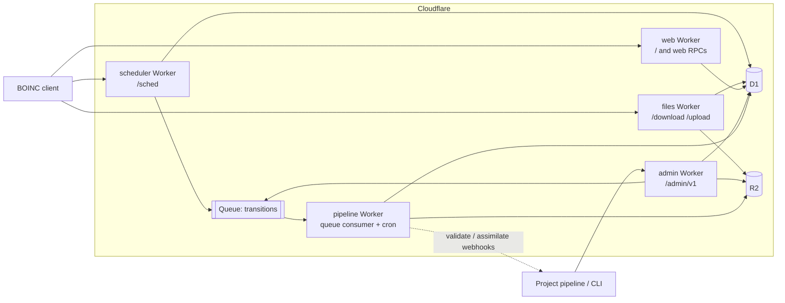

# Architecture

Status: implemented in part; see "Implementation status".

## Goal

Run a BOINC project server on Cloudflare's developer platform, with no origin server, so that
stock BOINC clients (8.x) attach, fetch work, upload results and get credit exactly as they do
against the C++/PHP server in this repository.

The stock server is a set of daemons that poll one MySQL database and share one file system:
`cgi` (scheduler), `feeder`, `transitioner`, validators, assimilators, `file_deleter`,
`db_purge`, `file_upload_handler`, Apache for downloads, and a PHP site. None of that runs on
Workers as is: there is no shared memory, no local disk, no long-running process and no MySQL.
The server side is therefore rewritten in Rust and compiled to WebAssembly. The wire protocols
and the job state machine are kept; the process model is replaced.

The upstream tree stays in this repository unchanged. It is the reference for behaviour
(`sched/`, `db/`, `tools/`, `lib/crypt.cpp`), and its client is what the end-to-end tests run.
New code lives under `cloud/`.

## Scope

The first target is feature parity with one real project, used as the reference deployment: a
five-app OCR project with container and native GPU apps, about a dozen hosts, quorum 1 and
quorum 2 apps, and a remote pipeline that submits work and collects results.

In scope, because the reference deployment uses it:

| Area | Features |
| --- | --- |
| Scheduler | account keys and weak keys, host records, result reporting, work requests for CPU and GPU, plan classes (container, NVIDIA, AMD, Intel, Apple GPU, multi-thread), client-version floors, batch and workunit-ID gates, per-app weights, assigned (targeted) jobs, `one_result_per_host_per_wu`, in-progress and daily limits, lost-result resend, request back-off |
| Job pipeline | workunit and result state machine, deadlines and retries, error limits, quorum validation (trivial, bitwise, project-supplied), canonical result choice, credit, assimilation hand-off, output and input clean-up, purge |
| Files | signed app versions, input downloads with range requests, multi-GB sticky files, upload certificates, uploads with size limits and checksums |
| Web RPCs | `get_project_config.php`, `lookup_account.php`, `create_account.php`, `server_status.php?xml=1`, `show_user.php?format=xml`, and the account manager RPCs `am_get_info.php`, `am_set_info.php`, `am_set_host_info.php` |
| Site | project home (master URL), apps, server status, account, hosts and tasks pages |
| Operations | app, platform, app-version and plan-class management, batch job submission, cancel, result feed for the project's pipeline, all over an authenticated HTTP API with a CLI |

Out of scope for now: forums, teams, profiles, preference editing, locality scheduling,
homogeneous redundancy, adaptive replication, trickle messages, BUDA, the XML stats export,
and the full PFC credit model (see "Credit").

## Service map

Five Workers, one D1 database, one R2 bucket, one queue. Each Worker is a Rust crate built with
`workers-rs`. Routes on the project hostname send each path to its Worker directly; there is
no gateway Worker in front.



| Stock component | Replacement |
| --- | --- |
| `cgi` scheduler | `scheduler` Worker |
| `feeder` and the shared-memory job cache | an indexed query on unsent results plus an atomic claim (see "Dispatch without a feeder") |
| `transitioner` | `pipeline` Worker, driven by the queue, with a cron sweep for deadlines |
| validators | `pipeline` Worker: built-in trivial and bitwise validators, and a webhook validator for project code |
| assimilators | `pipeline` Worker marks work ready; the project pulls it from the admin API or receives a webhook |
| `file_deleter` | part of the transition in the `pipeline` Worker |
| `db_purge` | cron handler in the `pipeline` Worker |
| `file_upload_handler` | `files` Worker writing to R2 |
| Apache download directory | `files` Worker reading from R2 |
| PHP web RPCs and site | `web` Worker |
| `create_work`, `update_versions`, `xadd`, ops pages | `admin` Worker and the `cboinc` CLI |
| `config.xml`, `plan_class_spec.xml`, `project.xml` | rows in D1, edited through the admin API, cached in each Worker for up to 30 seconds |

The split follows the stock daemons' boundaries where they have different load shapes and
different secrets: the scheduler is the hot request path; file transfer is byte-heavy and holds
no private keys; the pipeline is asynchronous; the pipeline and admin Workers hold the upload
signing key, and only admin can submit workunits.

## Code layout

```
cloud/
  crates/
    cb-proto/    BOINC XML tokenizer, scheduler request and reply, upload protocol
    cb-crypto/   BOINC key file format, RSA signatures, MD5
    cb-db/       the Db trait
    cb-core/     scheduling, plan classes, state machine, validators, credit, web RPCs, site pages, admin operations
    cb-sqlite/   Db trait on rusqlite, for native tests and tools
    cb-d1/       Db trait on D1
    cb-worker/   what the five Workers share: bindings, the settings cache, replies
  workers/
    scheduler/  files/  pipeline/  web/  admin/
  cli/           cboinc: admin client, key tools, app signing, load generator
  migrations/    D1 schema
  dev/           build, local stack and seeding scripts
  tests/app/     a small BOINC app for end-to-end tests
  docs/
```

All protocol and policy code is in plain Rust crates with no Workers dependency. Every SQL
statement goes through one `Db` trait with two implementations, so the full scheduler and
pipeline logic runs in native `cargo test` against SQLite, with the same SQL text D1 executes.
The Worker crates are thin: parse the request, call the core, map errors.

## Data

### Database: D1

D1 is the cheapest database Cloudflare offers for this workload. It has a free allowance on
both plans, bills per row read and written with no instance or hourly charge, and scales to
zero. Durable Object SQLite storage has the same per-row prices but adds compute duration
charges, and KV charges per write operation at several times the D1 row price.

D1 is SQLite, single-writer, and each query is a network round trip from the Worker. The design
follows from that:

- Each scheduler request makes a small, bounded number of round trips (see "Scheduler request
  path"). Statements are grouped into `batch()` calls, which run as one transaction.
- A `batch()` takes statements prepared in advance, so a transaction cannot span a read, a
  decision in Rust and a write. Every read-decide-write path is therefore optimistic: it
  reads, decides, and commits with one batch whose statements carry their own conditions
  (see "Concurrency").
- Smart Placement runs the Workers next to the database.
- Rows written are the main cost. The schema keeps few indexes, uses partial indexes so a
  row is in an index only while it is in the state that index serves, and the pipeline writes
  the final state of a result once rather than stepping it through each daemon's flag.

The schema is a port of `db/schema.sql` reduced to the tables in scope: `platform`, `app`,
`app_version`, `user`, `host`, `host_app_version`, `workunit`, `result`, `assignment`,
`batch`, `job_file`, plus `config` (key, JSON value, version). Column names and state
constants match upstream so that the upstream documentation still describes the data, and so a
MySQL dump can be imported later.

Indexes on the two large tables:

| Index | Serves | Rows in it |
| --- | --- | --- |
| `workunit(name)` unique | duplicate submission, report lookup | all |
| `workunit(transition_time)` where `transition_time < 2147483647` | deadline sweep | workunits with a pending transition |
| `workunit(appid, id)` where `assimilate_state = 1` | result feed | ready, not yet collected |
| `workunit(batch)` where `batch > 0` | batch status and cancel | batched |
| `result(name)` unique | report lookup | all |
| `result(workunitid)` | transitions | all |
| `result(appid, priority desc, id)` where `server_state = 2` | dispatch | unsent |
| `result(hostid)` where `server_state = 4` | lost-result resend, per-host limits | in progress |
| `result(hostid, id)` where `hostid > 0` | a computer's task list | sent |
| `result(userid, id)` where `userid > 0` | an account's task list | sent |

Large XML (`xml_doc`, `xml_doc_in`, `stderr_out`) is stored in the row; D1 allows 2 MB per row
and BOINC documents are a few KB. `stderr_out` is truncated to 64 KB as upstream does.

Target write budget, measured in tests from D1's `rows_written` metadata: at most 25 rows
written per quorum-1 job from submission to purge.

### Files: R2

One bucket per project.

| Prefix | Content | Written by | Lifetime |
| --- | --- | --- | --- |
| `download/<name>` | app version files, job inputs | admin API | job inputs: `delete_delay_hours` after assimilation, or forever when marked `no_delete`; app files: until the version is removed |
| `upload/<name>` | result outputs | files Worker | `delete_delay_hours` after assimilation |
| `archive/<date>/` | purged workunit and result rows, as JSON lines, one object per purge pass | pipeline cron | by bucket lifecycle rule |

Names are flat. The stock fan-out directories exist to keep directory sizes down on a POSIX
file system and have no purpose in an object store. R2 has no egress charge, serves range
requests, and has no object size limit that matters here (5 TB), so multi-GB model files are
ordinary downloads rather than a special case.

### Queue

`transitions` carries workunit IDs. The database is still the source of truth: every producer
also sets `workunit.transition_time = now` in the same batch as its other writes, and a
one-minute cron sweep transitions anything whose time has passed. A lost or duplicated queue
message therefore costs only latency or an idempotent re-run. This is the stock
design (daemons poll `transition_time`) with the queue as a fast path.

Messages are sent in the two cases where a transition has work to do at once: when a result is reported
and when assimilation is acknowledged. Submission creates the first results in the same
batch as the workunit, and dispatch only lowers `transition_time` to the new result's
deadline, so neither sends a message.

## Scheduler request path

`POST /sched` with a `<scheduler_request>` body, as sent by the client.

1. Parse the request with the tolerant tokenizer in `cb-proto` (BOINC XML is not always
   well-formed XML, and the client's reply parser is line-oriented, so both directions follow
   `sched/sched_types.cpp` rather than an XML library).
2. Batch 1 (read): user by authenticator or weak authenticator, host by ID, config version.
   If the config version changed, reload apps, app versions, platforms, plan classes and
   project settings; otherwise use the copy cached in the isolate.
3. Authenticate, find or create the host (same rules as `handle_request.cpp`: host ID and
   `rpc_seqno` checks, CPID match to detect a copied or reset client).
4. Batch 2 (read): reported results by name, this host's in-progress results, its
   `host_app_version` rows.
5. Find the app versions the host can run: platform match and the host-dependent part of
   plan class evaluation (`plan_class_spec.cpp` semantics: GPU model, VRAM, driver and
   client-version floors, container runtime). Every version that passes is kept, with its
   projected speed. Nothing is chosen yet, because the batch and workunit-ID gates of a plan
   class depend on the job.
6. Batch 3 (read): candidate unsent results for the apps that have a usable version, joined
   to their workunits, ordered by priority then age, interleaved across apps by weight; plus,
   with `enable_assignment`, assigned jobs for this host or user (see "Assigned jobs").
7. If an assigned job can be sent, the reply carries assigned jobs and no other new work,
   and steps 8 and 9 are skipped.
8. Batch 4 (read, only when `one_result_per_host_per_wu` or `one_result_per_user_per_wu` is
   set): which of the candidate workunits already have a result for this host or user, in
   any state. A host that returned, failed or timed out on a replica must not get another
   one (`sched/sched_check.cpp`, `slow_check`), so the in-progress list from batch 2 is not
   enough.
9. Filter candidates in memory. For each candidate, narrow the kept versions to the ones
   that can still be sent: the batch and workunit-ID gates admit the job, the client still
   wants work for the version's resource (seconds or idle instances not yet filled by this
   reply, as `need_this_resource` in `sched/sched_version.cpp`), and the version's daily
   quota and in-progress limits are not used up. Take the fastest version that remains; drop
   the candidate if none does. A CPU-only request therefore gets the CPU version of an app
   that also has a faster GPU version, and so does a request whose GPU share is already
   filled. Then check feasibility with that version (memory, disk, deadline against the
   host's estimated speed and availability) and the replica rule from batch 4 and within
   this reply.
10. Batch 5 (write, one transaction): update the host; apply result reports; claim each chosen
    result; lower `transition_time` on the workunits of claimed results and set it to now on
    the workunits of reported ones. The claim statements enforce the limits again (see
    "Limits under concurrent requests").
11. Send the workunit IDs of reported results to the queue, build the `<scheduler_reply>`
    from the claims that succeeded, return it.

### Dispatch without a feeder

The stock feeder preloads a window of unsent results (`shmem_work_items`, 100 by default) into
shared memory so that schedulers do not scan MySQL on every request; schedulers lock slots
there.
Here the partial index on unsent results makes the candidate query a short index range read,
and the conditional `UPDATE ... WHERE server_state = 2` is the slot lock: D1 runs one write at
a time, so two schedulers that pick the same result cannot both claim it. The loser sees fewer
rows returned and sends less work; the client asks again.

If D1 read latency or row reads ever limit throughput, the next step is a Durable Object that
holds the unsent window in memory, which is the feeder again. We build it only if measurements
show that D1 limits throughput.

### Limits under concurrent requests

A client can have two scheduler requests in flight (a retry after a timeout, or two clients
sharing a host ID). Both read the same spare capacity in batch 2, and the per-result claim
alone would let both use it. So each claim statement carries the limits in its `WHERE`
clause, evaluated against the database at commit time:

```sql
UPDATE result SET server_state = 4, hostid = ?, ...
WHERE id = ? AND server_state = 2
  AND (SELECT count(*) FROM result WHERE hostid = ? AND server_state = 4) < ?          -- per host
  AND (SELECT count(*) FROM result WHERE hostid = ? AND server_state = 4 AND appid = ?) < ?  -- per app
  AND (SELECT n_jobs_today FROM host_app_version WHERE host_id = ? AND app_version_id = ?) < ?  -- daily quota
RETURNING id
```

Each claim is followed in the batch by the `host_app_version` counter update for that
result, itself conditional on the claim having succeeded. The batch creates a missing
`host_app_version` row before the first claim that needs it. D1 applies a batch as one
transaction and runs writes one at a time, so a later claim in the same batch, or in a
concurrent request, sees the earlier ones. A request that loses the race claims fewer
results than it chose; it never exceeds a limit. The subqueries read the partial index on
in-progress results for one host, a few rows.

### Assigned jobs

A job can be assigned to one host or to one user's hosts, as with `create_work --target_host`
and `--target_user` upstream. The project turns this on with `enable_assignment`; a submission
that assigns a job while it is off is refused. Team targets and broadcast assignments
(`multi`, `enable_assignment_multi`) are not implemented.

Upstream creates the result of an assigned job in the scheduler, at the moment it sends it
(`send_assigned_job` in `sched/sched_assign.cpp`), and its transitioner creates no results
for such a workunit, which `create_work` marks `TRANSITION_NO_NEW_RESULTS`. That cannot work
here: creating a result signs its upload certificates, and the scheduler Worker does not hold
the upload key. So the results of an assigned job are created ahead of time, by job
submission (`create_work` in `crates/cb-core/src/work.rs`) and by the transition that
replaces a failed or timed-out instance (`transitioner_pass` in
`crates/cb-core/src/pipeline.rs`), in the reserved state `RESULT_SERVER_STATE_INACTIVE` (1)
instead of unsent (2). The workunit is still marked `TRANSITION_NO_NEW_RESULTS`, which here
means "create its results reserved". Dispatch reads only unsent results, so it never sees a
reserved one.

`handle_request` in `crates/cb-core/src/scheduler.rs` adds one query to batch 3: the
assignments for this host or user (`multi = 0`) whose workunit has no error and no canonical
result, has a reserved result, and has no result on this host, with the reserved result of
lowest ID for each, at most `MAX_ASSIGNED` (20). The query keeps only workunits of an app the
host has a usable version of and, when the workunit is pinned to a version, that version, so
jobs the host cannot run do not use up the 20. A plan class's batch and workunit-ID gates are
checked after the read. Assigned jobs go first. As upstream, they
skip the memory, disk, deadline, daily-quota and in-progress checks, but the request must ask
for work and the host must have a usable app version that the plan class's batch and
workunit-ID gates admit. The fastest such version is taken, preferring one for a resource the
client asks for. The claim is the same conditional `UPDATE` as for an unsent result, with
`server_state = 1` in place of 2, without the limit subqueries, and with a guard that the
host holds no other result of the workunit: upstream sends at most one instance of an
assigned job to a host, whatever `one_result_per_host_per_wu` says. Two requests that choose
the same reserved result cannot both claim it. If any assigned job is chosen, no other new
work goes in the reply (`send_work` in `sched/sched_send.cpp`); if its claim then loses a race,
that reply is empty and the client asks again.

Reserved results count as unsent in the transition. When a workunit gets its canonical
result, fails or is cancelled, its reserved results are retired (`OVER`, `DIDNT_NEED`) as
unsent ones are, so the purge, which waits for every result to be over, still takes the
workunit. An assigned workunit nobody claims keeps its reserved results and sits on the
safety-net transition time, as upstream's would sit with no results. The behaviours upstream
has follow from its rules: a host-assigned job whose only instance failed is not sent to that
host again, and a replacement for a user-assigned job goes to another of the user's hosts.
Because a host never gets a second instance, `build_workunit` in `crates/cb-core/src/work.rs`
refuses a host-assigned job with `target_nresults` above 1.
Assignment rows stay until the purge removes them with their workunit.

### Plan classes and admission gates

Plan classes are stored as the stock `plan_class_spec.xml` document in the `config` table and
parsed into the same structure upstream uses. The reference deployment opens and closes
admission by editing workunit-ID and batch bounds on live plan classes; here that is an admin
API call that bumps the config version, and every isolate picks it up within its cache
lifetime (30 seconds).

### Anonymous platform

A client with an `app_info.xml` reports the platform name `anonymous` and lists the app versions it
has in `<app_versions>`. `handle_request` in `crates/cb-core/src/scheduler.rs` serves it as
`sched/sched_version.cpp` and `sched/sched_send.cpp` do. As upstream, the project must have a
platform named `anonymous` (upstream's `tools/project.xml` lists it; here
`cboinc platform-put --name anonymous --user-friendly-name anonymous`). Without one the client is
refused like any unknown platform, and the alternate platforms an anonymous client lists are
ignored.

- **Versions.** The versions to choose among are the client's, not the `app_version` table. An
  entry for an app the project does not have is ignored, with the message "Unknown app name
  NAME in app_info.xml". What a version uses comes from the request (`CLIENT_APP_VERSION::parse`):
  `avg_ncpus` (1 if absent), the coprocessor type and count, and `flops`, which is the host's
  benchmark speed when absent, or 1e9 when that is zero too. Its peak speed, which becomes the
  result's `flops_estimate` and so what the result is credited on, is `avg_ncpus` times the host's
  benchmark speed (1e9 when that is missing, zero or not a number, as for an ordinary client's
  sequential app, so that the estimate is positive), plus the GPU count times the peak speed of
  the host's GPU of that type. The client's figures are bound by what the host reports
  (`anon_usage`): `avg_ncpus` by the host's CPU count, the GPU count by the number of GPUs of that type the host reports, and the GPU's peak
  speed is the host's figure with the plan class path's correction (`gpu_peak_flops`, 100 GFLOPS in
  place of a figure that is zero, negative or above 1e15). The stated `flops` is not part of the
  peak speed; it only sets the client's runtime estimate, and is kept between 1e6 and 1e17 so that
  the scale factor described under "Speed" stays between 1e-11 and 1e11. No plan class is
  evaluated: the client's plan class string is passed back as it came, and the plan class gates
  on workunit ID and batch do not apply. The app name, platform and plan class are cut to 256
  bytes when the request is read, and the platform and plan class are escaped when written into
  the reply, as is the app name in a message.
- **Choice.** For each job, `pick_anonymous` takes the client's versions of the job's app and
  skips a version for a platform whose name has no `64` when the job needs more than 2 GiB of
  address space, one whose daily quota is used up, one older than the app's `min_version`, and one
  for a resource the client asks no work for or whose limit on jobs in progress is reached. Of the
  rest it takes the highest projected speed, the earlier entry when two are equal. The choice is
  made again for each job, not kept per app as upstream does (the outcome is the same, because the
  inputs change only as quota and requests are used up). The memory,
  disk and deadline checks then run on that version alone; a job that fails them is not offered
  with a slower version. A GPU version is therefore used only when the host reports a GPU of that
  type and asks for work for it, and its jobs count against the request for that GPU.
- **Speed.** With more than 10 samples in the host's `host_app_version` row for the app and the
  resource, the speed is the one the average elapsed time per FLOP gives, at most 250 times the
  speed the client stated (`estimate_flops_anon_platform`). The reply carries the workunit's
  `rsc_fpops_est` and `rsc_fpops_bound` multiplied by the stated speed over the estimated one, so
  the client's runtime estimate and time limit come out as ours. The speed is kept between 1e6
  and 1e17 FLOPS before the ratio is taken, so the factor is finite and positive.
- **Reply.** The reply has the workunit and the result and no `<app>`, `<app_version>` or version
  `<file_info>`. The result's `<platform>`, `<version_num>` and `<plan_class>` are the client's
  entry, as written.
- **Records.** `result.app_version_id` is the negative resource type: -2 for CPU, -3 NVIDIA, -4
  AMD, -5 Intel, -6 Apple (`ANON_PLATFORM_*`, written by `anon_platform_id` in
  `crates/cb-core/src/model.rs`). The `host_app_version` row is keyed by `appid * 1000000 - id`,
  for example `appid * 1000000 + 2` for CPU (`generalized_app_version_id`, `anon_gavid`), so all of
  a client's versions of one app for one resource share a row, and the count of jobs sent today
  is kept per row within a request, so that two versions sharing a row cannot both spend the same
  quota. A lost result sent again is recorded again with the version it is sent with now, its
  `app_version_id` and `flops_estimate`, in the statement that moves its deadline, and the row
  for a new resource is created if missing. As upstream, lost results are looked for only in a
  request that may get work: the project sends jobs, the client has not said `dont_send_work`
  and it asks for some. A request that only reports leaves them alone. Which version it is sent
  with is described under "Differences from upstream". The daily quota and its changes on
  report and timeout, the in-progress limits, the elapsed-time and turnaround statistics and the
  streak of valid results all use that row. The in-progress counts treat a result whose
  `app_version_id` is -3 or lower as a GPU job. Credit is granted as for any result, from the
  result's `flops_estimate`, which is the version's peak speed; the scaling that `get_pfc` in
  `sched/credit.cpp` applies to anonymous results belongs to the full PFC model, which is not
  ported. The task pages show "Anonymous platform" and the resource, as `html/inc/result.inc` does.
- **Messages.** When no work is sent, an app that has work and none of the client's versions
  usable gets "Your app_info.xml file doesn't have a usable version of NAME." and a version cut
  by its daily quota gets "Daily job limit (N) has been reached", both as notices. There is no
  feeder to show which apps have work, so one statement asks the unsent-result index about all the
  apps in the table, with no bound parameters, and the list is filtered in the scheduler. A client
  none of whose versions is for a resource it asks work for, for example one with only a CPU
  version that asks for GPU work, is told only "No tasks sent", because the search does not run,
  as upstream's `work_needed` stops it; "Project has no tasks available" is said only when it did.
  Message text is plain text, such as an app's friendly name or a name the client sent, and
  `write_messages` in `crates/cb-proto/src/sched_reply.rs` escapes it when the reply is written,
  as it does for every message of the scheduler reply; code that builds a message does not.

Differences from upstream:

- At most 256 entries of the version list are read, so that one request's work is bounded. The
  scheduler Worker refuses a request body over 4 MiB.
- A client's app name, platform and plan class are cut to 256 bytes, on a character boundary.
  Upstream reads them into 256-byte buffers and ignores an element that does not fit.
- The peak speed differs from upstream's. `CLIENT_APP_VERSION::parse` computes it from
  `g_reply->host.p_fpops`, but `handle_request` in `sched/handle_request.cpp` parses the request
  before the host record is loaded, so that field is still zero (`SCHEDULER_REPLY::SCHEDULER_REPLY`
  clears it) and a CPU version's peak speed, and so its `flops_estimate`, is zero upstream; the GPU
  part uses the coprocessor figures the request carries, which a client writes before its app
  versions. `get_pfc` in `sched/credit.cpp` replaces a zero estimate with `AVG_CPU_FPOPS` and
  excludes the result from the statistics. Here the host's benchmark speed from the request is
  used, with the bounds above; upstream does not bound the client's CPU or GPU counts either. The
  client's stated `flops` is not used for credit upstream or here.
- A zero or missing benchmark gives 1e9 FLOPS both for the CPU part of the peak speed, so for the
  result's `flops_estimate`, and, when the client states no speed, for the client's estimate;
  upstream is left with a speed of zero.
- Beta apps (`app.beta`) go to a user who allows beta work, as for the project's own versions.
  Upstream does that for jobs in `quick_check` of `sched/sched_array.cpp`, for every platform; what
  the anonymous path lacks upstream is the per-version `beta` flag, which a client's own version
  has no equivalent of.
- A lost result is resent with a version chosen now from the client's list, as `get_app_version`
  does upstream, and is dropped (`Didn't resend lost task ... (expired)`) when none qualifies,
  daily quota included. Upstream takes the fastest version the client wants work for, and stops
  using a resource whose limit on jobs in progress is reached (`work_needed` clears its request),
  counting the tasks the client lists plus those resent in the request, which leaves the lost ones
  out. Here the counts come from the database, so a lost result counts on the resource it is
  recorded on. The result stays there when the client has a usable version for that resource and
  wants work for it, which needs no room, since the result is counted already; only otherwise does
  it move to the fastest other version, and then only to a kind of resource (CPU or GPU) whose
  limit has room, counting the results already moved in the request.
- A workunit committed to a project app version (`workunit.app_version_id` other than 0) is not
  sent to an anonymous client. Upstream does this for apps with homogeneous app version, which is
  not built here, so nothing sets that field today.
- A missing `host_app_version` row is created when the job is sent. Upstream's `hav_lookup` also
  creates one when a result is validated or times out; here those steps leave a missing row alone.
- The project preferences that switch a resource off do not apply to the client's own versions,
  as upstream's `get_app_version_anonymous` does not check them.
- The limits on jobs in progress are the ones described above for the project's versions, counted
  from the database by CPU and GPU, not from the client's list of tasks by processor type.

## Job pipeline

The upstream state machine is kept: `server_state`, `outcome`, `validate_state`,
`assimilate_state`, `file_delete_state` and `error_mask` have the same values and meanings.
What changes is that one handler does the work of three daemons.

`transition(workunit_id)`, called from the queue or the sweep:

1. Load the workunit and its results (one read batch).
2. Time out in-progress results past their deadline.
3. Count outcomes; set error bits when a limit is reached (`max_error_results`,
   `max_total_results`, `max_success_results`), and cancel unsent results if so.
4. Validate. With no canonical result, once enough successful results have arrived, look for
   a quorum that agrees (`check_set`). With a canonical result, compare each later successful
   result to it (`check_pair`): it becomes valid, with the canonical result's credit, or
   invalid. A successful result found when `file_delete_state` is no longer the initial
   value is marked too late and gets no credit (upstream does this once the canonical
   result's files are deleted); its files are not read.
5. If more results are needed (`target_nresults`, or a quorum not yet reached), create them,
   signing each output file's upload certificate with the upload key.
6. If a canonical result exists or the workunit has failed, and assimilation has not started
   (`ASSIMILATE_INIT`), mark it ready to assimilate. A workunit that is already ready or
   acknowledged (`ASSIMILATE_DONE`) keeps its state, so the transition that follows an
   acknowledgement does not put it back in the result feed.
7. Clean up, in two transitions. When every result is over, every successful result has a
   final validation verdict (none is still waiting for a validator or a retry), assimilation
   is acknowledged and `delete_delay_hours` has passed, set `file_delete_state` to ready.
   This transition deletes nothing. A later transition that reads the workunit in the ready
   state deletes the output objects, and the input objects not marked `no_delete`, and then
   records the deletion as done.
8. Set the next `transition_time` to the earliest of: the deadlines of results in progress,
   the time deferred deletion falls due (the most recently returned result plus
   `delete_delay_hours`, as `deferred_file_delete_time` in `sched/transitioner.cpp`), the
   next validation retry when a webhook or storage read failed, and the next deletion retry
   when a delete failed. With none of these outstanding, `transition_time` is set to
   2147483647, which keeps the workunit out of the deadline sweep.
9. Commit (one write batch).

Steps 2 to 8 run in memory on the rows read in step 1. Validation may read object metadata
or call a webhook; that happens between the read and the commit, outside any transaction.

### Concurrency

A scheduler request can report or claim a result of the workunit while a transition is
between its read and its commit. The `workunit` row has a revision counter, `rev`, and every
writer of a workunit or of one of its results (scheduler, admin API, transition) increments
it in the same batch as its change.

The commit batch of a transition starts with
`UPDATE workunit SET ..., rev = rev + 1, commit_token = <token> WHERE id = ? AND rev = <the
revision read>`, where the token is a random 62-bit number drawn for this attempt. Every
other statement in the batch (result updates and inserts, credit, host statistics) carries
`AND EXISTS (SELECT 1 FROM workunit WHERE id = ? AND commit_token = <token>)`. If anything
changed since the read, the first statement matches no row, the token is not written, and
none of the other statements apply; the transition reads again and retries, a bounded number
of times, and after that leaves the workunit to the sweep.

The guard tests the token and not the new revision, because two transitions that read the
same revision expect to write the same next one: the loser would find it in place, written
by the winner, and its result updates and credit would go through.

Deletion takes two transitions. The first sets `file_delete_state` to ready, commits under
the revision check and deletes no object. A report that arrives between its read and its
commit changes the revision, so the commit fails and the next attempt sees the new result and its later deletion time. Once the ready state is committed, nothing
reads those objects again: validation marks any later successful result too late without
opening files, and the report itself needs none.

A transition that reads the workunit in the ready state deletes the objects and then commits
the done state. If a delete call fails, the state stays ready
and the transition is retried; if the commit loses the revision race, the next transition
repeats the deletes, which is harmless because an R2 delete of a missing object succeeds.

### Validation

Per app, one of:

- `trivial`: any successful result is valid (quorum 1 apps).
- `bitwise`: results agree when every output file has the same MD5. Upload stores each
  object's MD5, so comparison reads metadata, not file bodies.
- `webhook`: the pipeline posts the workunit, the candidate results and short-lived signed
  download URLs for their outputs to a project endpoint, which answers with a verdict per
  result, the canonical result and optionally credit. This is where project-specific compare
  code runs (the stock `script_validator` case). It can be an external HTTPS endpoint or
  another Worker through a service binding. The call is retried with back-off; the workunit
  stays in "needs validation" until it answers.

### Assimilation

The stock assimilator is project code that runs next to the database. Here the project pulls:
`GET /admin/v1/assimilate?app=<name>&limit=<n>` returns ready workunits with their canonical
result, output file names and sizes; output bodies are fetched from `/admin/v1/outputs/<name>`;
`POST /admin/v1/assimilate/ack` marks them done. An optional webhook announces new work so the
project does not have to poll. Outputs are deleted once the workunit is acknowledged and
`delete_delay_hours` have passed since its most recently returned result, the rule upstream
uses. The project fetches outputs before it acknowledges, so an acknowledgement that comes
after the delay can delete them at once.

### Credit

The first version grants credit from elapsed time and the host's benchmark
(`elapsed_time * p_fpops * 200 / 86400e9` cobblestones, scaled by threads or GPU usage of the
app version), takes the minimum claim among the valid results of a quorum, and maintains total
and recent-average credit for hosts and users with the stock half-life. The full PFC model in
`sched/credit.cpp` (cross-version and cross-host normalisation) is not ported yet. A validator
webhook can override the granted credit.

## Files

### Download

`GET /download/<name>` streams the R2 object with `Content-Length`, `ETag`, `Accept-Ranges`
and range support (the client resumes interrupted downloads with `Range`). Responses carry a
five-minute `Cache-Control`. The client verifies app files against the code-signing
public key and input files against the MD5 in the workunit, so the download path needs no
authentication and holds no secret.

### Upload

`POST /upload/file_upload_handler` implements the `file_upload_handler` protocol. The path
keeps that name because a client treats a `<url>` in an output `<file_info>` as an upload URL
only when it contains `file_upload_handler` (`FILE_INFO::parse` in `client/client_types.cpp`);
any other URL is taken for a download. The requests are `<get_file_size>` and
`<file_upload>` with a signed `<file_info>`, then raw bytes. The Worker verifies the
`<xml_signature>` with the upload public key, checks `max_nbytes`, and streams the body into
R2 with the client's MD5 as an integrity check. A stored output is never replaced: the write
is conditional on the object not existing, so a second upload of the same name cannot change a
file a result was validated against.

Two differences from the stock handler:

- No partial-file resume. An interrupted upload starts again from zero (`get_file_size`
  answers 0 until the object is complete). The stock handler appends to a file at an offset,
  which an object store cannot do.
- One upload request is limited by the zone plan's request body limit (100 MB on Free and Pro).
  Larger outputs need the client's `gzip_when_done` or a higher plan.

## Keys and secrets

BOINC uses two RSA key pairs in its own key file format, and signs the MD5 of the data with
PKCS#1 v1.5 padding and no digest prefix (`lib/crypt.cpp`). `cb-crypto` reads and writes that
format and produces signatures the stock client accepts.

- Code-signing key: the private key never reaches Cloudflare. `cboinc sign` signs app files
  on an offline machine; the admin API stores the file and its signature. The public key is in
  the project config and is served to clients.
- Upload key: the private key is a Worker secret on the `pipeline` and `admin` Workers, which
  create results. The `files` Worker has only the public key.
- Admin API: bearer tokens stored as secrets, compared in constant time. Cloudflare Access can
  be put in front as well.
- Account passwords: the client sends `md5(password + email)`; the server stores an HMAC-SHA-256
  of that under a secret pepper. Authenticators are 128 random bits.

A deployment generates its own keys. A dev deployment never holds another project's keys.

## Web RPCs and site

The `web` Worker serves the master URL page, which carries the scheduler URL in the
`<link rel="boinc_scheduler">` form the client looks for, `get_project_config.php`,
`lookup_account.php` and `create_account.php` with the stock XML shapes and error numbers, and
`server_status.php` in HTML and XML. The account and computer counts on the status page
(`server_status` in `cloud/crates/cb-core/src/web.rs`) are a snapshot stored in the `config`
table under `status_counts` and refreshed after `STATUS_COUNTS_TTL` (10 minutes), so a poll does
not scan the `user` and `host` tables. PHP file names are kept in the URLs because clients have
them built in.

The account manager RPCs are in `cloud/crates/cb-core/src/web.rs`. `am_get_info` returns the
account a key belongs to, in the upstream reply shape. `am_set_host_info` sets a computer's venue;
one `UPDATE` whose `WHERE` clause checks both the key and that the computer belongs to it.
`am_set_info` answers "not supported" with error -1, as upstream has done since it switched
that RPC off. These RPCs, `show_user.php?format=xml&auth=` and the site login accept the account
key only: a weak key, which the scheduler accepts, gets `ERR_DB_NOT_FOUND` here, as upstream's
`BoincUser::lookup_auth` does. A blocked account is treated as unknown.

The site pages are in `cloud/crates/cb-core/src/site.rs`, reached through `site_page`:
`login_form.php`, `login_action.php`, `logout.php`, `home.php`, `hosts_user.php`,
`show_host_detail.php`, `results.php`, `result.php`, `workunit.php` and `show_user.php`.
Logging in, with the account key or with email address and password, sets the `auth` cookie
to the account key as upstream does, with `HttpOnly`, `Secure` and `SameSite=Lax`. It lasts a
year when "stay logged in" is ticked, and for the browser session otherwise. A password is
taken from a POST only. Private fields follow upstream: the account page, the IP address,
domain name, disk and activity fractions of a computer, and an account's task list are shown
to the account holder only. Another account's computers are listed only when it has
`show_hosts` set, and then without names. A computer's task list, a task (with its stderr) and
a workunit are public, as upstream. Every value from a client or a user is HTML-escaped. The
pages are served with `Cache-Control: private, no-store`.

Each page makes at most two round trips and three statements, and every list has a `LIMIT`:
20 tasks per page, 100 computers, 100 tasks of a workunit. `results.php` pages by task ID
(`before=` and `after=`) instead of upstream's `offset`, so a deep page reads as few index
entries as the first one. Its indexes (`res_host`, `res_user`) hold no state or application, so
a filtered page reads at most 500 tasks (`RESULTS_FILTER_WINDOW`) and filters those; when they
hold fewer than a page of matches, the page links on from the last task read, and can be
empty while older tasks still match. `hosts_user.php` leaves out computers that have been out
of contact for 30 days in the query, before the limit, and counts them separately. `results.php`
does not show upstream's per-state counts, which would count every
task of the computer or account. A computer page links to its tasks without counting them for
the same reason.

## Admin API and CLI

`/admin/v1` is JSON over HTTPS. `cboinc` wraps it.

| Resource | Operations |
| --- | --- |
| `status`, `catalog` | project counts; platforms, apps and app versions |
| `platforms`, `apps` | create, update |
| `app-versions` | upload signed files and register, deprecate, restore |
| `config` | project settings, plan classes, public keys |
| `files` | stage inputs (upload, or register an object already in the bucket); a stored name keeps its contents unless the caller asks to replace them |
| `jobs` | submit a batch of workunits in one call, query, cancel |
| `assimilate`, `outputs` | list finished work, fetch output files, acknowledge |
| `users`, `hosts` | create an account, block a user, set a host's daily result limit |

Job submission takes many workunits per request and writes them in batched statements, since
the reference pipeline submits in chunks of hundreds. `POST /admin/v1/jobs` takes
`{"app", "input_template", "result_template", "jobs": [...]}`; each job object has `name` and
optionally `input_files`, `command_line`, `additional_xml`, `batch`, `priority`, the `rsc_*`
bounds, `delay_bound`, `min_quorum`, `target_nresults`, the `max_*_results` limits, and
`assign`, as `{"target": "host", "id": <host ID>}` or `{"target": "user", "id": <user ID>}`
(see "Assigned jobs"). Unset numbers come from the input template, then from the upstream
`create_work` defaults (`JobSpec` in `crates/cb-core/src/work.rs`). `cboinc submit` builds the
job objects from its flags, with `--target-host` and `--target-user` for `assign`, or reads
them from a file given with `--jobs`.

## Cost model

Reference load, from the reference deployment's request logs and status pages: about 9,000
scheduler and upload requests a day, 500 to 2,000 results a day, inputs of about 2 MB per
page, about 1 TB of inputs kept.

| Meter | Reference load | Workers Free | Workers Paid ($5/month) |
| --- | --- | --- | --- |
| Worker requests | ~15,000/day with downloads | 100,000/day | 10 million/month |
| D1 rows written | up to ~50,000/day at 25 per job | 100,000/day | 50 million/month |
| D1 rows read | under 1 million/day | 5 million/day | 25 billion/month |
| D1 storage | grows ~10 MB/day at 2,000 jobs/day until purged | 500 MB per database (5 GB per account) | 10 GB per database; 5 GB included, then $0.75/GB |
| Queue operations | ~6,000/day at 2,000 jobs/day | 10,000/day | 1 million/month, then $0.40/million |
| R2 storage | inputs dominate | 10 GB | $0.015/GB-month |
| CPU per request | a few ms | 10 ms limit | 30 s limit |

The design uses one database, so the per-database limit applies. A job's rows
are about 5 KB (the workunit and result XML documents, stderr, index entries; to be measured),
so on the Free plan the database fills at roughly 100,000 jobs, 50 days at the reference rate,
and `purge_days` has to stay well under that; a month leaves headroom. On the Paid plan the 10 GB limit holds about two
million jobs.

Queue operations are counted per write, read and delete, so a message costs three. With one
message per reported result that is 6,000 a day at 2,000 jobs a day, before retries; replicated
jobs and assimilation acknowledgements add to it. When the Free allowance runs out, sends fail
and the one-minute sweep runs the transitions, up to a minute late.

The Free plan carries the reference job rate with little headroom and a hard stop at each daily
limit: the queue allowance runs out first, then the database reaches its size limit. The Paid plan is the
realistic production choice. Input storage is the largest line:
1 TB in R2 is about $15 a month, so a project that keeps every input should keep cold inputs
elsewhere and stage only the working set.

## Performance

The target is to be no slower than the reference deployment, a stock BOINC server behind a
Cloudflare Tunnel, measured from the same client machine. The figures below are from the dev
deployment on the Workers Free plan, 11 November 2026. The first table gives time to first byte
over 12 requests each, as minimum / median / maximum in milliseconds.

| Request | Reference | cloud-boinc |
| --- | --- | --- |
| `get_project_config.php` | 92 / 110 / 288 | 62 / 87 / 159 |
| Master page | 105 / 138 / 186 | 49 / 71 / 165 |
| Scheduler RPC, rejected account key | 151 / 206 / 352 | 75 / 141 / 297 |

An earlier run with a 5-second settings cache and no edge cache had cloud-boinc ahead on the
minimum and about 20 ms behind on the median. The settings are now cached in each Worker for
30 seconds, and the master page and project config are kept in the edge cache for the same
time.

Load test with `cboinc load`: 8 simulated hosts, 400 jobs, each host asking for work, uploading
a 1 KB output per result and reporting.

| Measure | Result |
| --- | --- |
| Requests | 464 in 23 s, 20 requests/s, no errors |
| Scheduler RPC, up to 8 jobs sent and reported per request | p50 157 ms, p90 472 ms, p99 623 ms |
| Upload | p50 310 ms, p90 410 ms, p99 508 ms |

The scheduler Worker reports its own time and database round trips in a `Server-Timing`
header. A request that sends no work takes one to four round trips of about 20 ms each.

Not compared with the reference: scheduler requests that send work, uploads and large
downloads, because measuring them there would put test load on a production project. The
reference deployment's observed rate is about 0.1 requests a second.

## Testing

1. Unit tests for the tokenizer, request and reply round trips, key format and signatures,
   plan class evaluation and each state transition.
2. Native integration tests: scheduler and pipeline logic end to end on SQLite, including
   quorum, deadline, error-limit and resend cases.
3. Local end-to-end: `dev/local.sh` runs the five Workers under `wrangler dev` with a local
   database, bucket and queue; `dev/seed.sh` sets up a test project; a stock BOINC client
   attaches, downloads the signed test app, runs jobs, uploads and reports.
4. Deployed end-to-end on the dev hostname with a stock client. Clients on several machines
   and platforms, CPU and GPU, are still to do.
5. Load test against the dev deployment with `cboinc load`.

The `cloud-ci` workflow runs formatting, Clippy, the native tests and the WebAssembly builds.

## Implementation status

Working end to end with a stock 8.0.4 client: attach, signature-checked download, compute,
upload, report, validation, assimilation and file deletion.

With `purge_days` set, a second cron trigger in the `pipeline` Worker removes workunits whose
files are deleted and that have not changed for that many days, together with their results
and assignments (`purge_pass` in `crates/cb-core/src/purge.rs`). The rows go to the bucket
under `archive/` first, in an object whose key ends in the MD5 of its contents. A purged
workunit's name becomes free again, as it does after `db_purge`; a project that purges should
not submit a job under a name it has used before, because a late report for the old job's
result would match the new one. A workunit with `nodelete` in its name is kept, as `db_purge`
keeps it.
So are the workunit with the highest ID and the one holding the result with the highest ID,
so that no ID is given out twice; they go once newer jobs exist. A workunit that changes
between the archive write and the delete stays and is archived again later, so the archive can
hold a workunit more than once, and the latest copy is the final one.
With `purge_days` at 0, the default, nothing is purged and the database grows until rows are
removed by hand.

`max_upload_nbytes` in the config bounds the size of one uploaded file, whether or not upload
certificates are checked.

Not implemented yet:

- In the scheduler: assigned jobs for teams and broadcast (`multi`) assignments, homogeneous
  redundancy and homogeneous app version, locality scheduling, size classes, and the client
  workload simulation behind upstream's deadline check.
- Plan classes hard-coded in `sched/sched_customize.cpp`. A plan class has to be in the spec
  file. The differences from `sched/plan_class_spec.cpp` are listed at the top of
  `crates/cb-core/src/plan_class.rs`.
- Upload resume, as described under Upload.
- On the site: account creation, password reset and email login links, editing account
  details and preferences, merging and deleting computers, per-app details of a computer,
  cross-project statistics links and certificates, and anything that sends email.

## Isolation from other deployments

A cloud-boinc deployment has its own hostname, database, bucket, queue and keys. Development
and tests use only the dev hostname. Test clients run as separate BOINC client instances with
their own data directories, so a machine that also crunches for another project keeps that
client's state untouched. Nothing in this repository reads from or writes to another project's
server.

## Open questions

- Whether the queue is worth keeping once the sweep interval and scheduler-triggered
  transitions are measured.
- Upload resume for large outputs (R2 multipart keyed by upload offset).
- Importing an existing project's MySQL database, and cutting a live master URL over.
